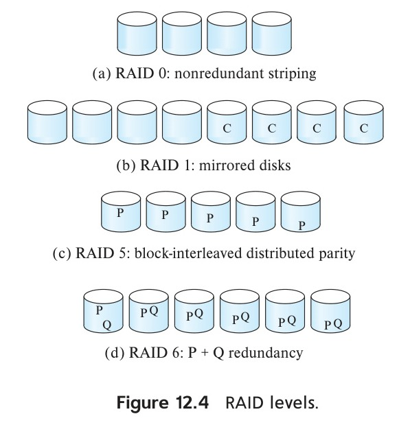

[← Prev: 2017](2017.md) | [Exam-Style Layer](../yearly_answers_exam_style/2018.md) | [Original Question Paper](../PreviousYearQuestion/2018.md) | [Next: 2019 →](2019.md)

---

# ECE 2215: Database Systems · Semester Final 2018 · Explanations

> [!info] Paper Metadata
> - **Examination:** B.Sc. Engineering 2nd Year Even Semester Examination, 2018
> - **Institution:** Rajshahi University of Engineering & Technology (RUET)
> - **Department:** Department of Electrical & Computer Engineering
> - **Curriculum Era:** Pre-OBE
> - **Full Marks:** 72 | **Time:** 3 Hours
> - **Instructions:** Answer any SIX questions taking THREE from each section.
> - **Question Count:** 23 sub-questions across Section A (12) and Section B (11)

---

## SECTION A

### Q.1(a) · 03 Marks

*Topic: [[../Topicwise_answers_explaination/T01_DB_Concepts_and_Architecture.md#T01.2 · File system vs DBMS (8 disadvantages of file systems)|T01.2 · File system vs DBMS (8 disadvantages of file systems)]] · Section A*

**Question.**
"A database is a tool for storing information efficiently"- Justify this statement.

**Answer.**

**What the examiner wants.**  
A clear technical justification showing how a database achieves efficiency. The expected mark split is 1 mark for each of the three dimensions of efficiency: storage space, retrieval speed, and operational concurrency.

**Key idea.**  
Efficiency means doing more while using fewer resources. Storing data in raw files wastes storage space through duplicate records and wastes time because lookups require scanning whole files. A database solves these issues with normalization, indexing, and multi-user transaction management.

**Step-by-step solution.**  
A database stores information efficiently by removing the major storage and access bottlenecks of traditional file systems:

1. **Storage Efficiency (Redundancy Control):** A database stores each fact in one place. It eliminates duplicate records across separate department files. This saves disk storage and prevents inconsistent copies.
2. **Retrieval Efficiency (Indexing and Query Optimization):** The DBMS uses tree or hash indexes. It also uses a cost-based query optimizer. This allows the system to find records in milliseconds without scanning whole files.
3. **Operational Efficiency (Concurrency and Data Independence):** Multiple users can query and update data at the same time without data corruption. Also, physical storage layouts can change without breaking existing application programs.

**Check.**  
*Quick self-test:*
- Q: What component of a DBMS ensures retrieval efficiency?  
  A: Index structures (like B+ trees) and the cost-based query optimizer.
- Q: How does redundancy control contribute to storage efficiency?  
  A: Storing facts once reduces disk space usage and removes the need for sync programs.

> [!warning] Common mistakes
> - Defining a database without explaining *why* it is efficient.
> - Focusing only on storage space while omitting query speed and concurrency.

**Exam tip.**  
Divide the answer into three clear headings: Storage Efficiency, Retrieval Efficiency, and Operational Efficiency.

**Sources.**  
- [Deck 01 · Slides 6–7, 24–25](../LectureSlides/01_Intro_to_Database_and_DBMS.md)  
- [Textbook Ch. 1 §1.2](../Textbook/Chapter_01_Introduction/Chapter%2001%20-%20Introduction.md)

---

### Q.1(b) · 04 Marks

*Topic: [[../Topicwise_answers_explaination/T02_ER_and_EER_Modeling.md#T02.4 · Weak vs strong entity sets (discriminator, identifying relationship)|T02.4 · Weak vs strong entity sets (discriminator, identifying relationship)]] · Section A*

**Question.**
Define entity set. Explain the following with suitable example: (i) strong entity set and (ii) weak entity set.

**Answer.**

**What the examiner wants.**  
Definition of an entity set (1 mark). Comprehensive comparison and explanation of strong vs weak entity sets (2 marks). Concrete examples showing the identifying relationship, discriminator, and composite primary key (1 mark).

**Key idea.**  
A strong entity set has enough attributes to tell every record apart. A weak entity set does not. A weak entity depends on an owner entity for its existence and identity. Its key is formed by taking the owner's primary key and attaching its own partial key (discriminator).

**Step-by-step solution.**  
**Entity Set:**  
An entity set is a collection of entities of the same type that share the same properties or attributes (e.g., the set of all students in a university).

| Feature | Strong Entity Set | Weak Entity Set |
| :--- | :--- | :--- |
| **Primary Key** | Has sufficient attributes to form its own primary key. | Lacks a primary key of its own. Uses a partial key (discriminator). |
| **Existence Dependency** | Independent. Does not depend on another entity set. | Existence-dependent on an identifying (strong) entity set. |
| **E-R Notation** | Single rectangle. | Double rectangle. |
| **Relationship Set** | Connected via regular relationship (single diamond). | Connected via identifying relationship (double diamond). |
| **Discriminator Key** | None (uses full primary key underlined with solid line). | Has a discriminator underlined with a dashed line. |
| **Composite PK** | Its own primary key. | Formed by (Owner Primary Key + Discriminator). |
| **Example** | `course` with primary key `course_id`. | `section` with discriminator `sec_id`, `semester`, `year`. |


*Figure: Expressing Weak Entity Sets in ER Diagram (Deck 05, Slide 37)*

- **Strong Entity Set Example:** `course` has attributes `course_id` (PK), `title`, `credits`. It exists independently.
- **Weak Entity Set Example:** `section` has attributes `sec_id`, `semester`, `year`. A section number like `Sec 1` is meaningless without knowing the course. Its full primary key is `(course_id, sec_id, semester, year)`.

*Short version for 2020 Q.2(c) and 2021 Q.8(c) (2 marks):*  
State the comparison table rows (Primary Key, Dependency, Notation, Example) and omit the separate entity set definition.

**Check.**  
*Quick self-test:*
- Q: What happens to a section tuple if the corresponding course tuple is deleted?  
  A: Because the section is existence-dependent, the section tuple must also be deleted (cascading delete).
- Q: How is a discriminator underlined in an E-R diagram?  
  A: With a dashed line.

> [!warning] Common mistakes
> - Thinking a weak entity set has no key attributes at all. It does have a discriminator (partial key).
> - Forgetting the double diamond for the identifying relationship. Drawing a single diamond loses marks.

**Exam tip.**  
Always mention the standard textbook example (`course` and `section`). Show the exact composite primary key formula.

**Sources.**  
- [Deck 05 · Slides 34–37](../LectureSlides/05_ER_Model.md)  
- [Textbook Ch. 6 §6.5](../Textbook/Chapter_06_ER_Model/Chapter%2006%20-%20Database%20Design%20Using%20the%20E-R%20Model.md)

---

### Q.1(c) · 05 Marks

*Topic: [[../Topicwise_answers_explaination/T02_ER_and_EER_Modeling.md#T02.5 · Design a full E-R diagram for a scenario|T02.5 · Design a full E-R diagram for a scenario]] · Section A*

**Question.**
What is E-R model? Draw an E-R diagram that includes teacher, student and course entities with following constraints: (i) Each teacher must take at least one course; (ii) A student can register one or more courses; (iii) A course may have teacher or not.

**Answer.**

**What the examiner wants.**  
Definition of the E-R model (1 mark). An accurate Chen-notation E-R diagram enforcing three exact participation and cardinality constraints (4 marks): double line on teacher, double line on student, and single line on course.

**Key idea.**  
"Must take at least one" or "can register one or more" means minimum participation is 1, which requires a double line (total participation). "May have teacher or not" means minimum participation is 0, which requires a single line (partial participation).

**Step-by-step solution.**  
**E-R Model:**  
The Entity-Relationship (E-R) model is a high-level conceptual data model. It views the real-world enterprise as a collection of basic objects called entities and relationships among these objects.

**Constraints Mapping in E-R Diagram:**
- *(i) Each teacher must take at least one course:*  
  **Total participation** of `TEACHER` in relationship `Teaches`, represented by a **double line** from `TEACHER` to `Teaches` (cardinality $1..\text{*}$).
- *(ii) A student can register one or more courses:*  
  **Total participation** of `STUDENT` in relationship `Registers`, represented by a **double line** from `STUDENT` to `Registers` (cardinality $1..\text{*}$, M:N relationship).
- *(iii) A course may have teacher or not:*  
  **Partial participation** of `COURSE` in relationship `Teaches`, represented by a **single line** from `COURSE` to `Teaches` (cardinality $0..1$ or $0..\text{*}$).


*Figure: E-R Diagram with Total and Partial Participation Constraints*

**Check.**  
*Constraint verification:*
- Teacher participation: Double line present $\checkmark$ (enforces $\ge 1$ course per teacher).
- Student participation: Double line present $\checkmark$ (enforces $\ge 1$ course per student).
- Course participation in `Teaches`: Single line present $\checkmark$ (allows 0 teachers for a course).

> [!warning] Common mistakes
> - Drawing single lines for Teacher and Student. The question explicitly says "at least one" and "one or more", which tests total participation (double lines).
> - Reversing the double line to the Course side.

**Exam tip.**  
Highlight the double lines clearly on your answer sheet and add a short two-line note listing the constraints. Examiners check the line style first.

**Sources.**  
- [Deck 05 · Slides 27–28](../LectureSlides/05_ER_Model.md)  
- [Textbook Ch. 6 §6.4.2](../Textbook/Chapter_06_ER_Model/Chapter%2006%20-%20Database%20Design%20Using%20the%20E-R%20Model.md)

---

### Q.2(a) · 04 Marks

*Topic: [[../Topicwise_answers_explaination/T03_Relational_Model_Keys_and_Integrity.md#T03.2 · Keys: super / candidate / primary / alternate / composite / foreign|T03.2 · Keys: super / candidate / primary / alternate / composite / foreign]] · Section A*
*(Repeated question: Also asked in 2023 | Solved in T03)*

**Question.**
Explain the distinctions among the terms primary key, candidate key, and super key with proper example.

**Answer.**

**What the examiner wants.**  
Precise definitions and clear distinctions among the four key types. The mark split is 1 mark per key type. The examiner expects minimality rules, nullability constraints, and an illustrative relational table.

**Key idea.**  
Think of a super key as any attribute set that uniquely identifies a row. A candidate key is a minimal super key: removing any attribute ruins uniqueness. The primary key is the single candidate key chosen by the database designer. A composite key is any key consisting of two or more attributes.

**Step-by-step solution.**  
A key is an attribute or set of attributes used to identify rows in a table.

**Distinctions Among Keys:**

| Key Type | Definition | Minimality | NULL Allowed |
| :--- | :--- | :--- | :--- |
| **(i) Primary Key** | The candidate key chosen by the database designer to identify tuples uniquely. | Yes (minimal) | No (never allowed) |
| **(ii) Candidate Key** | A minimal super key. Removing any attribute destroys uniqueness. | Yes (strictly minimal) | Yes (unless constrained `NOT NULL`) |
| **(iii) Super Key** | Any set of attributes that uniquely identifies a row. May contain extra attributes. | No (can have redundant attributes) | No for identifying columns |
| **(iv) Composite Key** | A key that consists of two or more attributes rather than a single attribute. | Can be minimal (candidate) or non-minimal | Depends on whether it is PK or unique |

**Relationship:**
$$
\text{Primary Key} \subseteq \text{Candidate Keys} \subseteq \text{Super Keys}
$$

**Running Example:**  
Consider relation $\text{Student}(\underline{\text{student\_id}}, \text{name}, \text{email}, \text{nid}, \text{dept\_name})$:

| student_id | name | email | nid | dept_name |
| :--- | :--- | :--- | :--- | :--- |
| 101 | Akib | akib@gmail.com | 1999123456 | ECE |
| 102 | Shuvo | shuvo@gmail.com | 2000654321 | ECE |
| 103 | Sakib | sakib@gmail.com | 2001987654 | ETE |

- **Super Key:** Any set containing a candidate key. Examples: $\{\text{student\_id}\}$, $\{\text{email}\}$, $\{\text{student\_id}, \text{name}\}$, $\{\text{email}, \text{dept\_name}\}$.
- **Candidate Key:** Minimal sets with no extra columns: $\{\text{student\_id}\}$, $\{\text{email}\}$, $\{\text{nid}\}$.
- **Primary Key:** The chosen identifier: $\{\text{student\_id}\}$.
- **Composite Key:** In table $\text{Takes}(\underline{\text{student\_id}}, \underline{\text{course\_id}}, \text{grade})$, the combination $\{\text{student\_id}, \text{course\_id}\}$ forms a composite candidate and primary key. Neither column alone identifies an enrollment record.

*Short version for 2018 Q.2(a) (4 marks):* Omit (iv) Composite key. Keep the definitions, distinctions table, and the Student running example for Super Key, Candidate Key, and Primary Key.  
*Short version for 2021 Q.2(b) (3 marks):* Same as 2018 Q.2(a). Present the 3-row distinction table and the Student relation key classification.

**Check.**  
*Minimality and closure verification:*
- For $\{\text{student\_id}, \text{name}\}$: It uniquely identifies each tuple, so it is a super key. But its subset $\{\text{student\_id}\}$ is also unique. So it has an extraneous attribute (`name`) and cannot be a candidate key.
- For $\{\text{student\_id}\}$: No proper subset exists (except empty set). So it is strictly minimal and qualifies as a candidate key.

> [!warning] Common mistakes
> - Confusing super keys with candidate keys. A candidate key must be minimal; a super key can have extra attributes.
> - Believing a composite key is a separate fourth category. Any super, candidate, or primary key with multiple attributes is a composite key.
> - Forgetting to state that a primary key prohibits NULL values.

**Exam tip.**  
Write down the subset formula $\text{Primary Key} \subseteq \text{Candidate Keys} \subseteq \text{Super Keys}$ right above your example. This gives the examiner an instant visual proof of your grasp.

**Sources.**  
- [Deck 02 · Slide 7](../LectureSlides/02_Relational_Model.md)  
- [Deck 06 · Slides 11–13](../LectureSlides/06_DBMS_Normalization.md)  
- [Textbook Ch. 2 §2.3](../Textbook/Chapter_02_Relational_Model/Chapter%2002%20-%20Introduction%20to%20the%20Relational%20Model.md)

---

### Q.2(b) · 03 Marks

*Topic: [[../Topicwise_answers_explaination/T02_ER_and_EER_Modeling.md#T02.8 · EER: aggregation|T02.8 · EER: aggregation]] · Section A*

**Question.**
Define the concept of aggregation. Give two examples of where this concept is useful.

**Answer.**

**What the examiner wants.**  
Definition of aggregation (1 mark). Two concrete real-world examples explaining why aggregation is useful to avoid redundancy (2 marks).

**Key idea.**  
In standard E-R modeling, relationships cannot connect to other relationships. Aggregation solves this limitation. It wraps a relationship and its entities into a single abstract entity box, allowing other relationships to link to it directly.

**Step-by-step solution.**  
**Definition:**  
Aggregation is an abstraction in E-R modeling through which a relationship set is treated as a higher-level abstract entity set. This allows the relationship itself to participate in further relationships with other entity sets without duplicating attributes.


*Figure: Aggregation Representation in E-R Diagram (Deck 05, Slide 59)*

**Two Examples Where Aggregation is Useful:**

1. **Student Project Evaluation:**  
   The ternary relationship `proj_guide` associates `student`, `instructor`, and `project`. To record an `evaluation` for that specific guidance assignment, treating `proj_guide` as an aggregate entity avoids creating an overlapping ternary relationship. `evaluation` links directly to the aggregate `proj_guide` through the relationship `eval_for`.

2. **Employee Project Monitoring:**  
   Employees work on projects via the relationship `Works_On`. A manager needs to monitor that specific work assignment. By aggregating `Works_On` into an entity, the `manager` can participate in a relationship `Monitors` directly with the aggregate entity `(Employee, Project)`.

*Short version for 2020 Q.3(a) (2 marks):*  
Give the definition of aggregation and describe Example 1 (`proj_guide` with `eval_for`) in 2 lines.

**Check.**  
*Relational schema check for aggregation:*
- Aggregated relationship `proj_guide`: attributes `(s_id, project_id, i_id)`.
- Connecting relationship `eval_for`:
  $$
  \text{eval\_for}(\underline{\text{s\_id}}, \underline{\text{project\_id}}, \underline{\text{i\_id}}, \underline{\text{evaluation\_id}})
  $$
- This avoids duplicating the `proj_guide` relationship table.

> [!warning] Common mistakes
> - Confusing aggregation in E-R modeling with SQL aggregate functions (`COUNT`, `SUM`, `AVG`). In E-R modeling, aggregation means treating a relationship as an entity.
> - Drawing a relationship directly connected to another relationship diamond without enclosing it in an aggregate entity rectangle.

**Exam tip.**  
Define the concept clearly, mention the dashed/bounding rectangle around the relationship, and use the project guidance evaluation example from Deck 05 Slide 59.

**Sources.**  
- [Deck 05 · Slides 57–60](../LectureSlides/05_ER_Model.md)  
- [Textbook Ch. 6 §6.8.5](../Textbook/Chapter_06_ER_Model/Chapter%2006%20-%20Database%20Design%20Using%20the%20E-R%20Model.md)

---

[← Prev: T01 · DB Concepts and Architecture](T01_DB_Concepts_and_Architecture.md) | [Exam-style layer](../Topicwise_answers_exam_style/T02_ER_and_EER_Modeling.md) | [Next: T03 · Relational Model, Keys & Integrity →](T03_Relational_Model_Keys_and_Integrity.md)

---

### Q.2(c) · 05 Marks

*Topic: [[../Topicwise_answers_explaination/T02_ER_and_EER_Modeling.md#T02.6 · Reduction of E-R to relational tables (M:N, ternary)|T02.6 · Reduction of E-R to relational tables (M:N, ternary)]] · Section A*

**Question.**
Consider a database used to record the marks that students get in different examinations of different course offerings. (i) Construct an E-R diagram that models examinations as entities, and uses a ternary relationship for the above database; (ii) Draw a relational data model for the above corresponding E-R diagram.

**Answer.**

**What the examiner wants.**  
Part (i): A Chen-notation E-R diagram showing a ternary relationship connecting Student, Course Offering, and Exam, with `marks` as a relationship attribute (2.5 marks).  
Part (ii): The relational schemas derived from the diagram, with primary keys and foreign keys clearly designated (2.5 marks).

**Key idea.**  
A ternary relationship associates three entities at once. When reduced to a relational schema, the ternary relationship becomes a table whose primary key is the composite union of the primary keys of all three participating entity sets.

**Step-by-step solution.**  
**(i) E-R Diagram with Ternary Relationship:**
- Participating Entity Sets: `STUDENT`, `COURSE_OFFERING`, `EXAM`.
- Ternary Relationship: `Scores` connecting all three entity sets.
- Relationship Attribute: `marks` (descriptive attribute placed on `Scores`).


*Figure: Ternary Relationship Model for Student Exam Marks*

**(ii) Relational Data Model (Relational Schemas):**

**student**(**student_id**, name, dept_name)  
`PK: student_id`

**course_offering**(**offering_id**, semester, year)  
`PK: offering_id`

**exam**(**exam_id**, exam_type, max_marks)  
`PK: exam_id`

**scores**(**student_id**, **offering_id**, **exam_id**, marks)  
`PK: (student_id, offering_id, exam_id)`  
`FK: student_id references student(student_id), offering_id references course_offering(offering_id), exam_id references exam(exam_id)`

*See also:* [[#2018 Q.3(c) · 04 Marks]] (conversion of M:N relationships into relational tables).

**Check.**  
*Primary key verification:*
- Can a student have different marks in different exams of the same course offering? Yes, `exam_id` varies.
- Can different students take the same exam in the same course offering? Yes, `student_id` varies.
- Therefore, all three keys `(student_id, offering_id, exam_id)` are required to uniquely determine `marks`.

> [!warning] Common mistakes
> - Putting `marks` inside the `EXAM` entity instead of on the relationship diamond. An exam has a maximum mark, but the actual marks obtained depend on the student, offering, and exam combined.
> - Breaking the ternary relationship into three separate binary relationships when the question explicitly asks for a ternary relationship.

**Exam tip.**  
For Part (ii), format the relations clearly. Put primary key columns in bold and write a dedicated `PK:` and `FK:` line under each relation.

**Sources.**  
- [Deck 05 · Slides 15–16, 41, 45](../LectureSlides/05_ER_Model.md)  
- [Textbook Ch. 6 §6.2.5, §6.6](../Textbook/Chapter_06_ER_Model/Chapter%2006%20-%20Database%20Design%20Using%20the%20E-R%20Model.md)

---

### Q.3(a) · 06 Marks

*Topic: [[../Topicwise_answers_explaination/T04_Relational_Algebra_and_Calculus.md#T04.2 · Write RA queries on a given schema (incl. "only" queries → set difference, $\gamma$ count/max, RA modification/update)|T04.2 · Write RA queries on a given schema (incl. "only" queries → set difference, $\gamma$ count/max, RA modification/update)]] · Section A*

**Question.**
Consider the following insurance database, where primary keys are underlined.<br>`person (<u>driver_id</u>, name, address)`<br>`car (<u>license</u>, model, year)`<br>`accident (<u>report_number</u>, date, location)`<br>`owns (<u>driver_id</u>, license)`<br>`participated (<u>driver_id</u>, car, <u>report_number</u>, damage_amount)`<br><br>Write down the relational algebra statement for the following queries:<br>(i) Find the total number of people who owned cars that were involved in accidents in 1989.<br>(ii) Find the number of accidents in which the cars belonging to "John Smith" were involved.<br>(iii) Update the damage amounts for the car with license number "AABB2019" in the accident with report_number "AR201930" to \$3000.

**Answer.**

**What the examiner wants.**  
Three relational algebra statements worth 2 marks each. Tests multi-table joins, distinct counting with aggregation ($\gamma$), and relational tuple updating.

**Key idea.**  
In part (i) and (ii), a person may own multiple cars or be involved in multiple accidents. Use `count-distinct` to count individual people and distinct accident reports without duplicate inflation. In part (iii), apply generalized projection on the matching record and union with all unaffected records.

**Step-by-step solution.**

*Assumption: The calendar year is extracted from the `date` attribute using $\text{year}(\text{date}) = 1989$.*

**(i) Total number of people who owned cars involved in accidents in 1989:**

1. Filter accident records for 1989 and join with `participated` on `report_number`:

$$
T_1 \leftarrow \sigma_{\text{year}(\text{date}) = 1989}(\text{accident}) \bowtie \text{participated}
$$

2. Join with `owns` matching `participated.car = owns.license`. This links each involved vehicle to its registered owner:

$$
T_2 \leftarrow T_1 \bowtie_{\text{participated.car} = \text{owns.license}} \text{owns}
$$

3. Count distinct owner IDs so that an owner whose car had multiple accidents is counted once:

$$
\boxed{\gamma_{\text{count-distinct}(\text{owns.driver\_id})}(T_2)}
$$

**(ii) Number of accidents involving cars belonging to "John Smith":**

1. Find the driver ID of John Smith and join with `owns` to find his registered vehicle licenses:

$$
T_{\text{john\_cars}} \leftarrow \sigma_{\text{name} = \text{"John Smith"}}(\text{person}) \bowtie \text{owns}
$$

2. Join with `participated` by matching license numbers with `participated.car`:

$$
T_{\text{accidents}} \leftarrow T_{\text{john\_cars}} \bowtie_{\text{owns.license} = \text{participated.car}} \text{participated}
$$

3. Count distinct accident report numbers:

$$
\boxed{\gamma_{\text{count-distinct}(\text{report\_number})}(T_{\text{accidents}})}
$$

**(iii) Update damage amounts for car "AABB2019" in accident "AR201930" to \$3000:**

1. Define the selection condition identifying the exact record to modify:

$$
P \equiv (\text{car} = \text{"AABB2019"} \land \text{report\_number} = \text{"AR201930"})
$$

2. Select the target record:

$$
T_{\text{target}} \leftarrow \sigma_P(\text{participated})
$$

3. Replace the `damage_amount` attribute with the literal value 3000:

$$
T_{\text{updated}} \leftarrow \Pi_{\text{driver\_id}, \text{car}, \text{report\_number}, 3000}(T_{\text{target}})
$$

4. Separate all unaffected records in `participated`:

$$
T_{\text{untouched}} \leftarrow \text{participated} - T_{\text{target}}
$$

5. Reassign `participated` as the union of both sets:

$$
\boxed{\text{participated} \leftarrow T_{\text{updated}} \cup T_{\text{untouched}}}
$$

**Check.**  
Trace part (iii):
- Suppose `participated` contains tuples `("D1", "AABB2019", "AR201930", 1500)` and `("D2", "XY100", "AR201930", 500)`.
- $T_{\text{target}}$ isolates `("D1", "AABB2019", "AR201930", 1500)`.
- $T_{\text{updated}}$ produces `("D1", "AABB2019", "AR201930", 3000)`.
- $T_{\text{untouched}}$ retains `("D2", "XY100", "AR201930", 500)`.
- Union contains both tuples with the updated value intact.

> [!warning] Common mistakes
> - Using `count` instead of `count-distinct`. If John Smith's car is involved in an accident with two drivers participating, a simple count would count the same accident twice.
> - Confusing `car` attribute in `participated` with the table `car`. The attribute `participated.car` stores the license plate string.
> - Forgetting the untouched set difference during the update.

**Exam tip.**  
When counting people or entities involved across multiple events, always write `count-distinct` rather than plain `count`.

**Sources.**  
`[Lecture Deck 02 · Slides 16–29](../LectureSlides/02_Relational_Model.md)`  
`[Textbook Ch. 2 §2.6](../Textbook/Chapter_02_Relational_Model/Chapter%2002%20-%20Introduction%20to%20the%20Relational%20Model.md)`  
`[Textbook Ch. 16 §16.1](../Textbook/Chapter_16_Query_Optimization/Chapter%2016%20-%20Query%20Optimization.md)`

---

### Q.3(b) · 02 Marks

*Topic: [[../Topicwise_answers_explaination/T03_Relational_Model_Keys_and_Integrity.md#T03.1 · Relation, tuple, attribute, domain; domain vs data type|T03.1 · Relation, tuple, attribute, domain; domain vs data type]] · Section A*

**Question.**
Differentiate between domain and data type.

**Answer.**

**What the examiner wants.**  
A concise conceptual distinction between domain and data type. The mark split is 1 mark for definitions and 1 mark for comparison points with a clear example.

**Key idea.**  
A data type describes how computer hardware stores data in memory (such as integer or text). A domain describes what data means in the real world (such as student age or course grades). Two attributes can share the same data type but belong to totally different domains.

**Step-by-step solution.**  
A **domain** is the logical set of all valid values that an attribute can take. It defines real-world meaning and business constraints.  
A **data type** is a physical storage format recognized by the computer hardware and DBMS. It defines memory layout and low-level bit representation.

| Comparison Point | Domain | Data Type |
| :--- | :--- | :--- |
| **Concept Level** | Conceptual and semantic level. It reflects business meaning. | Physical implementation level. It specifies storage layout. |
| **Values Allowed** | Strict set of valid real-world values (for example, letter grades `{'A', 'B', 'C', 'F'}`). | Broad machine-level value range (for example, `CHAR(2)` accepts any two characters). |
| **Constraints** | Carries logical rules and business checks (such as `age >= 18`). | Only restricts memory size and storage category (such as `INT`). |
| **Equivalence** | Two attributes with the same data type can have different domains. | Two attributes share the same data type if their storage format matches. |

*Example:* `student_age` and `monthly_salary` can both use the `INT` data type. But they belong to different domains. Adding an age to a salary makes no logical sense.

**Check.**  
*Quick self-test:*
- Q: Can two columns have the same data type but different domains?  
  A: Yes. `roll_number` and `bus_fare` can both be `INT`, but comparing them is semantically meaningless.
- Q: Where does a domain operate compared to a data type?  
  A: A domain operates at the logical or conceptual layer. A data type operates at the physical storage layer.

> [!warning] Common mistakes
> - Treating a domain as merely a synonym for an SQL data type. A domain is a broader relational concept that includes semantic constraints.
> - Forgetting that SQL uses `CHECK` constraints and user-defined types to approximate domains.
> - Writing a long essay instead of a 4-row comparison table.

**Exam tip.**  
Use a comparison table with four rows. Always add the age versus salary example to secure the full 2 marks.

**Sources.**  
- [Deck 02 · Slide 4](../LectureSlides/02_Relational_Model.md)  
- [Deck 03 · Slide 6](../LectureSlides/03_Introduction_to_SQL.md)  
- [Textbook Ch. 2 §2.1](../Textbook/Chapter_02_Relational_Model/Chapter%2002%20-%20Introduction%20to%20the%20Relational%20Model.md)

---

### Q.3(c) · 04 Marks

*Topic: [[../Topicwise_answers_explaination/T02_ER_and_EER_Modeling.md#T02.3 · Mapping cardinality (1:1, 1:N, M:N) & participation constraints|T02.3 · Mapping cardinality (1:1, 1:N, M:N) & participation constraints]] · Section A*

**Question.**
What is mapping cardinality? How a many to many relationship can be converted into table. Explain with example.

**Answer.**

**What the examiner wants.**  
Definition of mapping cardinality (1 mark). Clear explanation of how an M:N relationship becomes a table (1.5 marks). A concrete worked example showing schemas, primary keys, and foreign keys (1.5 marks).

**Key idea.**  
When entities have an M:N relationship, we cannot place the foreign key in either entity table without causing repeating groups or nulls. So we create a separate junction table. Its primary key combines the primary keys of both participating entities.

**Step-by-step solution.**  
**Mapping Cardinality:**  
Mapping cardinality (or cardinality ratio) expresses the number of entities to which another entity can be associated via a relationship set. For binary relationships, it must be 1:1, 1:N, N:1, or M:N.

**Conversion of a Many-to-Many (M:N) Relationship into a Table:**
1. Create a dedicated relation schema for the relationship set.
2. Include the primary key of each participating entity set as foreign keys in this new table.
3. Include any descriptive attributes associated with the relationship set.
4. The composite primary key of the new table is formed by the union of the primary keys of both participating entity sets.


*Figure: Many-to-Many Relationship Model and Reduction to Relational Table*

**Example:**
- Entity `STUDENT` with attributes `student_id` (PK), `name`.
- Entity `COURSE` with attributes `course_id` (PK), `title`.
- Relationship `Takes` (M:N) with descriptive attribute `grade`.

**Relational Schemas:**

**student**(**student_id**, name)  
`PK: student_id`

**course**(**course_id**, title)  
`PK: course_id`

**takes**(**student_id**, **course_id**, grade)  
`PK: (student_id, course_id)`  
`FK: student_id references student(student_id), course_id references course(course_id)`

**Check.**  
*Trace check:*
- Suppose student `S1` takes courses `C1` and `C2`.
- Student `S2` also takes course `C1`.
- Table `takes` stores:
  - `(S1, C1, 'A')`
  - `(S1, C2, 'B')`
  - `(S2, C1, 'A')`
- Every row is distinct. The composite key `(student_id, course_id)` uniquely identifies each enrollment.

> [!warning] Common mistakes
> - Choosing only one column as the primary key of the junction table. Both foreign keys together are needed to form the minimal superkey.
> - Forgetting descriptive attributes of the relationship (like `grade`) when creating the junction table.

**Exam tip.**  
State the general rule first (`PK = PK(E1) ∪ PK(E2)`). Then write out the exact schema with `PK:` and `FK:` lines.

**Sources.**  
- [Deck 05 · Slides 20, 45](../LectureSlides/05_ER_Model.md)  
- [Textbook Ch. 6 §6.4, §6.6](../Textbook/Chapter_06_ER_Model/Chapter%2006%20-%20Database%20Design%20Using%20the%20E-R%20Model.md)

---

### Q.4(a) · 04 Marks

*Topic: [[../Topicwise_answers_explaination/T08_Normalization_and_Functional_Dependencies.md#T08.1 · Why normalize: redundancy and insert/update/delete anomalies|T08.1 · Why normalize: redundancy and insert/update/delete anomalies]] · Section A*

**Question.**
What problem may occur if databases are used without normalization? Discuss with proper example.

**Answer.**

**What the examiner wants.**  
A structured answer listing data redundancy and the three classic modification anomalies (1.5 marks). Then, a concrete relational table example illustrating each problem clearly (2.5 marks).

**Key idea.**  
When you lump multiple real-world entities into a single relation, you store the same fact repeatedly. This repetition wastes disk space. Worse, when you modify, insert, or delete data, the database either loses valid facts or ends up with conflicting values. Normalization fixes this by giving each independent entity its own table.

**Step-by-step solution.**

Using databases without normalization causes four major problems:

1. **Data Redundancy:** The same facts are stored repeatedly in multiple rows. This wastes disk storage and slows down query processing.
2. **Update Anomaly:** If a piece of data is stored in multiple records, modifying it requires updating all those records. If any row is missed, the database enters an inconsistent state.
3. **Insertion Anomaly:** New data cannot be recorded unless unrelated data is also present. For instance, a new course cannot be inserted without enrolling a student if the primary key includes the student ID.
4. **Deletion Anomaly:** Deleting one fact unintentionally erases another valid fact. For example, deleting the only student enrolled in a course deletes the course itself.

#### Example

Consider an unnormalized table storing student enrollment and instructor data:

| Student_ID | Student_Name | Course | Instructor | Instructor_Phone |
| :--- | :--- | :--- | :--- | :--- |
| S01 | Riad | DBMS | Dr. Hasan | 01711... |
| S01 | Riad | AI | Dr. Abdullah | 01811... |
| S02 | Zoha | DBMS | Dr. Hasan | 01711... |

- **Redundancy:** The instructor name and phone for "DBMS" are stored twice.
- **Update Anomaly:** If Dr. Hasan changes his phone number, we must update both rows. If we update row 1 but miss row 3, Dr. Hasan has two different phone numbers.
- **Insertion Anomaly:** Suppose the university introduces a new course "ML" taught by Dr. Kamal. If no student has enrolled yet, we cannot insert this course because `Student_ID` is part of the primary key and cannot be `NULL`.
- **Deletion Anomaly:** If student S01 drops the "AI" course and row 2 is deleted, all information about Dr. Abdullah and the AI course is completely lost.

*Short version for CT-03 Q.02 (3 marks):* State the four problems (data redundancy, update anomaly, insertion anomaly, deletion anomaly). Give a brief two-line explanation and one table row example showing an inconsistent update.

**Check.**  
*Quick self-test:*
- Q: Why cannot a new course be added without a student in the example?  
  A: Because `Student_ID` is part of the primary key, and primary key attributes cannot be null.
- Q: How does normalization resolve the deletion anomaly?  
  A: By splitting the table into `STUDENT`, `COURSE`, and `ENROLLMENT` tables so course data exists independently of student enrollments.

> [!warning] Common mistakes
> - Listing only the names of anomalies without giving a concrete table example.
> - Confusing update anomaly with ordinary concurrency conflicts. Update anomaly is caused by redundant data copies in a single unnormalized table.
> - Forgetting to mention why an insertion fails: primary key columns reject `NULL` under Entity Integrity.

**Exam tip.**  
Draw a simple 3-row table with 5 columns. Use it to demonstrate all three anomalies one by one. This takes less than two minutes and guarantees full marks.

**Sources.**  
- [Deck 06 · Slides 3–10](../LectureSlides/06_DBMS_Normalization.md)
- [Textbook Ch. 7 §7.1](../Textbook/Chapter_07_Normalization/Chapter%2007%20-%20Relational%20Database%20Design.md)

---

### Q.4(b) · 04 Marks

*Topic: [[../Topicwise_answers_explaination/T09_Transactions_ACID_and_Anomalies.md#T09.1 · ACID properties (with the \$50 transfer example/diagram)|T09.1 · ACID properties (with the \$50 transfer example/diagram)]] · Section A*

**Question.**
Describe the ACID-properties of database system with appropriate diagram.

**Answer.**

**What the examiner wants.**  
An explanation of the ACID properties accompanied by a clear illustrative diagram. The mark split is 2 marks for property descriptions and 2 marks for a diagram showing the transaction steps, state evolution, and ACID guarantees.

**Key idea.**  
Use the standard \$50 fund transfer transaction from account $A$ to account $B$. Show how each ACID property applies to the intermediate and final database states.

**Step-by-step solution.**  
To maintain database integrity against failures and concurrent updates, every transaction must satisfy four **ACID** properties:

- **Atomicity:** All operations of the transaction take effect or none do.
- **Consistency:** Execution in isolation preserves all explicit constraints and implicit invariants.
- **Isolation:** Intermediate uncommitted states remain invisible to other concurrent transactions.
- **Durability:** Committed updates survive crashes permanently on stable storage.

**Illustration with \$50 Fund Transfer ($T_1$):**  
Let account $A$ have \$1000 and account $B$ have \$2000. $T_1$ moves \$50 from $A$ to $B$.

$$
\begin{aligned}
1.&\quad \text{read}(A) \\
2.&\quad A := A - 50 \\
3.&\quad \text{write}(A) \quad [A \text{ becomes } \$950] \\
4.&\quad \text{read}(B) \\
5.&\quad B := B + 50 \\
6.&\quad \text{write}(B) \quad [B \text{ becomes } \$2050] \\
7.&\quad \text{commit}
\end{aligned}
$$


*Figure: ACID properties in fund transfer transaction (Generated)*

**Mapping to the Diagram:**
1. **Atomicity:** If a crash occurs after step 3, account $A$ is \$950 while account $B$ remains \$2000. The recovery system uses log records to roll back $A$ to \$1000.
2. **Consistency:** The invariant $A + B = \$3000$ holds in the initial state and in the final state. Money is neither created nor lost.
3. **Isolation:** Between steps 3 and 6, the sum is temporarily \$2950. Concurrency control blocks concurrent transaction $T_2$ from reading this intermediate state.
4. **Durability:** After step 7 commits, balances $A = \$950$ and $B = \$2050$ survive power loss.

**Check.**  
*Quick self-test:*
- Q: At what point in the transaction is the database temporarily inconsistent?  
  A: Between step 3 and step 6, where $A$ has been decremented to \$950 but $B$ has not yet been incremented.
- Q: What preserves atomicity if the power fails at step 4?  
  A: The write-ahead undo log restores $A$ from \$950 back to \$1000.

> [!warning] Common mistakes
> - Drawing a transaction state transition diagram (Active, Partially Committed, etc.) instead of a diagram that illustrates the ACID properties. The question asks for a diagram of the ACID properties.
> - Forgetting to state the total balance invariant ($A + B = \$3000$).

**Exam tip.**  
Sketch the three boxes shown in the figure: Initial State ($A=\$1000, B=\$2000$), Intermediate State ($A=\$950, B=\$2000$, inconsistent), and Final State ($A=\$950, B=\$2050$). Add four callout arrows for A, C, I, and D.

**Sources.**  
- [Deck 07 · Slides 4–7](../LectureSlides/07_Transactions.md)  
- [Textbook Ch. 17 §17.2](../Textbook/Chapter_17_Transactions/Chapter%2017%20-%20Transactions.md)

---

### Q.4(c) · 04 Marks

*Topic: [[../Topicwise_answers_explaination/T08_Normalization_and_Functional_Dependencies.md#T08.6 · Define normalization (and its importance) & 1NF / 2NF / 3NF|T08.6 · Define normalization (and its importance) & 1NF / 2NF / 3NF]] · Section A*
*(Repeated question: Also asked in 2019 | Solved in T08)*

**Question.**
Explain the rules of 1NF and 2NF with a proper example.

**Answer.**

**What the examiner wants.**  
Definition of normalization (1 mark), detailed discussion of 1NF rules with a clear example (1.5 marks), and 2NF rules with a clear example (1.5 marks).

**Key idea.**  
1NF requires that every cell holds one single value (no lists). 2NF requires 1NF plus that every non-key attribute depends on the whole key, not just half of it.

**Step-by-step solution.**

#### 1. What is Normalization?

**Normalization** is the process of decomposing a relation schema into smaller schemas to minimize data redundancy and prevent insertion, deletion, and update anomalies.

#### 2. First Normal Form (1NF)

**Rules:**
- Every attribute must hold only atomic (single, indivisible) values.
- No multi-valued attributes or repeating groups are permitted.
- Each column must contain values of the same domain, and each row must be uniquely identifiable.

**Example:**

*Violating 1NF:*

| Student_ID | Name | Phone |
| :--- | :--- | :--- |
| S01 | Fahim | 01711, 01822 |
| S02 | Noor | 01933 |

*Converted to 1NF (atomic rows):*

| Student_ID | Name | Phone |
| :--- | :--- | :--- |
| S01 | Fahim | 01711 |
| S01 | Fahim | 01822 |
| S02 | Noor | 01933 |

PK: `(Student_ID, Phone)`

#### 3. Second Normal Form (2NF)

**Rules:**
- The relation must be in 1NF.
- There must be **no partial dependency**. No non-prime attribute can depend on a proper subset of any candidate key.

**Example:**

Consider relation `ENROLL(StudentID, CourseID, StudentName, Grade)`:
- Candidate Key: `(StudentID, CourseID)`
- Dependencies:
  - `(StudentID, CourseID) -> Grade` (Full dependency)
  - `StudentID -> StudentName` (Partial dependency on proper subset `StudentID`)

*Converted to 2NF (decompose to remove partial dependency):*
1. `STUDENT(StudentID, StudentName)` with PK `StudentID`
2. `ENROLLMENT(StudentID, CourseID, Grade)` with PK `(StudentID, CourseID)`

*Short version for 2018 Q.4(c) (4 marks):* State the rules for 1NF (atomicity, no multi-valued attributes) with the phone number example. State the rules for 2NF (in 1NF, no partial dependencies) with the student course example.

**Check.**  
*Quick self-test:*
- Q: What makes a phone list violate 1NF?  
  A: Storing multiple phone numbers in one row makes the cell non-atomic.
- Q: Why is `StudentName` partially dependent in `ENROLL`?  
  A: Because knowing `StudentID` is already enough to determine `StudentName`; `CourseID` is completely unnecessary.

> [!warning] Common mistakes
> - Discussing rules without providing before-and-after tables for the examples.
> - Choosing a 2NF example with a single-attribute primary key. Partial dependencies only exist when candidate keys are composite!

**Exam tip.**  
Keep the examples minimal: use a 2-row table for 1NF and a 4-attribute relation for 2NF.

**Sources.**  
- [Deck 06 · Slides 30–34](../LectureSlides/06_DBMS_Normalization.md)
- [Textbook Ch. 7 §7.3.4](../Textbook/Chapter_07_Normalization/Chapter%2007%20-%20Relational%20Database%20Design.md)

---

## SECTION B

### Q.5(a) · 04 Marks

*Topic: [[../Topicwise_answers_explaination/T09_Transactions_ACID_and_Anomalies.md#T09.5 · Concurrency problems (dirty read, lost update, unrepeatable read, phantom, incorrect summary)|T09.5 · Concurrency problems (dirty read, lost update, unrepeatable read, phantom, incorrect summary)]] · Section B*

**Question.**
If concurrency-control management is not implemented properly what problem may occur? Explain with example.

**Answer.**

**What the examiner wants.**  
Identification and explanation of the data corruption anomalies that occur when concurrent transactions run without proper concurrency control. The examiner expects two-column chronological schedules showing exactly how values get corrupted. Mark split: 2 marks per problem explained with schedule.

**Key idea.**  
When concurrent operations interleave without control, they violate isolation. The five classic concurrency anomalies are: Lost Update, Dirty Read (temporary update), Unrepeatable Read, Phantom Read, and Incorrect Summary.

**Step-by-step solution.**  
If concurrency-control management is not implemented properly, uncoordinated interleaving violates transaction isolation. This causes five major anomalies:

1. **Lost Update Problem:**
   - **Concept:** An update done by one transaction is overwritten and lost because another concurrent transaction writes to the same item without incorporating the first update.
   - **Schedule ($A = 500$ initially):**

| Time | Transaction $T_1$ | Transaction $T_2$ | Database State / Note |
| :--- | :--- | :--- | :--- |
| $t_1$ | $\text{read}(A)$ | | $T_1$ reads $A = 500$ |
| $t_2$ | $A := A - 50$ | | $T_1$ computes local $A = 450$ |
| $t_3$ | $\text{write}(A)$ | | Database updated to $A = 450$ |
| $t_4$ | | $\text{write}(A)$ | $T_2$ performs blind write: $A = 25$ |
| $t_5$ | $\text{commit}$ | | $T_1$ commits |
| $t_6$ | | $\text{commit}$ | Final $A = 25$ ($T_1$'s $-\$50$ update is lost!) |

2. **Dirty Read Problem (Temporary Update Problem):**
   - **Concept:** Occurs when a transaction reads a data item updated by another transaction that has not yet committed and later fails and rolls back.
   - **Schedule ($A = 100$ initially):**

| Time | Transaction $T_1$ | Transaction $T_2$ | Database State / Note |
| :--- | :--- | :--- | :--- |
| $t_1$ | $\text{read}(A)$ | | $T_1$ reads $A = 100$ |
| $t_2$ | $A := A + 100$ | | $T_1$ computes local $A = 200$ |
| $t_3$ | $\text{write}(A)$ | | Database $A = 200$ (uncommitted) |
| $t_4$ | | $\text{read}(A)$ | $T_2$ reads dirty value $A = 200$ |
| $t_5$ | | $A := A - 50$ | $T_2$ computes $A = 150$ |
| $t_6$ | | $\text{write}(A)$ | Database $A = 150$ |
| $t_7$ | | $\text{commit}$ | $T_2$ commits with invalid data |
| $t_8$ | **Failure / Rollback** | | $T_1$ fails; log restores $A = 100$ |

$T_2$ based its computation on a temporary value that never officially existed, leaving the database inconsistent.

3. **Unrepeatable Read Problem:**
   - **Concept:** A transaction reads the same data item twice but obtains different values because another transaction modified and committed the item in between.
   - **Schedule ($A = 500$ initially):**

| Time | Transaction $T_1$ | Transaction $T_2$ | Database State / Note |
| :--- | :--- | :--- | :--- |
| $t_1$ | $\text{read}(A)$ | | $T_1$ reads $A = 500$ |
| $t_2$ | | $\text{read}(A)$ | $T_2$ reads $A = 500$ |
| $t_3$ | | $A := A + 100$ | $T_2$ computes local $A = 600$ |
| $t_4$ | | $\text{write}(A)$ | Database $A = 600$ |
| $t_5$ | | $\text{commit}$ | $T_2$ commits |
| $t_6$ | $\text{read}(A)$ | | $T_1$ reads $A = 600$ (reads different value!) |

4. **Phantom Read Problem:**
   - **Concept:** A transaction accesses a variable, but when it attempts to access that variable again, an error occurs because another transaction has deleted it.
   - **Schedule:**

| Time | Transaction $T_1$ | Transaction $T_2$ | Note |
| :--- | :--- | :--- | :--- |
| $t_1$ | $\text{read}(A)$ | $\text{read}(A)$ | Both transactions read data item $A$ |
| $t_2$ | $\text{delete}(A)$ | | $T_1$ deletes data item $A$ and commits |
| $t_3$ | | $\text{read}(A)$ | $T_2$ attempts to read $A$ again, but item does not exist |

5. **Incorrect Summary Problem:**
   - **Concept:** An aggregate transaction calculates a summary across items while another transaction updates them. The aggregate reads some items before the update and others after, yielding an inaccurate summary.
   - **Example:** $T_1$ transfers \$50 from $A$ to $B$. If $T_2$ reads $A$ after the deduction ($A = \$950$) but reads $B$ before the addition ($B = \$1000$), its computed sum is \$1950 instead of \$2000.

*Variant for 2024 Q.8(a) (3 marks):*  
List the five anomalies, then provide the full schedule tables for Lost Update and Dirty Read.

*Short version for CT-04 Q.03 (4 marks):*  
Select **Lost Update** and **Dirty Read** with their definitions and schedule tables above.

**Check.**  
*Quick self-test:*
- Q: What makes a read "dirty"?  
  A: The data was written by an uncommitted transaction that might abort and roll back.
- Q: How does an unrepeatable read differ from a dirty read?  
  A: In an unrepeatable read, the modifying transaction successfully commits. In a dirty read, the modifying transaction aborts or is still uncommitted.

> [!warning] Common mistakes
> - Writing text paragraphs without a chronological step-by-step table. Examiners deduct marks if the schedule sequence is not clearly tabulated.
> - Confusing Lost Update with Dirty Read.
> - Forgetting to specify the starting value of $A$ and the final damaged value.

**Exam tip.**  
For 4-mark questions, pick Lost Update and Dirty Read as your primary two examples. They are the easiest to draw and the most convincing to examiners.

**Sources.**  
- [Deck 07 · Slides 28–33](../LectureSlides/07_Transactions.md)  
- [Textbook Ch. 17 §17.5](../Textbook/Chapter_17_Transactions/Chapter%2017%20-%20Transactions.md)

---

[← Prev: T08 · Normalization and Functional Dependencies](T08_Normalization_and_Functional_Dependencies.md) | [Exam-style layer](../Topicwise_answers_exam_style/T09_Transactions_ACID_and_Anomalies.md) | [Next: T10 · Serializability →](T10_Serializability.md)

---

### Q.5(b) · 04 Marks

*Topic: [[../Topicwise_answers_explaination/T11_Concurrency_Control_Protocols.md#T11.4 · Deadlock: conditions, prevention vs detection, wait-for graph, victim selection|T11.4 · Deadlock: conditions, prevention vs detection, wait-for graph, victim selection]] · Section B*

**Question.**
What do you know about deadlock in transaction management? Under what conditions it is less expensive to avoid deadlock than to allow deadlocks to occur and then to detect them?

**Answer.**

**What the examiner wants.**  
This question comes from Textbook Exercise 18.20. The examiner looks for the concept of deadlock in transactions (1 mark), followed by a clear trade-off analysis explaining when prevention or avoidance is cheaper than detection and recovery (3 marks).

**Key idea.**  
Deadlock detection lets transactions run freely until they lock up, then detects cycles and aborts victims. Avoidance or prevention restricts lock requests so deadlocks never happen. If transactions clash often, detecting deadlocks leads to constant, expensive rollbacks. In that case, prevention is cheaper. But if transactions rarely conflict, detection is cheaper because prevention imposes unnecessary rules and false aborts.

**Step-by-step solution.**  
**1. Deadlock in Transaction Management:**  
A deadlock is a state where concurrent transactions block one another permanently. Each transaction holds a lock that another transaction needs and waits for a lock that another holds. A circular wait forms in the system wait-for graph. The transactions can make no further progress. The database system must break the deadlock by picking a victim transaction and rolling it back.

**2. When Avoidance / Prevention is Less Expensive Than Detection:**  
Deadlock avoidance or prevention is less expensive than detection and recovery under these conditions:

1. **High Lock Contention (High Deadlock Frequency):**  
   When many transactions compete for the same shared data items, deadlocks happen frequently. Deadlock detection must run often, finding cycles and aborting transactions repeatedly. Rolling back transactions over and over wastes significant processing time. Prevention stops cycles before they occur, saving these rollback costs.
2. **Long or Work-Intensive Transactions:**  
   If transactions perform complex calculations or heavy disk updates, aborting a transaction near its completion wastes substantial work. Prevention avoids deep, expensive rollbacks.
3. **High Cost of Detection Overhead:**  
   Under heavy workloads, maintaining the wait-for graph and running cycle-detection algorithms adds noticeable CPU overhead. Prevention avoids this continuous monitoring cost.

**3. When Detection is Less Expensive:**  
Deadlock detection is cheaper when deadlocks are **rare**. This occurs when transactions are short, concurrency is moderate, and data access sets are largely disjoint. Under these conditions, transactions rarely block. Running detection only periodically allows maximum concurrency without the strict locking rules or false-positive aborts of prevention protocols.

**Check.**  
*Trade-off summary:*
- High contention + long transactions $\implies$ Avoidance / Prevention is cheaper.
- Low contention + short transactions $\implies$ Detection & Recovery is cheaper.

> [!warning] Common mistakes
> - Giving only the definition of deadlock and forgetting the condition comparison entirely.
> - Stating that prevention is always superior. Prevention reduces concurrency and can cause unnecessary early rollbacks.
> - Failing to mention lock contention as the main deciding factor.

**Exam tip.**  
Divide the second part of your answer into clear conditions: high contention vs low contention, and long vs short transactions.

**Sources.**  
- [Deck 08 · Slides 20–25](../LectureSlides/08_Concurrency_Control_Mechanisms.md)  
- [Textbook Ch. 18 §18.2, Exercise 18.20](../Textbook/Chapter_18_Concurrency_Control/Chapter%2018%20-%20Concurrency%20Control.md)

---

### Q.5(c) · 04 Marks

*Topic: [[../Topicwise_answers_explaination/T12_Recovery_System_and_RAID.md#T12.1 / T12.4 · Failures in DBMS & RAID Model Recovery|T12.1 / T12.4 · Failures in DBMS & RAID Model Recovery]] · Section B*
*(Special 2+2 Mark Question: Failures in DBMS & RAID Recovery)*

**Question.**
Discuss each type of failure that can happen in DBMS. How does RAID model help to recover a system?

**Answer.**

#### Part 1: Failure Classification in DBMS (2 Marks)

**What the examiner wants.**  
A concise summary of the three main failure types in a DBMS, sized appropriately for a 2-mark portion of a split question.

**Key idea.**  
Group failures into transaction-level errors, system-level memory wipes, and physical drive crashes.

**Step-by-step solution.**  
A DBMS is subject to three primary failure types:

1. **Transaction Failure:** A transaction cannot continue due to internal logical errors (invalid inputs, overflow) or system-induced conditions (deadlocks).
2. **System Crash:** Hardware faults or power cuts wipe volatile RAM. Disk storage remains intact under the fail-stop assumption.
3. **Disk Failure:** Head crashes or unreadable physical sectors destroy non-volatile disk blocks.

**Check.**  
*Quick self-test:*
- Q: Does a system crash destroy data written to disk?  
  A: No, only volatile memory in RAM is lost. Disks remain intact under the fail-stop assumption.

> [!warning] Common mistakes
> - Writing a long essay that exceeds the 2-mark time budget.
> - Answering the RAID question in this section instead of keeping the parts separate.

**Exam tip.**  
Keep each failure type to one concise sentence. This leaves enough time to answer the RAID part.

**Sources.**  
- [Textbook Ch. 19 §19.1](../Textbook/Chapter_19_Recovery_System/Chapter%2019%20-%20Recovery%20System.md)

#### Part 2: RAID Recovery Mechanisms (2 Marks)

**What the examiner wants.**  
An explanation of how RAID architectures recover from disk and sector failures without taking the database offline.

**Key idea.**  
RAID stores redundant information (duplicate mirror drives or parity blocks) across multiple physical drives. If one drive fails, data is served from the mirror or calculated using XOR logic.

**Step-by-step solution.**  
The RAID (Redundant Array of Independent Disks) model protects the database system from disk and media failures in three ways:

1. **Immediate Failover via Mirroring (RAID 1):** If a primary disk fails, the system instantly directs read and write requests to the mirror drive. The database continues running with zero downtime and zero data loss.
2. **On-the-Fly Parity Reconstruction (RAID 5 / RAID 6):** When a disk fails, the RAID controller reconstructs lost data blocks on the fly using a bitwise XOR of the surviving data and parity blocks.
3. **Online Rebuild with Hot Spares:** The controller copies reconstructed data onto a standby spare disk in the background. The repair completes without taking the database offline.

**Check.**  
*Quick self-test:*
- Q: How does RAID 5 reconstruct lost data from a failed disk?  
  A: By computing the bitwise XOR of the surviving data blocks and parity blocks in the affected stripe.

> [!warning] Common mistakes
> - Confusing RAID disk-level recovery with DBMS log-based transaction recovery.
> - Claiming that RAID 0 provides recovery capability (RAID 0 has zero redundancy).

**Exam tip.**  
Focus directly on disk failure tolerance: mirroring failover, parity XOR math, and hot-spare background rebuilds.

**Sources.**  
- [Textbook Ch. 12 §12.5](../Textbook/Chapter_12_Physical_Storage/Chapter%2012%20-%20Physical%20Storage%20Systems.md)

---

### Q.6(a) · 04 Marks

*Topic: [[../Topicwise_answers_explaination/T09_Transactions_ACID_and_Anomalies.md#T09.4 · Concurrent execution: advantages; serial vs concurrent vs serializable schedules|T09.4 · Concurrent execution: advantages; serial vs concurrent vs serializable schedules]] · Section B*

**Question.**
Define transaction and schedule. What is the difference between serial schedule and serializable schedule?

**Answer.**

**What the examiner wants.**  
Definitions of transaction (1 mark) and schedule (1 mark), followed by a structured comparison contrasting serial schedules with serializable schedules (2 marks).

**Key idea.**  
A serial schedule executes transactions sequentially without interleaving. A serializable schedule interleaves operations from different transactions for performance, but is mathematically equivalent in its final effect to some serial schedule.

**Step-by-step solution.**  
**Definitions:**
- **Transaction:** A logical unit of program execution that accesses and possibly updates various data items in a database.
- **Schedule:** A sequence of instructions that specifies the chronological order in which instructions of concurrent transactions are executed. A schedule must contain all operations of its constituent transactions and preserve the internal operation order within each transaction.

**Difference Between Serial Schedule and Serializable Schedule:**

| Feature | Serial Schedule | Serializable Schedule |
| :--- | :-- | :-- |
| **Instruction Interleaving** | No interleaving. Transactions run strictly one after another; each finishes before the next begins. | Instructions of multiple transactions are interleaved concurrently. |
| **System Concurrency** | Zero concurrency. Hardware sits idle during disk I/O waits. | High concurrency. CPU and disk operate in parallel across transactions. |
| **Throughput & Latency** | Low throughput. Short transactions suffer long queue delays. | High throughput. Short transactions complete with low average response time. |
| **Correctness** | Always correct and consistent by default. | Correct only if it produces the same final state as some serial execution. |
| **Verification** | No verification needed. | Requires testing (e.g., precedence graph cycle check for conflict serializability). |

**Check.**  
*Quick self-test:*
- Q: Is every serial schedule serializable?  
  A: Yes. Every serial schedule is trivially serializable because it is equivalent to itself.
- Q: Is every serializable schedule serial?  
  A: No. A serializable schedule interleaves instructions from different transactions.

> [!warning] Common mistakes
> - Conflating serial with serializable. They are not the same: serial has no interleaving; serializable has interleaving with equivalence to serial.
> - Forgetting that a schedule must preserve the operation sequence of each individual transaction.

**Exam tip.**  
Use a comparison table for the second half of the question. Tabular answers make marking fast and guarantee full credit.

**Sources.**  
- [Deck 07 · Slides 10–15](../LectureSlides/07_Transactions.md)  
- [Textbook Ch. 17 §17.5–17.6](../Textbook/Chapter_17_Transactions/Chapter%2017%20-%20Transactions.md)

---

### Q.6(b) · 04 Marks

*Topic: [[../Topicwise_answers_explaination/T11_Concurrency_Control_Protocols.md#T11.6 · Timestamp ordering: R-TS/W-TS rules, trace a schedule; rolled-back transaction gets a NEW timestamp|T11.6 · Timestamp ordering: R-TS/W-TS rules, trace a schedule; rolled-back transaction gets a NEW timestamp]] · Section B*

**Question.**
When a transaction is rolled back under timestamp ordering and it is assigned a new timestamp? Why can it not simply keep its old timestamp?

**Answer.**

**What the examiner wants.**  
This question comes from Textbook Exercise 18.26. The examiner wants:
1. The exact conditions under which a transaction is rolled back under timestamp ordering on read and write (1.5 marks).
2. The statement that a new, larger timestamp is assigned upon restart (0.5 marks).
3. The reasoning for why keeping the old timestamp fails, specifically pointing out repeated failures and starvation (2 marks).

**Key idea.**  
Timestamp ordering makes older transactions execute before younger ones. If an older transaction arrives late and tries to read or write an item that a younger transaction already altered, the order is broken. So the older transaction is rolled back. When it restarts, it must get a new, higher timestamp. If it kept its old timestamp, the exact same conflict would happen all over again, causing starvation.

**Step-by-step solution.**  
**1. When a Transaction is Rolled Back Under Timestamp Ordering:**  
Under the Timestamp Ordering (TSO) protocol, a transaction $T_i$ with timestamp $\text{TS}(T_i)$ is rolled back when it attempts an out-of-order operation:

- **On a `read(Q)` Operation:**  
  If $\text{TS}(T_i) < \text{W-timestamp}(Q)$, transaction $T_i$ needs to read a value of $Q$ that was already overwritten by a younger transaction. The read operation is rejected, and $T_i$ is rolled back.
- **On a `write(Q)` Operation:**  
  - If $\text{TS}(T_i) < \text{R-timestamp}(Q)$, the value of $Q$ produced by $T_i$ was needed previously by a younger transaction that already read an older value. The write operation is rejected, and $T_i$ is rolled back.
  - If $\text{TS}(T_i) < \text{W-timestamp}(Q)$, transaction $T_i$ attempts to write an obsolete value over a newer value written by a younger transaction. The write operation is rejected, and $T_i$ is rolled back.

**2. Assigning a New Timestamp:**  
When $T_i$ is rolled back, the system aborts it and cleans up its partial changes. When $T_i$ is restarted, the system assigns it a **new, larger timestamp** based on the current system clock or logical counter.

**3. Why It Cannot Keep Its Old Timestamp:**

1. **Avoids Immediate Repeat Failure:**  
   If $T_i$ kept its old timestamp, its timestamp would still be smaller than the updated $\text{R-timestamp}(Q)$ and $\text{W-timestamp}(Q)$ values on the data items. Upon restarting, when $T_i$ attempts the same operation, the exact same condition fails again.
2. **Prevents Starvation (Livelock):**  
   Keeping the old timestamp locks the transaction into an infinite abort-restart loop. It could never complete. Assigning a new timestamp gives it a higher priority relative to newer arrivals and allows it to proceed.
3. **Restores Serialization Order:**  
   A new timestamp positions the restarted transaction at the current moment in logical time. It now executes after the transactions that conflicted with it, allowing its operations to succeed.

*Short version for 2024 Q.8(b) (3 marks):* Give the read and write rollback conditions concisely. Then explain in 2 points why the old timestamp causes repeated aborts and starvation.

**Check.**  
*Logic check:*
- Suppose $T_1$ ($\text{TS}=10$) writes $A$, but $T_2$ ($\text{TS}=20$) already read $A$ ($\text{R-TS}(A)=20$).
- $T_1$ fails because $10 < 20$. $T_1$ is rolled back.
- If $T_1$ restarts with old $\text{TS}=10$, it re-attempts $\text{write}(A)$. $\text{R-TS}(A)$ is still 20. $10 < 20$ fails again immediately.
- If $T_1$ restarts with new $\text{TS}=25$, $25 \ge 20$. The write succeeds.

> [!warning] Common mistakes
> - Confusing timestamp ordering with wait-die or wound-wait. In wait-die and wound-wait, a rolled-back transaction keeps its old timestamp so it gains priority. In standard timestamp ordering, a rolled-back transaction MUST get a NEW timestamp to avoid repeat failures.
> - Stating only the read rollback condition and omitting the write rollback conditions.
> - Forgetting to use the term starvation or livelock.

**Exam tip.**  
Be very clear on the distinction: deadlock prevention (wait-die) keeps old timestamps; timestamp ordering (TSO) assigns new timestamps. Examiners check for this exact distinction.

**Sources.**  
- [Deck 08 · Slides 26–29](../LectureSlides/08_Concurrency_Control_Mechanisms.md)  
- [Textbook Ch. 18 §18.5.2, Exercise 18.26](../Textbook/Chapter_18_Concurrency_Control/Chapter%2018%20-%20Concurrency%20Control.md)

---

### Q.6(c) · 04 Marks

*Topic: [[../Topicwise_answers_explaination/T10_Serializability.md#T10.3 · Precedence-graph test → cycle → serial order(s)|T10.3 · Precedence-graph test → cycle → serial order(s)]] · Section B*

**Question.**
Consider the following schedule.<br><br><table border="1" cellpadding="4" style="border-collapse: collapse; margin-top: 6px; margin-bottom: 6px;"><thead><tr><th style="padding: 4px 20px; text-align: center;">T<sub>1</sub></th><th style="padding: 4px 20px; text-align: center;">T<sub>2</sub></th></tr></thead><tbody><tr><td style="padding: 3px 12px;">read(A);</td><td></td></tr><tr><td style="padding: 3px 12px;">A:=A+10;</td><td></td></tr><tr><td></td><td style="padding: 3px 12px;">read(A);</td></tr><tr><td></td><td style="padding: 3px 12px;">A:=A-100;</td></tr><tr><td></td><td style="padding: 3px 12px;">write(A);</td></tr><tr><td></td><td style="padding: 3px 12px;">read(B);</td></tr><tr><td style="padding: 3px 12px;">write(A);</td><td></td></tr><tr><td style="padding: 3px 12px;">read(B);</td><td></td></tr><tr><td style="padding: 3px 12px;">B:=B-10;</td><td></td></tr><tr><td style="padding: 3px 12px;">write(B)</td><td></td></tr><tr><td></td><td style="padding: 3px 12px;">B:=B+100;</td></tr><tr><td></td><td style="padding: 3px 12px;">write(B);</td></tr></tbody></table><br>Determine whether the schedule is conflict serializable or not?

**Answer.**

**What the examiner wants.** Chronological extraction of conflicting read/write instructions (1 mark), edge listing for the precedence graph (1.5 marks), graph diagram and cycle detection (1 mark), and the final verdict (0.5 marks).

**Key idea.** A schedule of transactions is conflict serializable if and only if its precedence graph is acyclic. We build the graph by checking pairs of conflicting instructions on the same data item. If $T_1$ accesses an item before $T_2$ performs a conflicting operation, we draw an edge $T_1 \to T_2$. If another pair requires $T_2 \to T_1$, a cycle forms, proving the schedule cannot be serialized.

**Step-by-step solution.**

#### 1. Extract Significant Database Operations

We ignore local arithmetic (`A:=A+10`, etc.) and focus on the database read and write instructions in order:
1. $T_1: \text{read}(A)$
2. $T_2: \text{read}(A)$
3. $T_2: \text{write}(A)$
4. $T_2: \text{read}(B)$
5. $T_1: \text{write}(A)$
6. $T_1: \text{read}(B)$
7. $T_1: \text{write}(B)$
8. $T_2: \text{write}(B)$

#### 2. Find All Conflicting Pairs

We compare instructions between different transactions on the same data item where at least one is a write:
- **Item $A$:**
  - $T_1: \text{read}(A)$ (step 1) occurs before $T_2: \text{write}(A)$ (step 3) $\implies$ directed edge $T_1 \to T_2$.
  - $T_2: \text{read}(A)$ (step 2) occurs before $T_1: \text{write}(A)$ (step 5) $\implies$ directed edge $T_2 \to T_1$.
  - $T_2: \text{write}(A)$ (step 3) occurs before $T_1: \text{write}(A)$ (step 5) $\implies$ directed edge $T_2 \to T_1$.
- **Item $B$:**
  - $T_2: \text{read}(B)$ (step 4) occurs before $T_1: \text{write}(B)$ (step 7) $\implies$ directed edge $T_2 \to T_1$.
  - $T_1: \text{read}(B)$ (step 6) occurs before $T_2: \text{write}(B)$ (step 8) $\implies$ directed edge $T_1 \to T_2$.
  - $T_1: \text{write}(B)$ (step 7) occurs before $T_2: \text{write}(B)$ (step 8) $\implies$ directed edge $T_1 \to T_2$.

#### 3. Draw Precedence Graph


The precedence graph consists of vertices $\{T_1, T_2\}$ and directed edges:
- $T_1 \to T_2$ (due to $r_1(A) \to w_2(A)$ and $r_1(B) \to w_2(B)$)
- $T_2 \to T_1$ (due to $w_2(A) \to w_1(A)$ and $r_2(B) \to w_1(B)$)

This produces a directed cycle:
$$
T_1 \longleftrightarrow T_2
$$

**Result:** The precedence graph contains a cycle. Therefore, the schedule is **NOT conflict serializable**.

**Check.**
- Look at item $A$: $T_2$ writes $A$ while $T_1$ has already read $A$ but has not yet written $A$. Then $T_1$ writes $A$. This is a write-write conflict with $T_2$ preceding $T_1$, but $T_1$ read $A$ before $T_2$ wrote $A$. This creates an immediate cycle on $A$ alone.
- Look at item $B$: $T_2$ reads $B$ before $T_1$ writes $B$, but $T_1$ reads and writes $B$ before $T_2$ writes $B$. This also creates an immediate cycle on $B$.

> [!warning] Common mistakes
> - Drawing graph edges based on local calculations rather than database reads and writes.
> - Finding only one conflicting pair and missing the reverse conflict that forms the cycle.
> - Concluding a schedule is serializable just because the calculations seem to balance. Serializability depends strictly on the instruction execution order.

**Exam tip.** Always check both data items ($A$ and $B$). Even if you spot the cycle on item $A$, listing the conflicts on item $B$ guarantees full marks.

**Sources.**
- [Deck 07 · Slides 25–26](../LectureSlides/07_Transactions.md)
- [Textbook Ch. 17 §17.6](../Textbook/Chapter_17_Transactions/Chapter%2017%20-%20Transactions.md)

---

### Q.7(a) · 04 Marks

*Topic: [[../Topicwise_answers_explaination/T05_SQL_DDL_DML_Aggregates_Subqueries.md#T05.2 · DDL + DML warm-up: `CREATE`, `INSERT`, `ALTER ... ADD`, `UPDATE`, `DELETE`, rename, filter|T05.2 · DDL + DML warm-up: `CREATE`, `INSERT`, `ALTER ... ADD`, `UPDATE`, `DELETE`, rename, filter]] · Section B*

**Question.**
Write down the SQL queries for following operations.<br>(i) Create table for student (<u>roll</u>, Name, <u>Dept</u>)<br>(ii) Insert one example entry for student table<br>(iii) Modify the student table to student(<u>roll</u>, Name, dept, session)<br>(iv) Show the roll and name of the students of ECE department only.

**Answer.**

**What the examiner wants.**  
Four fundamental SQL operations (1 mark each):  
1. DDL `CREATE TABLE` with underlined attributes as primary key.  
2. DML `INSERT INTO` syntax.  
3. DDL `ALTER TABLE` to append a new column.  
4. DML `SELECT` with projection and equality selection predicate.

**Key idea.**  
Relational tables start with a schema definition (`CREATE`), receive tuples (`INSERT`), adapt to new requirements via schema modification (`ALTER`), and answer inquiries through projection and selection (`SELECT`).

**Step-by-step solution.**  
*(i) Create student table:*

```sql
CREATE TABLE student (
    roll INT,
    name VARCHAR(50),
    dept VARCHAR(20),
    PRIMARY KEY (roll, dept)
);
```

*(ii) Insert one example entry:*

```sql
INSERT INTO student (roll, name, dept)
VALUES (1810001, 'Rahim', 'ECE');
```

*(iii) Modify student table to add session:*

```sql
ALTER TABLE student
ADD session VARCHAR(10);
```

*(iv) Show roll and name of students from ECE:*

```sql
SELECT roll, name
FROM student
WHERE dept = 'ECE';
```

*Variant for 2024 Q.4(b) (4 marks):* The identical queries answer parts (i) through (iv).

**Check.**  
*Schema progression:*
- Initial schema: $\text{student}(\underline{\text{roll}}, \text{name}, \underline{\text{dept}})$ with 3 attributes.
- Post-ALTER schema: $\text{student}(\underline{\text{roll}}, \text{name}, \underline{\text{dept}}, \text{session})$ with 4 attributes; existing tuples receive `NULL` for `session`.
- Selection filter: Evaluates `dept = 'ECE'` and projects only `roll` and `name`.

> [!warning] Common mistakes
> - Writing `ALTER TABLE student MODIFY session ...` instead of `ADD session`. In SQL, `ADD` appends a new attribute; `MODIFY` changes an existing attribute's domain type.
> - Forgetting `PRIMARY KEY (roll, dept)` when both attributes are underlined in the question.

**Exam tip.**  
For 1-mark sub-questions, write standard SQL without superfluous clauses.

**Sources.**  
[Deck 03 · Slides 7–11, 13, 17](../LectureSlides/03_Introduction_to_SQL.md), [Textbook Ch. 3 §3.2, §3.3](../Textbook/Chapter_03_Intro_SQL/Chapter%2003%20-%20Introduction%20to%20SQL.md).

---

### Q.7(b) · 08 Marks

*Topic: [[../Topicwise_answers_explaination/T05_SQL_DDL_DML_Aggregates_Subqueries.md#T05.5 · Aggregation queries: `GROUP BY` + `HAVING`, CGPA = $\Sigma(\text{gpa}\cdot\text{credit})/\Sigma\text{credit}$, extremes without `LIMIT` (min/max/2nd-highest)|T05.5 · Aggregation queries: `GROUP BY` + `HAVING`, CGPA = $\Sigma(\text{gpa}\cdot\text{credit})/\Sigma\text{credit}$, extremes without `LIMIT` (min/max/2nd-highest)]] · Section B*

**Question.**
Consider the following data tables:<br><br>`Product (p_id, p_name, quantity, unit_price)`<br>`Customer (c_id, c_name, contact)`<br>`Sales (c_id, p_id, quantity)`<br><br>Write down SQL expressions for following queries.<br>(i) Show the information of those customers who have bought more than five different products.<br>(ii) Show the information of those products that were sold more than ten pieces.<br>(iii) Show the information of the product with maximum sale (maximum sold amount of money or bought by the maximum customer).<br>(iv) Show the product id and corresponding remaining quantity of that product.

**Answer.**

**What the examiner wants.**  
Four complex business queries (2 marks each):  
1. Grouping customers and filtering on distinct product count using `HAVING COUNT(DISTINCT ...) > 5`.  
2. Grouping products and filtering on total quantity sold using `HAVING SUM(quantity) > 10`.  
3. Aggregation query identifying the top-selling product by total monetary value (or customer reach).  
4. Remaining inventory query requiring a `LEFT JOIN` and `COALESCE` to prevent unsold products from disappearing.

**Key idea.**  
`HAVING` filters aggregated groups after `GROUP BY`, whereas `WHERE` filters individual rows prior to grouping. For inventory tracking, unsold products have no matching rows in `Sales`. An inner join drops them, so an outer join (`LEFT JOIN`) with `COALESCE(SUM(s.quantity), 0)` is required to report full starting stock for unsold items.

**Step-by-step solution.**  
*(i) Customers who bought more than five different products:*

```sql
SELECT c.c_id, c.c_name, c.contact
FROM Customer c
JOIN Sales s ON c.c_id = s.c_id
GROUP BY c.c_id, c.c_name, c.contact
HAVING COUNT(DISTINCT s.p_id) > 5;
```

*(ii) Products sold more than ten pieces:*

```sql
SELECT p.p_id, p.p_name, p.quantity, p.unit_price
FROM Product p
JOIN Sales s ON p.p_id = s.p_id
GROUP BY p.p_id, p.p_name, p.quantity, p.unit_price
HAVING SUM(s.quantity) > 10;
```

*(iii) Product with maximum sale:*

*Primary interpretation: Maximum sold amount of money ($\sum (\text{quantity} \times \text{unit\_price})$):*

```sql
SELECT p.p_id, p.p_name, p.quantity, p.unit_price,
       SUM(s.quantity * p.unit_price) AS total_sales_value
FROM Product p
JOIN Sales s ON p.p_id = s.p_id
GROUP BY p.p_id, p.p_name, p.quantity, p.unit_price
ORDER BY total_sales_value DESC
LIMIT 1;
```

*(Alternative subquery without `LIMIT` to return all tied products on top revenue):*

```sql
SELECT p.p_id, p.p_name, p.quantity, p.unit_price
FROM Product p
JOIN Sales s ON p.p_id = s.p_id
GROUP BY p.p_id, p.p_name, p.quantity, p.unit_price
HAVING SUM(s.quantity * p.unit_price) = (
    SELECT MAX(prod_rev)
    FROM (
        SELECT SUM(s2.quantity * p2.unit_price) AS prod_rev
        FROM Sales s2
        JOIN Product p2 ON s2.p_id = p2.p_id
        GROUP BY s2.p_id
    ) AS sub
);
```

*Alternative interpretation: Bought by the maximum number of distinct customers:*

```sql
SELECT p.p_id, p.p_name, p.quantity, p.unit_price,
       COUNT(DISTINCT s.c_id) AS customer_count
FROM Product p
JOIN Sales s ON p.p_id = s.p_id
GROUP BY p.p_id, p.p_name, p.quantity, p.unit_price
ORDER BY customer_count DESC
LIMIT 1;
```

*(iv) Product ID and corresponding remaining quantity:*

```sql
SELECT p.p_id,
       p.quantity - COALESCE(SUM(s.quantity), 0) AS remaining_quantity
FROM Product p
LEFT JOIN Sales s ON p.p_id = s.p_id
GROUP BY p.p_id, p.quantity;
```

**Check.**  
*Trace of part (iv) inventory calculation:*
- Product A: Initial `quantity = 100`. Sold 20 in `Sales`. `SUM = 20`. `Remaining = 100 - 20 = 80`.
- Product B: Initial `quantity = 50`. Never sold. `Sales` row is `NULL`. `COALESCE(NULL, 0) = 0`. `Remaining = 50 - 0 = 50`.
- An inner join would have discarded Product B entirely. The `LEFT JOIN` preserves Product B.

> [!warning] Common mistakes
> - Using `COUNT(s.p_id)` instead of `COUNT(DISTINCT s.p_id)` in part (i); a customer buying the same product 6 times did not buy 5 *different* products.
> - Using an `INNER JOIN` in part (iv); unsold products disappear from the report instead of displaying their intact warehouse quantity.
> - Filtering grouped aggregations in `WHERE` instead of `HAVING` (e.g., `WHERE SUM(quantity) > 10` is an immediate syntax error).

**Exam tip.**  
Whenever an inventory problem asks for remaining quantity, always write a `LEFT JOIN` with `COALESCE` to account for unsold inventory items.

**Sources.**  
[Deck 03 · Slides 32–34, 48–51](../LectureSlides/03_Introduction_to_SQL.md), [Deck 04 · Slides 5–7](../LectureSlides/04_Joining_and_Views.md), [Textbook Ch. 3 §3.7](../Textbook/Chapter_03_Intro_SQL/Chapter%2003%20-%20Introduction%20to%20SQL.md).

---

### Q.8(a) · 05 Marks

*Topic: [[../Topicwise_answers_explaination/T07_Triggers_and_Stored_Procedures.md#T07.1 · What a trigger is, its purposes, its syntax (ECA, `BEFORE/AFTER`, `FOR EACH ROW`)|T07.1 · What a trigger is, its purposes, its syntax (ECA, `BEFORE/AFTER`, `FOR EACH ROW`)]] · Section B*

**Question.**
What is triggering? What are the purposes of using trigger? Write the syntax for creating trigger?

**Answer.**

**What the examiner wants.**  
A complete three-part answer: the definition of trigger and triggering (1.5 marks), four distinct practical purposes (1.5 marks), and the exact syntax for creating a trigger (2 marks).

**Key idea.**  
A trigger is an automated stored routine. It wakes up when a table event occurs, tests an optional condition, and runs an action. Think of a smoke detector. When smoke appears (event), it checks whether smoke density is high (condition), and rings an alarm (action). This structure is the ECA model.

**Step-by-step solution.**  

#### 1. What is Triggering?

A **trigger** is a stored SQL block. The DBMS executes it automatically when a modification occurs on a table or view.

The automatic detection of the event and execution of the trigger action is called **triggering**.

Triggers follow the **ECA (Event-Condition-Action) model**:
- **Event:** A database modification (`INSERT`, `UPDATE`, or `DELETE`) that activates the trigger.
- **Condition:** An optional boolean test checked when the event occurs.
- **Action:** The SQL statements that run automatically if the condition is satisfied.

#### 2. Purposes of Using Triggers

1. **Enforcing Complex Integrity Constraints:** Triggers enforce business rules across multiple tables that standard table constraints (`CHECK`, `FOREIGN KEY`) cannot express.
2. **Auditing and Security:** Triggers automatically log sensitive operations into audit tables with user identity, timestamp, and before-and-after values.
3. **Maintaining Derived and Summary Data:** Triggers keep summary values synchronized across tables. For example, they update a student credit total or warehouse stock automatically.
4. **Automating Workflows and Alerts:** Triggers generate reorders when inventory falls below minimum levels, create notifications, or clean up related dependent records.

#### 3. Syntax for Creating a Trigger (MySQL 8)

**General Template:**

```sql
DELIMITER //

CREATE TRIGGER trigger_name
{BEFORE | AFTER} {INSERT | UPDATE | DELETE}
ON table_name
FOR EACH ROW
BEGIN
    -- Trigger body statements
    -- Access row values via OLD.column_name and NEW.column_name
    -- Terminate and rollback on error using SIGNAL
END //

DELIMITER ;
```

- `BEFORE | AFTER`: Specifies whether the action executes before modifying table data or after the modification completes.
- `INSERT | UPDATE | DELETE`: Identifies the DML event that activates the trigger.
- `ON table_name`: Specifies the target table.
- `FOR EACH ROW`: Defines a row-level trigger that runs once for each affected row.
- `OLD` and `NEW`: Transition qualifiers that refer to column values before and after the change.

**Example (Enforcing non-negative stock before insert):**

```sql
DELIMITER //

CREATE TRIGGER trg_check_product_stock
BEFORE INSERT ON Products
FOR EACH ROW
BEGIN
    IF NEW.stock < 0 THEN
        SIGNAL SQLSTATE '45000'
            SET MESSAGE_TEXT = 'Error: Stock level cannot be negative';
    END IF;
END //

DELIMITER ;
```

*Variant for 2020 Q.8(a) (4 marks):* The same definition, purposes, syntax template, and example answer the question directly.

**Check.**  
*Quick self-test:*
- Q: Why is `FOR EACH ROW` needed?  
  A: It instructs the database engine to fire the trigger logic individually for each row modified by the statement.
- Q: Which transition qualifiers are available during an `UPDATE` event?  
  A: Both `OLD` (values before the change) and `NEW` (values after the change).
- Q: Can an `INSERT` trigger access `OLD.column_name`?  
  A: No. There is no existing record before an insert, so `OLD` is undefined.

> [!warning] Common mistakes
> - Forgetting `DELIMITER //`, which causes MySQL command line tools to fail on the inner semicolons.
> - Confusing `BEFORE` and `AFTER` timing. Use `BEFORE` to validate or modify incoming data. Use `AFTER` to update secondary tables or write audit logs.
> - Omitting the ECA (Event-Condition-Action) model when explaining the core mechanism.
> - Using SQL:1999 standard syntax (`REFERENCING NEW ROW`, `WHEN (condition)`) in MySQL. MySQL 8 does not support these clauses and uses built-in `NEW.col` / `OLD.col` with `IF ... THEN` constructs instead.

**Exam tip.**  
Divide your answer into three clear numbered headings: Definition and ECA model, Purposes, and Syntax. This structure lets the examiner assign full marks quickly.

**Sources.**  
- [Textbook Ch. 5 §5.3](../Textbook/Chapter_05_Advanced_SQL/Chapter%2005%20-%20Advanced%20SQL.md)

---

### Q.8(b) · 04 Marks

*Topic: [[../Topicwise_answers_explaination/T12_Recovery_System_and_RAID.md#T12.2 · Role of the recovery manager (could a never-failing DB skip it?)|T12.2 · Role of the recovery manager (could a never-failing DB skip it?)]] · Section B*

**Question.**
Suppose that there is a database system that never failed, is a recovery manager required for this system? Justify your answer.

**Answer.**

**What the examiner wants.**  
An unambiguous affirmative answer ("Yes"), followed by a rigorous technical justification showing that transaction rollbacks occur even when the underlying hardware and operating system never crash.

**Key idea.**  
System crashes and disk failures are not the only reasons transactions fail. Individual transactions frequently abort due to logic errors, input validation errors, deadlock resolution, or explicit user cancellations. Atomicity requires that these aborted transactions be undone.

**Step-by-step solution.**  
**Yes, a recovery manager is still required.**

Even in a hypothetical system where the hardware and operating system never crash, a recovery manager is essential for the following reasons:

1. **Transactions Still Abort:** A failure-free hardware platform prevents system crashes and disk failures. But individual transactions still fail and must be rolled back.
2. **Causes of Transaction Abort:**
   - *Logical Errors:* A transaction may encounter bad user input, division by zero, arithmetic overflow, or missing data.
   - *Explicit User Aborts:* An application or user may voluntarily cancel an operation (such as issuing a `ROLLBACK` when funds are insufficient).
   - *Integrity Violations:* A transaction may violate primary key, foreign key, or check constraints, forcing an abort.
   - *Deadlock Resolution:* The concurrency controller may select a transaction as a deadlock victim and abort it to break the cycle.
3. **Preserving Atomicity:** The ACID property of **Atomicity** requires that all changes of an aborted transaction be undone. The database must return to its pre-transaction state.
4. **Execution of Rollback:** The recovery manager reads undo log records, restores old data values in the buffer and disk, and releases locks. Without a recovery manager, aborted transactions would leave partial, corrupted updates in the database.

**Check.**  
*Quick self-test:*
- Q: If the hardware never crashes, why would a transaction abort?  
  A: Bad input data, division by zero, deadlock victim selection, constraint violations, or user cancellation.
- Q: What ACID property is violated if uncommitted updates remain after an abort?  
  A: Atomicity is violated.

> [!warning] Common mistakes
> - Answering "No" under the mistaken belief that recovery managers only handle power failures and hardware crashes.
> - Overlooking deadlock victim selection and explicit `ROLLBACK` statements.
> - Failing to cite the ACID atomicity requirement.

**Exam tip.**  
Start with a direct "Yes" in bold, then list the causes of transaction failure (logical errors, user rollbacks, deadlocks) and link them directly to atomicity.

**Sources.**  
- [Textbook Ch. 17 §17.1–17.2](../Textbook/Chapter_17_Transactions/Chapter%2017%20-%20Transactions.md)  
- [Textbook Ch. 19 §19.1, §19.4](../Textbook/Chapter_19_Recovery_System/Chapter%2019%20-%20Recovery%20System.md)  
- Textbook Practice Exercise 17.1

---

### Q.8(c) · 03 Marks

*Topic: [[../Topicwise_answers_explaination/T12_Recovery_System_and_RAID.md#T12.4 · RAID levels, comparing levels, RAID's role in recovery|T12.4 · RAID levels, comparing levels, RAID's role in recovery]] · Section B*

**Question.**
Describe the different RAID levels.

**Answer.**

**What the examiner wants.**  
A structured description of the primary RAID levels (0, 1, 5, 6) including striping, redundancy mechanisms, and fault tolerance, accompanied by the standard textbook diagram and short notes on legacy levels.

**Key idea.**  
RAID levels represent different design trade-offs between I/O speed, storage overhead, and fault tolerance.

**Step-by-step solution.**  

*Figure 12.4: RAID levels (Textbook Ch. 12, Figure 12.4)*

RAID organizes multiple physical disks to provide performance and fault tolerance. The primary levels are:

- **RAID 0 (Block Striping, No Redundancy):** Blocks are striped across multiple disks. It offers high read and write throughput, but any single drive failure causes complete data loss.
- **RAID 1 (Mirrored Disks):** Every disk has an identical duplicate disk. It provides 100% data redundancy and fast recovery, but requires double the storage capacity.
- **RAID 5 (Block-Interleaved Distributed Parity):** Data and parity blocks are distributed across all $N + 1$ disks. It survives any single disk failure with low storage overhead ($1 / (N+1)$).
- **RAID 6 (P + Q Redundancy):** Uses two independent error-correcting blocks (P and Q) across all disks. It tolerates up to two simultaneous disk failures.

*Summary of Other Levels:*
- **RAID 2:** Bit-level striping with Hamming error-correcting codes (obsolete).
- **RAID 3:** Byte-level striping with a single dedicated parity disk (obsolete).
- **RAID 4:** Block-level striping with a single dedicated parity disk (suffers from parity disk write bottlenecks).
- **RAID 1+0 (RAID 10):** Combines mirroring and striping to deliver high fault tolerance and fast I/O.

**Check.**  
*Quick self-test:*
- Q: How many disk failures can RAID 6 tolerate?  
  A: Two concurrent disk failures, using P and Q error-correcting codes.
- Q: Why is RAID 5 preferred over RAID 4?  
  A: RAID 5 distributes parity blocks across all drives, avoiding the single parity disk bottleneck of RAID 4.

> [!warning] Common mistakes
> - Claiming RAID 0 provides fault tolerance.
> - Forgetting to mention that RAID 5 distributes parity across all disks.
> - Missing the textbook diagram for RAID levels.

**Exam tip.**  
For each level, clearly state: (1) striping unit, (2) redundancy type, and (3) number of disk failures tolerated.

**Sources.**  
- [Textbook Ch. 12 §12.5](../Textbook/Chapter_12_Physical_Storage/Chapter%2012%20-%20Physical%20Storage%20Systems.md)

---

[← Prev: 2017](2017.md) | [Exam-Style Layer](../yearly_answers_exam_style/2018.md) | [Original Question Paper](../PreviousYearQuestion/2018.md) | [Next: 2019 →](2019.md)
