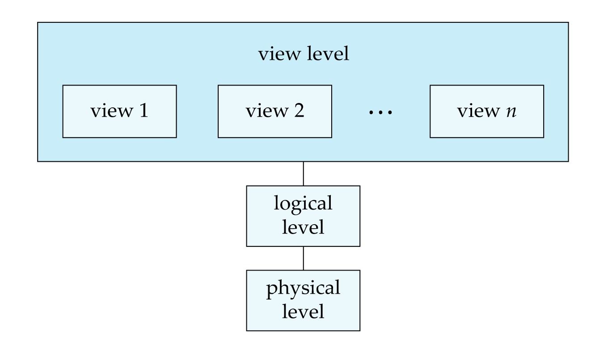

[← Prev: 2018](2018.md) | [Exam-Style Layer](../yearly_answers_exam_style/2019.md) | [Original Question Paper](../PreviousYearQuestion/2019.md) | [Next: 2020 →](2020.md)

---

# ECE 2215: Database Systems · Semester Final 2019 · Explanations

> [!info] Paper Metadata
> - **Examination:** B.Sc. Engineering 2nd Year Even Semester Examination, 2019
> - **Institution:** Rajshahi University of Engineering & Technology (RUET)
> - **Department:** Department of Electrical & Computer Engineering
> - **Curriculum Era:** Pre-OBE
> - **Full Marks:** 72 | **Time:** 3 Hours
> - **Instructions:** Answer any SIX questions taking THREE from each section.
> - **Question Count:** 19 sub-questions across Section A (10) and Section B (9)

---

## SECTION A

### Q.1(a) · 03 Marks

*Topic: [[Topicwise_answers_explaination/T01_DB_Concepts_and_Architecture.md#T01.2 · File system vs DBMS|T01.2 · File system vs DBMS]] · Section A*

**Question.**
Why DBMS is important? What are its advantages?

**Answer.**

**What the examiner wants.**  
A brief statement on why a DBMS is important (~1 mark) and a structured list of at least 4 to 5 key advantages over file systems (~2 marks).

**Key idea.**  
A DBMS provides a central, reliable layer between applications and physical storage. Its advantages directly fix the classic drawbacks of file processing systems: duplicate data, lack of ad-hoc access, and crash vulnerability.

**Step-by-step solution.**  
**Importance of DBMS:**  
A DBMS provides centralized, secure, and coordinated control over an organization's data. It replaces scattered operating system files and ensures that data remains reliable, shared, and recoverable during hardware or software crashes.

**Advantages of DBMS over File Processing Systems:**
1. **Control of Data Redundancy and Inconsistency:** Centralized data storage minimizes duplicate entries and prevents conflicting records.
2. **Data Independence:** Physical storage structures can change without requiring updates to application programs.
3. **Fast and Convenient Data Access:** Declarative query languages (like SQL) retrieve data without custom low-level programming.
4. **Transaction Management (ACID Properties):** Guarantees atomicity during crashes and protects data integrity during concurrent multi-user access.
5. **Data Security and Integrity Constraints:** Restricts unauthorized access through user privileges and enforces business rules automatically.

*Variant for 2023 Q.1(b) (3 marks):* Focus directly on the 5 advantages over file processing systems; omit the general importance statement.

**Check.**  
*Quick self-test:*
- Q: What does data independence mean in practice?  
  A: You can change disk storage layouts or indexes without rewriting application queries.
- Q: Why is atomicity a major advantage of DBMS?  
  A: It guarantees that fund transfers or updates complete fully or roll back completely during a crash.

> [!warning] Common mistakes
> - Listing fewer than 4 points for a 3-mark question.
> - Confusing software features with business benefits without naming technical mechanisms.

**Exam tip.**  
List 5 numbered advantages with bold titles. This guarantees full marks even if an examiner deducts for a brief point.

**Sources.**  
- [Deck 01 · Slides 4, 6–7](../LectureSlides/01_Intro_to_Database_and_DBMS.md)  
- [Textbook Ch. 1 §1.2](../Textbook/Chapter_01_Introduction/Chapter%2001%20-%20Introduction.md)

---

### Q.1(b) · 03 Marks

*Topic: [[Topicwise_answers_explaination/T02_ER_and_EER_Modeling.md#T02.4 · Weak vs strong entity sets|T02.4 · Weak vs strong entity sets]] · Section A*

**Question.**
What are entity and entity set? How is a weak entity set handled in DBMS? Explain.

**Answer.**

**What the examiner wants.**  
Definitions of entity and entity set (1 mark). Clear explanation of the technical steps a DBMS uses to implement a weak entity set in relational tables (2 marks).

**Key idea.**  
Relational databases do not have a native "weak table" type. Instead, a DBMS handles weak entities by importing the owner table's primary key as a foreign key, combining it with the discriminator to create the primary key, and enforcing cascade deletion.

**Step-by-step solution.**  
- **Entity:** An object that exists in the real world and is distinguishable from other objects.
- **Entity Set:** A collection of entities of the same type sharing the same attributes.

**Handling a Weak Entity Set in DBMS:**
1. **Primary Key Formation:** The DBMS cannot identify weak entity tuples by local attributes alone. It combines the primary key of the identifying strong entity with the weak entity's discriminator (partial key).
   $$
   \text{PK}(\text{Weak}) = \text{PK}(\text{Identifying Entity}) \cup \text{Discriminator}
   $$
2. **Table Schema Reduction:** A dedicated table is created for the weak entity. It includes the identifying entity's primary key as a foreign key along with all weak entity attributes. The identifying relationship does not need a separate table.
3. **Foreign Key Integrity with Cascade:** The identifying foreign key is declared with `ON DELETE CASCADE`. If the owner entity tuple is deleted, all dependent weak entity tuples are automatically removed.

**Check.**  
*SQL Schema Implementation Check:*
```sql
CREATE TABLE section (
    course_id   VARCHAR(8),
    sec_id      VARCHAR(8),
    semester    VARCHAR(6),
    year        NUMERIC(4,0),
    PRIMARY KEY (course_id, sec_id, semester, year),
    FOREIGN KEY (course_id) REFERENCES course(course_id) ON DELETE CASCADE
);
```
The table schema directly demonstrates how the identifying foreign key combines with the discriminator to form the primary key.

> [!warning] Common mistakes
> - Creating an extra table for the identifying relationship. In relational reduction, the identifying relationship is redundant because the foreign key is already inside the weak entity table.
> - Omitting `ON DELETE CASCADE`, which is essential to enforce existence dependency.

**Exam tip.**  
List the three clear database steps: primary key construction, table creation without relationship table, and cascading deletion.

**Sources.**  
- [Deck 05 · Slides 34–36, 42, 48](../LectureSlides/05_ER_Model.md)  
- [Textbook Ch. 6 §6.5, §6.6.2](../Textbook/Chapter_06_ER_Model/Chapter%2006%20-%20Database%20Design%20Using%20the%20E-R%20Model.md)

---

### Q.1(c) · 06 Marks

*Topic: [[Topicwise_answers_explaination/T02_ER_and_EER_Modeling.md#T02.5 · Design a full E-R diagram for a scenario|T02.5 · Design a full E-R diagram for a scenario]] · Section A*

**Question.**
Suppose you are recruited as a database specialist by the Rajshahi High-Tech authority to help them design a database for train e-ticketing system efficiently. Now think the regular features and draw an E-R diagram accordingly.

**Answer.**

**What the examiner wants.**  
A realistic, domain-specific E-R diagram for an online railway ticketing system (6 marks). The diagram needs primary entities (Passenger, Ticket, Train, Station), realistic attributes, primary keys underlined, and proper relationship cardinalities.

**Key idea.**  
A train ticketing system manages passengers buying tickets for specific trains traveling along routes made of stations. Tickets are the central transaction records linking passengers to trains.

**Step-by-step solution.**  
**System Requirements & Entities:**
1. **PASSENGER:** Stores account details. Attributes: `user_id` (PK), `name`, `nid`, `phone`.
2. **TICKET:** Represents booked travel tickets. Attributes: `ticket_no` (PK), `journey_date`, `seat_no`, `fare`, `class`.
3. **TRAIN:** Represents trains. Attributes: `train_no` (PK), `train_name`, `total_seats`.
4. **STATION:** Represents railway stops. Attributes: `station_code` (PK), `station_name`, `city`.

**Relationships:**
- `Books` (1:N): A passenger books one or more tickets. Each ticket is booked by one passenger (descriptive attribute: `booking_date`).
- `For_Train` (N:1): Many tickets belong to a specific train. Each ticket is assigned to exactly one train.
- `Stops_At` (M:N): Trains stop at multiple stations, and stations service multiple trains. Descriptive attributes: `arrival_time`, `dep_time`.


*Figure: Train E-Ticketing System E-R Diagram*

**Check.**  
*Workflow validation:*
- Passenger logs in and selects a train route (`Stops_At` schedule).
- Passenger books a seat (`Books` relationship produces a `TICKET`).
- The ticket links directly to the specific train (`For_Train` relationship).

> [!warning] Common mistakes
> - Making an M:N direct relationship between Passenger and Train without a Ticket entity. A physical ticket has seat number, coach, journey date, and fare that need their own entity.
> - Forgetting schedule attributes (`arrival_time`, `dep_time`) on the `Stops_At` relationship.

**Exam tip.**  
Write out the 4 entities and their keys in bullet points before drawing. This keeps the diagram structured and easy to read.

**Sources.**  
- [Deck 05 · Slides 7–39](../LectureSlides/05_ER_Model.md)  
- [Textbook Ch. 6 §6.2–§6.4](../Textbook/Chapter_06_ER_Model/Chapter%2006%20-%20Database%20Design%20Using%20the%20E-R%20Model.md)

---

### Q.2(a) · 04 Marks

*Topic: [[Topicwise_answers_explaination/T01_DB_Concepts_and_Architecture.md#T01.4 · Data abstraction levels, schemas and instances|T01.4 · Data abstraction levels, schemas and instances]] · Section A*
*(Repeated question: Also asked in 2017 | Solved in T01)*

**Question.**
What is data abstraction? Describe the different level of data abstraction.

**Answer.**

**What the examiner wants.**  
The definition and purpose of data abstraction (~1 mark), clear descriptions of all three abstraction levels (physical, logical, view) (~2 marks), and the architecture diagram (~1 mark).

**Key idea.**  
Database systems use complex data structures to store information efficiently. Most users and application programmers do not understand storage pointers or disk block layouts. Data abstraction hides low-level complexity to provide a clean and intuitive interface.

**Step-by-step solution.**  
**Purpose of Data Abstraction:**  
A database contains complex data structures, storage blocks, and indexing schemes. Most end users and programmers are not trained in low-level storage details. Data abstraction hides this physical complexity. It simplifies user interactions, enforces security, and enables physical data independence.

**Levels of Data Abstraction:**
1. **Physical level:** The lowest abstraction level. It describes *how* records are stored on secondary storage media (such as byte offsets, data blocks, B+ trees, and hashing schemes).
2. **Logical level:** The intermediate level. It describes *what* data is stored in the database and the relationships among those data. Programmers and administrators work at this level using schemas.
   Example record:
   ```text
   type instructor = record
       ID : string;
       name : string;
       dept_name : string;
       salary : integer;
   end;
   ```
3. **View level:** The highest abstraction level. It describes only the subset of the database relevant to a specific user group. It hides other data and complex structures for ease of use and security (for example, hiding instructor salaries from students).


*Figure: Three levels of data abstraction (Deck 01, Slide 14)*

*Variant for 2019 Q.2(a) (4 marks):* Define data abstraction, describe the three levels, and include the diagram.  
*Variant for CT-01 Q.01 (5 marks):* State the definition, explain the three levels, show the record example, and draw the diagram.

**Check.**  
*Quick level-matching test:*
- Record block allocation on disk blocks $\rightarrow$ Physical level.
- Entity definition with column names and data types $\rightarrow$ Logical level.
- Form displaying student grades without instructor salaries $\rightarrow$ View level.

> [!warning] Common mistakes
> - Mixing up the logical level and view level. Remember that the logical level describes the *entire* database, while each view describes a *subset*.
> - Leaving out the architecture diagram.

**Exam tip.**  
Draw the three-tiered box diagram with multiple view boxes on top, the logical box in the middle, and the physical box at the bottom.

**Sources.**  
- [Deck 01 · Slides 13–14](../LectureSlides/01_Intro_to_Database_and_DBMS.md)  
- [Textbook Ch. 1 §1.3](../Textbook/Chapter_01_Introduction/Chapter%2001%20-%20Introduction.md)

---

### Q.2(b) · 08 Marks

*Topic: [[Topicwise_answers_explaination/T04_Relational_Algebra_and_Calculus.md#T04.2 · Write RA queries on a given schema|T04.2 · Write RA queries on a given schema]] · Section A*

**Question.**
Consider the following relational database.<br>`Patient (Patient_ID, Patient_name, Mobile)`<br>`History (Patient_ID, Symptom, Date)`<br>`Report (Parient_ID, Corona_center, Test_result)`<br><br>Now write down the relational algebra (Not SQL) to find out the following queries.<br>(i) Find the names of those patients who have fever symptom.<br>(ii) Consider that if any patient has high-fever symptom he/she will be suspected as corona patient. Find out such maximum number of patients in a date.<br>(iii) Find out the mobile numbers of those patients who have provided samples in Rajshahi corona center and their results have become positive.<br>(iv) Find out the name of those patients who have high fever symptom but test result have become negative.<br><br>*(Note: Printed as "Parient_ID" in Report schema in original question paper; refers to "Patient_ID")*

**Answer.**

**What the examiner wants.**  
Four relational algebra queries worth 2 marks each. Covers selection on joined tables and daily grouping with peak aggregation. Also tests multi-table filtering and set intersection between history and lab test reports.

**Key idea.**  
Link patients to clinical records via `Patient_ID`. Natural joins equate common keys. For part (ii), group by `Date` and count patients, then find the global maximum of these daily totals.

**Step-by-step solution.**

*Assumption: In relation `Report`, `Parient_ID` is a typographical misprint for `Patient_ID`.*

**(i) Names of patients who have fever symptom:**

1. Select records from `History` where `Symptom = "fever"`.
2. Natural join with `Patient` on `Patient_ID`.
3. Project the patient names:

$$
\boxed{\Pi_{\text{Patient\_name}}(\text{Patient} \bowtie \sigma_{\text{Symptom} = \text{"fever"}}(\text{History}))}
$$

**(ii) Maximum number of suspected patients (high-fever symptom) on a date:**

1. Select history records for patients exhibiting high fever:

$$
T_1 \leftarrow \sigma_{\text{Symptom} = \text{"high-fever"}}(\text{History})
$$

2. Group the suspected cases by `Date` and count the patients on each date:

$$
T_{\text{daily}} \leftarrow {}_{\text{Date}}\gamma_{\text{count}(\text{Patient\_ID}) \ \text{as} \ \text{patient\_count}}(T_1)
$$

3. Find the maximum count across all recorded dates:

$$
\boxed{\gamma_{\text{max}(\text{patient\_count})}(T_{\text{daily}})}
$$

**(iii) Mobile numbers of patients tested in Rajshahi corona center with positive results:**

1. Filter `Report` for center "Rajshahi" and test result "positive".
2. Natural join with `Patient` on `Patient_ID`.
3. Project `Mobile`:

$$
\boxed{\Pi_{\text{Mobile}}(\text{Patient} \bowtie \sigma_{\text{Corona\_center} = \text{"Rajshahi"} \land \text{Test\_result} = \text{"positive"}}(\text{Report}))}
$$

**(iv) Names of patients who have high fever symptom but negative test result:**

1. Retrieve the IDs of patients recorded with high fever:

$$
T_{\text{high}} \leftarrow \Pi_{\text{Patient\_ID}}(\sigma_{\text{Symptom} = \text{"high-fever"}}(\text{History}))
$$

2. Retrieve the IDs of patients whose test results returned negative:

$$
T_{\text{neg}} \leftarrow \Pi_{\text{Patient\_ID}}(\sigma_{\text{Test\_result} = \text{"negative"}}(\text{Report}))
$$

3. Find the patients satisfying both conditions using set intersection, join with `Patient`, and project their names:

$$
\boxed{\Pi_{\text{Patient\_name}}(\text{Patient} \bowtie (T_{\text{high}} \cap T_{\text{neg}}))}
$$

*Short version for 2024 Q.5(a) (Sec B, 4 marks, CO2):*  
Answer parts (i) and (ii) only. Part (i) matches part (i) above. Part (ii) targets Rangpur instead of Rajshahi:

$$
\Pi_{\text{Mobile}}(\text{Patient} \bowtie \sigma_{\text{Corona\_center} = \text{"Rangpur"} \land \text{Test\_result} = \text{"positive"}}(\text{Report}))
$$

**Check.**  
Suppose:
- `History`: `(P1, "high-fever", "2020-04-01")`, `(P2, "high-fever", "2020-04-01")`, `(P3, "high-fever", "2020-04-02")`.
- `Report`: `(P1, "Rajshahi", "negative")`, `(P2, "Rajshahi", "positive")`.

- Part (ii): Count on 2020-04-01 is 2. Count on 2020-04-02 is 1. The max operation yields 2.
- Part (iv): $T_{\text{high}} = \{P1, P2, P3\}$. $T_{\text{neg}} = \{P1\}$. Intersection is $\{P1\}$. The query correctly retrieves P1's name.

> [!warning] Common mistakes
> - Halting or getting confused by the misprint `Parient_ID`. Write one assumption line and continue with `Patient_ID`.
> - Treating "high fever but negative test result" as set difference of symptom strings rather than the intersection of patient IDs across the two relations.
> - Forgetting the outer projection, which outputs raw IDs and extra columns instead of the requested names or mobile numbers.

**Exam tip.**  
When a question repeats across years with only a city name swapped, the query structure is identical. Memorize the two-step pattern for daily extremes: group by date with count, then apply scalar max.

**Sources.**  
`[Lecture Deck 02 · Slides 11–29](../LectureSlides/02_Relational_Model.md)`  
`[Textbook Ch. 2 §2.6](../Textbook/Chapter_02_Relational_Model/Chapter%2002%20-%20Introduction%20to%20the%20Relational%20Model.md)`

---

### Q.3(a) · 04 Marks

*Topic: [[Topicwise_answers_explaination/T08_Normalization_and_Functional_Dependencies.md#T08.6 · Define normalization (and its importance) & 1NF / 2NF / 3NF|T08.6 · Define normalization (and its importance) & 1NF / 2NF / 3NF]] · Section A*

**Question.**
What is normalization? Discuss 1NF and 2NF.

**Answer.**

**What the examiner wants.**  
Definition of normalization (1 mark), detailed discussion of 1NF rules with a clear example (1.5 marks), and 2NF rules with a clear example (1.5 marks).

**Key idea.**  
1NF requires that every cell holds one single value (no lists). 2NF requires 1NF plus that every non-key attribute depends on the whole key, not just half of it.

**Step-by-step solution.**

#### 1. What is Normalization?

**Normalization** is the process of decomposing a relation schema into smaller schemas to minimize data redundancy and prevent insertion, deletion, and update anomalies.

#### 2. First Normal Form (1NF)

**Rules:**
- Every attribute must hold only atomic (single, indivisible) values.
- No multi-valued attributes or repeating groups are permitted.
- Each column must contain values of the same domain, and each row must be uniquely identifiable.

**Example:**

*Violating 1NF:*

| Student_ID | Name | Phone |
| :--- | :--- | :--- |
| S01 | Fahim | 01711, 01822 |
| S02 | Noor | 01933 |

*Converted to 1NF (atomic rows):*

| Student_ID | Name | Phone |
| :--- | :--- | :--- |
| S01 | Fahim | 01711 |
| S01 | Fahim | 01822 |
| S02 | Noor | 01933 |

PK: `(Student_ID, Phone)`

#### 3. Second Normal Form (2NF)

**Rules:**
- The relation must be in 1NF.
- There must be **no partial dependency**. No non-prime attribute can depend on a proper subset of any candidate key.

**Example:**

Consider relation `ENROLL(StudentID, CourseID, StudentName, Grade)`:
- Candidate Key: `(StudentID, CourseID)`
- Dependencies:
  - `(StudentID, CourseID) -> Grade` (Full dependency)
  - `StudentID -> StudentName` (Partial dependency on proper subset `StudentID`)

*Converted to 2NF (decompose to remove partial dependency):*
1. `STUDENT(StudentID, StudentName)` with PK `StudentID`
2. `ENROLLMENT(StudentID, CourseID, Grade)` with PK `(StudentID, CourseID)`

*Short version for 2018 Q.4(c) (4 marks):* State the rules for 1NF (atomicity, no multi-valued attributes) with the phone number example. State the rules for 2NF (in 1NF, no partial dependencies) with the student course example.

**Check.**  
*Quick self-test:*
- Q: What makes a phone list violate 1NF?  
  A: Storing multiple phone numbers in one row makes the cell non-atomic.
- Q: Why is `StudentName` partially dependent in `ENROLL`?  
  A: Because knowing `StudentID` is already enough to determine `StudentName`; `CourseID` is completely unnecessary.

> [!warning] Common mistakes
> - Discussing rules without providing before-and-after tables for the examples.
> - Choosing a 2NF example with a single-attribute primary key. Partial dependencies only exist when candidate keys are composite!

**Exam tip.**  
Keep the examples minimal: use a 2-row table for 1NF and a 4-attribute relation for 2NF.

**Sources.**  
- [Deck 06 · Slides 30–34](../LectureSlides/06_DBMS_Normalization.md)
- [Textbook Ch. 7 §7.3.4](../Textbook/Chapter_07_Normalization/Chapter%2007%20-%20Relational%20Database%20Design.md)

---

### Q.3(b) · 03 Marks

*Topic: [[Topicwise_answers_explaination/T09_Transactions_ACID_and_Anomalies.md#T09.2 · Consistency property alone, with example|T09.2 · Consistency property alone, with example]] · Section A*

**Question.**
Explain the consistency property of a database system with a proper example.

**Answer.**

**What the examiner wants.**  
A dedicated discussion of the consistency property. The examiner looks for the distinction between explicit constraints and implicit application invariants, along with a concrete numerical example showing temporary internal inconsistency versus final restored consistency. Mark split: 1 mark for definition/types, 2 marks for the example.

**Key idea.**  
Consistency means preserving truth and valid business invariants. While a transaction is running, the database can be temporarily inconsistent internally. But once the transaction finishes, consistency must be fully restored.

**Step-by-step solution.**  
**Definition:**  
The **consistency** property requires that executing a transaction in isolation preserves the consistency of the database. If the database starts in a valid state that satisfies all integrity rules, it must end in a valid state after the transaction completes.

**Categories of Consistency Constraints:**
1. **Explicit Constraints:** Rules enforced automatically by the DBMS, including primary keys, foreign keys, data types, and `CHECK` constraints (such as `balance >= 0`).
2. **Implicit Invariants:** Business rules that cannot easily be expressed in DDL, such as preserving total assets across account transfers.

**Example (Bank Transfer):**  
Let account $A$ have \$1000 and account $B$ have \$2000. The consistency invariant requires total funds to remain constant:

$$
A + B = 1000 + 2000 = 3000
$$

Transaction $T_1$ transfers \$50 from $A$ to $B$:
1. $\text{read}(A)$
2. $A := A - 50$
3. $\text{write}(A) \quad [A \text{ becomes } 950]$
4. $\text{read}(B)$
5. $B := B + 50$
6. $\text{write}(B) \quad [B \text{ becomes } 2050]$

- **Temporary Inconsistency During Execution:** After step 3, $A = 950$ and $B = 2000$. The sum is $950 + 2000 = 2950$. The database enters a temporarily inconsistent state.
- **Restored Consistency at End:** After step 6 completes, $A = 950$ and $B = 2050$. The sum is $950 + 2050 = 3000$. Database consistency is restored.
- **Responsibility:** Ensuring transaction logic is correct is primarily the responsibility of the **application programmer**.

**Check.**  
*Quick self-test:*
- Q: Is the database consistent between step 3 and step 6?  
  A: No. It is temporarily inconsistent internally ($A+B = 2950$).
- Q: Why is this temporary inconsistency acceptable?  
  A: Because isolation prevents other transactions from observing it, and atomicity ensures the entire transaction completes or rolls back.

> [!warning] Common mistakes
> - Believing that database data is consistent at every millisecond during execution. A transaction temporarily breaks consistency while performing intermediate updates.
> - Omitting the distinction between explicit constraints (enforced by DBMS) and implicit invariants (responsibility of the programmer).

**Exam tip.**  
Explicitly state that temporary inconsistency during execution is normal and necessary. The requirement is that consistency is restored when the transaction finishes.

**Sources.**  
- [Deck 07 · Slide 6](../LectureSlides/07_Transactions.md)  
- [Textbook Ch. 17 §17.2](../Textbook/Chapter_17_Transactions/Chapter%2017%20-%20Transactions.md)

---

### Q.3(c) · 05 Marks

*Topic: [[Topicwise_answers_explaination/T06_Joins_and_Views.md#T06.1 · Types of joins|T06.1 · Types of joins]] · Section A*

**Question.**
What is joining? Discuss each type of joining between two data tables with example.

**Answer.**

**What the examiner wants.**  
A formal definition of a join operation in relational database systems (1 mark), followed by descriptions and examples of the main join types: Inner join, Left outer join, Right outer join, Full outer join, and Cross join (4 marks, approximately 1 mark per join type).

**Key idea.**  
A join operation combines tuples from two tables into a single result relation. It checks matching values in specified columns. An inner join keeps only matching rows. An outer join retains matching rows plus unmatched rows from one or both tables by padding empty attributes with `NULL`. A cross join pairs every row from the first table with every row from the second table.

**Step-by-step solution.**

**Definition of Joining:**  
A join operation takes two relations and combines them into one relation based on a matching condition. It acts as a Cartesian product followed by a selection predicate and projection.


*Figure: Join types and join conditions (Deck 04, Slide 4)*

**Example Base Tables:**

Table `course`:

| course_id | title | dept_name | credits |
| :--- | :--- | :--- | :--- |
| BIO-301 | Genetics | Biology | 4 |
| CS-190 | Game Design | Comp. Sci. | 4 |
| CS-315 | Robotics | Comp. Sci. | 3 |

Table `prereq`:

| course_id | prereq_id |
| :--- | :--- |
| BIO-301 | BIO-101 |
| CS-190 | CS-101 |
| CS-347 | CS-101 |

---

#### 1. Inner Join (and Natural Join)
Retains only tuples that satisfy the join condition in both tables. Unmatched rows are dropped.

```sql
SELECT course.course_id, title, dept_name, prereq_id
FROM course
INNER JOIN prereq ON course.course_id = prereq.course_id;
```

Relational algebra:
$$
\text{course} \bowtie \text{prereq}
$$

**Result:**

| course_id | title | dept_name | prereq_id |
| :--- | :--- | :--- | :--- |
| BIO-301 | Genetics | Biology | BIO-101 |
| CS-190 | Game Design | Comp. Sci. | CS-101 |

---

#### 2. Left Outer Join
Preserves every row from the left table (`course`). Fills right-table attributes with `NULL` when no match exists.

```sql
SELECT course.course_id, title, dept_name, prereq_id
FROM course
LEFT JOIN prereq ON course.course_id = prereq.course_id;
```

Relational algebra:
$$
\text{course} \mathbin{⟕} \text{prereq}
$$

**Result:**

| course_id | title | dept_name | prereq_id |
| :--- | :--- | :--- | :--- |
| BIO-301 | Genetics | Biology | BIO-101 |
| CS-190 | Game Design | Comp. Sci. | CS-101 |
| CS-315 | Robotics | Comp. Sci. | `NULL` |

---

#### 3. Right Outer Join
Preserves every row from the right table (`prereq`). Fills left-table attributes with `NULL` when no match exists.

```sql
SELECT prereq.course_id, title, dept_name, prereq_id
FROM course
RIGHT JOIN prereq ON course.course_id = prereq.course_id;
```

Relational algebra:
$$
\text{course} \mathbin{⟖} \text{prereq}
$$

**Result:**

| course_id | title | dept_name | prereq_id |
| :--- | :--- | :--- | :--- |
| BIO-301 | Genetics | Biology | BIO-101 |
| CS-190 | Game Design | Comp. Sci. | CS-101 |
| CS-347 | `NULL` | `NULL` | CS-101 |

---

#### 4. Full Outer Join
Retains all rows from both tables. It pairs matching rows and fills missing values with `NULL`. MySQL emulates it using `UNION`.

```sql
SELECT course.course_id, title, dept_name, prereq_id
FROM course
LEFT JOIN prereq ON course.course_id = prereq.course_id
UNION
SELECT prereq.course_id, title, dept_name, prereq_id
FROM course
RIGHT JOIN prereq ON course.course_id = prereq.course_id;
```

Relational algebra:
$$
\text{course} \mathbin{⟗} \text{prereq}
$$

**Result:**

| course_id | title | dept_name | prereq_id |
| :--- | :--- | :--- | :--- |
| BIO-301 | Genetics | Biology | BIO-101 |
| CS-190 | Game Design | Comp. Sci. | CS-101 |
| CS-315 | Robotics | Comp. Sci. | `NULL` |
| CS-347 | `NULL` | `NULL` | CS-101 |

---

#### 5. Cross Join (Cartesian Product)
Combines each row of the first table with every row of the second table without any condition.

```sql
SELECT *
FROM course
CROSS JOIN prereq;
```

Relational algebra:
$$
\text{course} \times \text{prereq}
$$

It returns $3 \times 3 = 9$ rows.

*Variant for 2023 Q.5(c) (4 marks):* The same definition and four outer and inner join examples answer the question.

**Check.**  
*Quick self-test:*
- Q: What happens to a course with no prerequisites in an INNER JOIN?  
  A: It is dropped from the result relation because no matching tuple exists in `prereq`.
- Q: How does a FULL OUTER JOIN handle tuples present in only one table?  
  A: It retains both tuples and pads the missing columns from the other relation with `NULL`.
- Q: Does MySQL support the SQL standard `FULL OUTER JOIN` syntax directly?  
  A: No. MySQL does not have native `FULL OUTER JOIN` syntax, so we combine `LEFT JOIN` and `RIGHT JOIN` with `UNION`.

> [!warning] Common mistakes
> - Writing that MySQL supports native `FULL OUTER JOIN` syntax directly.
> - Confusing Natural Join with Inner Join: Natural Join automatically equates all common column names, whereas Inner Join uses an explicit condition.
> - Omitting `NULL` values when drawing outer join result tables.

**Exam tip.**  
Use one small pair of 3-row tables across all join types. This saves drawing time and lets the examiner verify row counts instantly.

**Sources.**  
- [Deck 04 · Slides 3–13, 20–23](../LectureSlides/04_Joining_and_Views.md)  
- [Textbook Ch. 4 §4.1](../Textbook/Chapter_04_Intermediate_SQL/Chapter%2004%20-%20Intermediate%20SQL.md)

---

### Q.4(a) · 07 Marks

*Topic: [[Topicwise_answers_explaination/T10_Serializability.md#T10.4 · Build serializable/non-serializable schedules ($T_1,T_2$ with "if A = 0 then B := B+1")|T10.4 · Build serializable/non-serializable schedules ($T_1,T_2$ with "if A = 0 then B := B+1")]] · Section A*

**Question.**
What is concurrency control? Consider the following two transactions.<br><br>**T1:**<br>`read (P);`<br>`read (Q);`<br>`if P=10 then Q:=Q-5;`<br>`write (Q);`<br><br>**T2:**<br>`read (Q);`<br>`read (P);`<br>`if Q=10 then P:=P+5;`<br>`write (P);`<br><br>Let the consistency requirement be P=5 or Q=5 with P=Q=5 the initial values.<br>(i) Show a concurrent execution of T1 and T2 that produces a serializable schedule.<br>(ii) Is there a concurrent execution of T1 and T2 that produces a serializable schedule?<br><br>*(Note: In the printed question paper, sub-question (ii) is printed identically to (i) as "Is there a concurrent execution of T1 and T2 that produces a serializable schedule?")*

**Answer.**

**What the examiner wants.** Definition of concurrency control (2 marks), handling of the printed transaction scenario with initial values and IF conditions (2.5 marks), and analysis of serializable vs non-serializable concurrent schedules (2.5 marks).

**Key idea.** Concurrency control ensures database consistency when multiple transactions run simultaneously. The given scenario is adapted from Silberschatz Exercise 17.15, but has typographical errors in the question paper. We address the question as printed, and also explain the textbook intent.

**Step-by-step solution.**

#### 1. What is Concurrency Control?

**Concurrency control** is the DBMS subsystem that manages simultaneous execution of transactions on a shared database. Its main goals are:
1. **Consistency:** Ensure concurrent transactions do not violate database consistency rules or produce incorrect final states.
2. **Isolation:** Ensure each transaction executes as if it were running alone, preventing anomalies like dirty reads and lost updates.
3. **Throughput:** Maximize system resource use (CPU, disk) and reduce average transaction waiting time.

---

#### 2. Scenario Analysis

*Assumption: Sub-question (ii) repeats (i) due to a printing error, and the IF conditions test P = 10 / Q = 10 while initial values are P = Q = 5; we answer as printed, and also show the intended reading modeled on the Silberschatz consistency exercise.*

##### Analysis Under Printed Values ($P = 5, Q = 5$)

- Initial values: $P = 5, Q = 5$.
- Consistency condition: $P = 5 \vee Q = 5$.
- In $T_1$, $P$ is read as 5. The condition `P = 10` evaluates to **false**. $Q$ is not decremented. $T_1$ writes $Q = 5$.
- In $T_2$, $Q$ is read as 5. The condition `Q = 10` evaluates to **false**. $P$ is not incremented. $T_2$ writes $P = 5$.
- Because neither condition ever triggers, $P$ and $Q$ remain 5 in all possible schedules. Consistency is trivially preserved.

---

#### 3. Part (i): Concurrent Execution That Produces a Serializable Schedule

A concurrent schedule is serializable if its precedence graph is acyclic. We achieve this by letting one transaction complete its conflicting operations on the shared variables before the other begins:

| Step | $T_1$ | $T_2$ | Local Actions |
| :--: | :-- | :-- | :-- |
| 1 | `read(P);` | | $T_1$ reads $P = 5$ |
| 2 | `read(Q);` | | $T_1$ reads $Q = 5$ |
| 3 | `if P=10 then Q:=Q-5;`<br>`write(Q);` | | Condition false; writes $Q = 5$ |
| 4 | | `read(Q);` | $T_2$ reads $Q = 5$ |
| 5 | | `read(P);` | $T_2$ reads $P = 5$ |
| 6 | | `if Q=10 then P:=P+5;`<br>`write(P);` | Condition false; writes $P = 5$ |

**Conflict Analysis:**
- $T_1: \text{read}(P)$ occurs before $T_2: \text{write}(P) \implies T_1 \to T_2$.
- $T_1: \text{write}(Q)$ occurs before $T_2: \text{read}(Q) \implies T_1 \to T_2$.
- All directed edges go from $T_1$ to $T_2$. There are no edges from $T_2$ to $T_1$.

The precedence graph is acyclic. The schedule is **conflict serializable**, with equivalent serial order:
$$
\boxed{\langle T_1, T_2 \rangle}
$$

---

#### 4. Part (ii): Intended Reading and Non-Serializable Interleaving

Sub-question (ii) repeats (i) due to a misprint. In the original Silberschatz problem, sub-question (ii) asks: *"Is there an interleaved concurrent execution of $T_1$ and $T_2$ that produces a non-serializable schedule?"*

Consider an interleaved execution where both transactions read before writing:

| Step | $T_1$ | $T_2$ |
| :--: | :-- | :-- |
| 1 | `read(P);` | |
| 2 | | `read(Q);` |
| 3 | `read(Q);` | |
| 4 | | `read(P);` |
| 5 | `write(Q);` | |
| 6 | | `write(P);` |


**Conflicts:**
- $T_1$ reads $P$ (step 1) before $T_2$ writes $P$ (step 6) $\implies T_1 \to T_2$.
- $T_2$ reads $Q$ (step 2) before $T_1$ writes $Q$ (step 5) $\implies T_2 \to T_1$.

The precedence graph contains a directed cycle:
$$
T_1 \longleftrightarrow T_2
$$

Because of this cycle, this interleaved schedule is **NOT conflict serializable**.

Also, if the IF conditions were intended to test initial values (`if P = 5 then Q := Q - 5` and `if Q = 5 then P := P + 5`), this interleaving would produce $P = 10$ and $Q = 0$, violating the consistency requirement $P = 5 \vee Q = 5$.

**Check.**
- Concurrency control definition addresses ACID isolation and consistency.
- The acyclic schedule in part (i) has only forward edges $T_1 \to T_2$.
- The interleaved schedule in part (ii) has forward edge $T_1 \to T_2$ and backward edge $T_2 \to T_1$, confirming the cycle.

> [!warning] Common mistakes
> - Failing to state the assumption regarding the misprinted sub-question (ii) and mismatched IF conditions.
> - Omitting the definition of concurrency control. The first sentence asks "What is concurrency control?".
> - Ignoring that even when numeric values do not change, a read-write cycle violates conflict serializability.

**Exam tip.** Always answer both what is printed and what was clearly intended. This ensures you receive full credit regardless of which marking scheme the examiner follows.

**Sources.**
- [Textbook Ch. 17 §17.1, §17.6 & Exercise 17.15](../Textbook/Chapter_17_Transactions/Chapter%2017%20-%20Transactions.md)
- [Deck 07 · Slides 2, 10, 16–21](../LectureSlides/07_Transactions.md)

---

### Q.4(b) · 05 Marks

*Topic: [[Topicwise_answers_explaination/T12_Recovery_System_and_RAID.md#T12.1 · Failure classification, precautions, recovery methods|T12.1 · Failure classification, precautions, recovery methods]] · Section A*

**Question.**
How many ways a DBMS could be failed? What precautions should be taken considering the failure of DBMS and point out the recovery methods.

**Answer.**

**What the examiner wants.**  
A three-part answer covering failure modes (2 marks), runtime precautions (1.5 marks), and recovery methods (1.5 marks).

**Key idea.**  
A database handles failures in two distinct stages. First, it takes proactive precautions during normal runtime (logging, RAID, battery backups). Second, it executes reactive recovery algorithms (undo/redo, checkpoints) after a failure occurs.

**Step-by-step solution.**  

#### 1. Ways a DBMS Can Fail
A DBMS can fail in three primary ways:
- **Transaction Failure:** Caused by logical errors (overflow, invalid input) or system errors (deadlock aborts).
- **System Crash:** Loss of volatile main memory from power loss, CPU faults, or operating system crashes.
- **Disk Failure:** Loss of non-volatile disk storage caused by head crashes or bad sectors.
- *(Site / Disaster Failure):* Physical destruction of an entire data center caused by fire, flood, or earthquake.

#### 2. Precautions Against DBMS Failures
- **Write-Ahead Logging (WAL):** Force log records to stable storage before writing modified data pages to disk.
- **Uninterruptible Power Supply (UPS) & NVRAM:** Use battery-backed caches to prevent incomplete writes during sudden power loss.
- **Disk Redundancy (RAID):** Use mirroring (RAID 1) or parity (RAID 5/6) to survive single or double disk failures.
- **Archival Off-Site Backups:** Periodically copy full database dumps and log files to remote tape or cloud storage.

#### 3. Recovery Methods
- **Log-Based Recovery:**
  - *Undo:* Reverses uncommitted updates using old values from the log.
  - *Redo:* Re-applies committed updates using new values from the log.
- **Checkpoints:** Periodically flushes dirty buffer blocks and logs active transactions, bounding the restart log scan.
- **Shadow Paging:** Writes updates to a separate page copy and switches pointers atomically, avoiding undo/redo logs.
- **Archival Restore and Roll-Forward:** Restores the last offline backup and replays subsequent archived log records.

*Short version for 2024 Q.3(b) (CO1, 4 marks):* Provide the same three sections in concise bullet points to fit the 4-mark time limit.

**Check.**  
*Quick self-test:*
- Q: Why is Write-Ahead Logging (WAL) classified as a precaution rather than a recovery method?  
  A: WAL is performed during normal execution to guarantee that necessary recovery data exists before a failure happens.
- Q: How do checkpoints speed up recovery after a system crash?  
  A: Checkpoints ensure modified buffer blocks are flushed to disk, so the recovery manager does not need to scan the log before the checkpoint.

> [!warning] Common mistakes
> - Confusing precautions (preventive runtime actions) with recovery methods (restart algorithms).
> - Forgetting to distinguish between undo (reversing uncommitted data) and redo (replaying committed data).
> - Leaving out physical precautions such as RAID and UPS.

**Exam tip.**  
Use three distinct headings matching the prompt: Failures, Precautions, and Recovery Methods.

**Sources.**  
- [Textbook Ch. 19 §19.1–19.4](../Textbook/Chapter_19_Recovery_System/Chapter%2019%20-%20Recovery%20System.md)  
- [Textbook Ch. 12 §12.5](../Textbook/Chapter_12_Physical_Storage/Chapter%2012%20-%20Physical%20Storage%20Systems.md)

---

## SECTION B

### Q.5(a) · 02 Marks

*Topic: [[Topicwise_answers_explaination/T05_SQL_DDL_DML_Aggregates_Subqueries.md#T05.1 · What SQL is; SQL short note|T05.1 · What SQL is; SQL short note]] · Section B*

**Question.**
Write a short note on SQL.

**Answer.**

**What the examiner wants.**  
The formal full name of SQL, its original historical background (IBM System R), its declarative paradigm, and its major sub-languages (DDL, DML, DCL/TCL). The mark split is 1 mark for the core definition and role, and 1 mark for key functional parts.

**Key idea.**  
Unlike procedural programming languages (C, Java) where you write explicit loops to access disk records, SQL is non-procedural (declarative). You describe the desired target relation using set operations and relational predicates. The internal database query processor handles the physical indexing and file scanning.

**Step-by-step solution.**  
**SQL (Structured Query Language)** is the standard declarative computer language used to define, query, and manipulate data in relational database management systems (RDBMS). It was originally developed at IBM in the 1970s for System R.

Key parts of SQL include:
1. **Data Definition Language (DDL):** Defines relation schemas, integrity constraints, and indexes (`CREATE`, `ALTER`, `DROP`).
2. **Data Manipulation Language (DML):** Queries and modifies table tuples (`SELECT`, `INSERT`, `UPDATE`, `DELETE`).
3. **Data Control & Transaction Control (DCL/TCL):** Manages user permissions (`GRANT`, `REVOKE`) and transaction boundaries (`COMMIT`, `ROLLBACK`).

SQL is declarative. The user specifies what result is wanted rather than how to calculate it.

**Check.**  
*Quick self-test:*
- Q: What makes SQL declarative rather than procedural?  
  A: Users state the desired result conditions without writing algorithmic loops or index navigation procedures.
- Q: Which SQL component is used to enforce entity integrity?  
  A: DDL, through `PRIMARY KEY` and `NOT NULL` constraints inside `CREATE TABLE`.

> [!warning] Common mistakes
> - Confusing SQL with a general-purpose programming language; pure SQL does not provide branching or iteration without stored procedural extensions.
> - Omitting DDL commands and mentioning only `SELECT`.

**Exam tip.**  
For 2 marks, keep the response under 80 words. Name the language, define its declarative property, and bullet DDL, DML, and DCL/TCL.

**Sources.**  
[Deck 03 · Slides 3–4](../LectureSlides/03_Introduction_to_SQL.md), [Textbook Ch. 3 §3.1–3.2](../Textbook/Chapter_03_Intro_SQL/Chapter%2003%20-%20Introduction%20to%20SQL.md).

---

### Q.5(b) · 08 Marks

*Topic: [[Topicwise_answers_explaination/T05_SQL_DDL_DML_Aggregates_Subqueries.md#T05.7 · Multi-table business-schema query sets (MySQL): Covid, Company, Insurance, E-commerce|T05.7 · Multi-table business-schema query sets (MySQL): Covid, Company, Insurance, E-commerce]] · Section B*

**Question.**
Consider the following relational database.<br>`Patient (Patient_ID, Patient_name, Mobile)`<br>`History (Patient_ID, Symptom, Date)`<br>`Report (Parient_ID, Corona_center, Test_result)`<br><br>Now write down the SQL (Not Algebra) to find out the following queries.<br>(i) Find the names of those patients who have-fever symptom.<br>(ii) Consider that if any patient has high fever symptom he/she will be suspected as corona patient. Find out such maximum number of patients in a date.<br>(iii) Find out the mobile numbers of those patients who have provided samples in Rajshahi corona center and their results have become positive.<br>(iv) Find out the name of those patients who have high fever symptom but test result have become negative.<br><br>*(Note: In the physical question paper, SECTION-B heading and Q.5(a)–(b) appear at the bottom of Page 1; Q.5(c) continues at the top of Page 2)*<br>*(Note: Printed as "Parient_ID" in Report schema in original question paper; refers to "Patient_ID")*

**Answer.**

**What the examiner wants.**  
Four relational database queries across medical tracking relations (2 marks each):  
1. String pattern matching (`LIKE '%fever%'`) across joined tables.  
2. Two-level aggregation: first grouping and counting suspected patients per date, then extracting the maximum count using a derived table.  
3. Multi-table join filtering by clinic location and positive test result.  
4. Three-table join identifying patients with high fever symptoms whose laboratory test returned negative.

**Key idea.**  
Part (ii) requires finding the peak daily suspect count. Since standard SQL does not allow nested aggregate functions like `MAX(COUNT(*))`, the daily counts must be computed inside a subquery in the `FROM` clause, after which `MAX()` is applied to the derived column.

**Step-by-step solution.**  
*Assumption: "Parient_ID" in the Report table is a typographical misprint for Patient_ID and joins with Patient.Patient_ID.*

*(i) Names of patients who have fever symptom:*

```sql
SELECT DISTINCT p.Patient_name
FROM Patient p
JOIN History h ON p.Patient_ID = h.Patient_ID
WHERE h.Symptom LIKE '%fever%';
```

*(ii) Maximum number of high-fever patients recorded on a single date:*

```sql
SELECT MAX(daily_count) AS max_patients
FROM (
    SELECT Date, COUNT(DISTINCT Patient_ID) AS daily_count
    FROM History
    WHERE Symptom = 'high fever'
    GROUP BY Date
) AS daily_summary;
```

*(Alternative returning the specific date with the peak count:* `SELECT Date, COUNT(DISTINCT Patient_ID) AS patient_count FROM History WHERE Symptom = 'high fever' GROUP BY Date ORDER BY patient_count DESC LIMIT 1;`*)*

*(iii) Mobile numbers of patients tested in Rajshahi corona center with positive result:*

```sql
SELECT DISTINCT p.Mobile
FROM Patient p
JOIN Report r ON p.Patient_ID = r.Parient_ID
WHERE r.Corona_center = 'Rajshahi'
  AND r.Test_result = 'positive';
```

*(iv) Names of patients with high fever symptom whose test result is negative:*

```sql
SELECT DISTINCT p.Patient_name
FROM Patient p
JOIN History h ON p.Patient_ID = h.Patient_ID
JOIN Report r ON p.Patient_ID = r.Parient_ID
WHERE h.Symptom = 'high fever'
  AND r.Test_result = 'negative';
```

**Check.**  
*Trace with sample medical records:*
- Date '2020-04-01' has 3 distinct patients with 'high fever'.
- Date '2020-04-02' has 5 distinct patients with 'high fever'.
- The inner derived table in part (ii) yields rows `('2020-04-01', 3)` and `('2020-04-02', 5)`.
- The outer `MAX(daily_count)` evaluates to 5.

> [!warning] Common mistakes
> - Writing `SELECT MAX(COUNT(Patient_ID))` directly; nesting aggregate functions inside a single `SELECT` clause is invalid SQL syntax.
> - Forgetting `DISTINCT` in patient name projections; if a patient has multiple fever entries, their name repeats unless `DISTINCT` is specified.

**Exam tip.**  
When an aggregate of an aggregate is needed, wrap the initial `GROUP BY` query in the `FROM` clause with an alias (e.g., `FROM (...) AS daily_summary`).

**Sources.**  
[Deck 03 · Slides 18, 22, 30–32, 48–49](../LectureSlides/03_Introduction_to_SQL.md), [Textbook Ch. 3 §3.4, §3.7, §3.8](../Textbook/Chapter_03_Intro_SQL/Chapter%2003%20-%20Introduction%20to%20SQL.md).

---

### Q.5(c) · 02 Marks

*Topic: [[Topicwise_answers_explaination/T05_SQL_DDL_DML_Aggregates_Subqueries.md#T05.2 · DDL + DML warm-up: CREATE, INSERT, ALTER ... ADD, UPDATE, DELETE, rename, filter|T05.2 · DDL + DML warm-up: CREATE, INSERT, ALTER ... ADD, UPDATE, DELETE, rename, filter]] · Section B*

**Question.**
<!-- Page 2 begins here in printed paper -->Write down the SQL queries to create the following tables.<br>`Patient (Patient_ID, Patient_name, Mobile)`<br>`History (Patient_ID, Symptom, Date)`<br>`Report (Parient_ID, Corona_center, Test_result)`<br><br>*(Note: Printed as "SQI." and "Parient_ID" in original question paper)*

**Answer.**

**What the examiner wants.**  
Three complete `CREATE TABLE` statements demonstrating correct data type assignment, primary keys, and foreign key references linking dependent tables to the master `Patient` relation.

**Key idea.**  
`Patient` is an independent master relation. `History` and `Report` are dependent relations that track observations and test reports respectively. Because a patient can report symptoms across multiple dates, `History` requires a composite primary key `(Patient_ID, Symptom, Date)`.

**Step-by-step solution.**  
*Assumption: "Parient_ID" in the Report table is a typographical misprint for Patient_ID and serves as a foreign key referencing the Patient table.*

```sql
CREATE TABLE Patient (
    Patient_ID INT PRIMARY KEY,
    Patient_name VARCHAR(50),
    Mobile VARCHAR(15)
);

CREATE TABLE History (
    Patient_ID INT,
    Symptom VARCHAR(50),
    Date DATE,
    PRIMARY KEY (Patient_ID, Symptom, Date),
    FOREIGN KEY (Patient_ID) REFERENCES Patient(Patient_ID)
);

CREATE TABLE Report (
    Patient_ID INT PRIMARY KEY,
    Corona_center VARCHAR(50),
    Test_result VARCHAR(20),
    FOREIGN KEY (Patient_ID) REFERENCES Patient(Patient_ID)
);
```

**Check.**  
*Relational integrity verification:*
- Referencing tables (`History`, `Report`) define foreign keys pointing to `Patient(Patient_ID)`.
- Creation order: `Patient` must be created first before child tables execute their foreign key constraints.

> [!warning] Common mistakes
> - Setting `Patient_ID` alone as the primary key of `History`. A single patient can experience multiple symptoms on multiple dates, causing duplicate key violations unless the key is composite.
> - Leaving the printed typo `Parient_ID` unaddressed without an assumption note.

**Exam tip.**  
Always define the parent table before the referencing child tables so foreign key dependencies resolve cleanly.

**Sources.**  
[Deck 03 · Slides 7–9](../LectureSlides/03_Introduction_to_SQL.md), [Textbook Ch. 3 §3.2](../Textbook/Chapter_03_Intro_SQL/Chapter%2003%20-%20Introduction%20to%20SQL.md).

---

### Q.6(a) · 06 Marks

*Topic: [[Topicwise_answers_explaination/T08_Normalization_and_Functional_Dependencies.md#T08.1 · Why normalize: redundancy and insert/update/delete anomalies|T08.1 · Why normalize: redundancy and insert/update/delete anomalies]] · Section B*

**Question.**
Consider the following data tables.<br><br><b>Student</b><br><table border="1" cellpadding="4" style="border-collapse: collapse; text-align: center; margin-top: 6px; margin-bottom: 6px;"><thead><tr><th>Roll</th><th>Name</th><th>Dept</th><th>Sub Code</th><th>Sub Grade</th><th>Reg Sub Code</th></tr></thead><tbody><tr><td>1710001</td><td>Mr. A</td><td>ECE</td><td>ECE-2103</td><td>A+</td><td>ECE-2103<br>ECE-2107</td></tr><tr><td>1710002</td><td>Mr. B</td><td>ECE</td><td>ECE-2107</td><td>A</td><td>ECE-2103<br>ECE-2107</td></tr><tr><td>1710003</td><td>Mr. C</td><td>ECE</td><td>ECE-2103</td><td>A-</td><td>ECE-2103</td></tr><tr><td>1710004</td><td>Mr. D</td><td>ECE</td><td>ECE-2107</td><td>A+</td><td>ECE-2107</td></tr><tr><td>1710001</td><td>Mr. A</td><td>ECE</td><td>ECE-2107</td><td>A-</td><td>ECE-2103<br>ECE-2107</td></tr><tr><td>1710002</td><td>Mr. B</td><td>ECE</td><td>ECE-2103</td><td>A+</td><td>ECE-2103<br>ECE-2107</td></tr></tbody></table><br>Now,<br>(i) Carefully notice the entries and point out your opinion regarding space efficiency.<br>(ii) What will happen if you update any particular information?<br>(iii) What will happen if you are asked to delete 'ECE-2107' from the registered course list preserving all other information?

**Answer.**

**What the examiner wants.**  
Direct answers to all three parts: (i) evaluation of storage wastage due to repeated student attributes and multi-valued course lists (2 marks); (ii) analysis of update anomalies and inconsistencies (2 marks); (iii) analysis of deletion challenges including string manipulation and loss of records for single-course students (2 marks).

**Key idea.**  
The table mixes three different concepts in one place: student demographics, individual course grades, and registered course lists. Even worse, `Reg Sub Code` stores multiple course codes inside a single cell. This design wastes storage and creates severe data manipulation headaches.

**Step-by-step solution.**

#### (i) Space Efficiency

The table is highly space-inefficient for three reasons:

1. **Repetitive Student Attributes:** The attributes `Name` ("Mr. A", "Mr. B") and `Dept` ("ECE") are repeated across multiple rows for the same `Roll`.
2. **Multi-valued and Redundant List:** The attribute `Reg Sub Code` contains multi-valued lists (e.g., `ECE-2103, ECE-2107`). Storing this composite list in every row for a student wastes substantial storage.
3. **Violation of First Normal Form:** Storing multiple course codes in a single cell violates 1NF atomicity. This requires extra variable-length string storage and complex string parsing during queries.

#### (ii) Consequences of Updating Information

Updating any student-level or course-level attribute causes an **update anomaly**:

- If student 1710001 changes his name or transfers to another department, all rows with Roll `1710001` must be updated.
- If a student registers for a new course, the multi-valued field `Reg Sub Code` must be modified across every row for that student.
- If any row is updated while another is missed, the database becomes inconsistent. For example, Roll `1710001` could end up with different department names or conflicting registered course lists in different rows.

#### (iii) Deleting 'ECE-2107' from Registered Course List

If asked to delete 'ECE-2107' from the registered course list while preserving all other data:

1. **For students with multiple registered courses (1710001, 1710002):** The database cannot simply delete rows. It must parse the multi-valued text in `Reg Sub Code` across all their records and strip 'ECE-2107'. This is slow and error-prone.
2. **For student 1710004 (Mr. D):** His only registered course is 'ECE-2107'. If 'ECE-2107' is removed:
   - Setting `Reg Sub Code` to `NULL` leaves an incomplete record.
   - If the business rule or primary key requires a valid course, deleting the row causes a **deletion anomaly**. It deletes Mr. D's roll number, name, department, and his grade for that course.

**Check.**  
*Quick self-test:*
- Q: What makes `Reg Sub Code` non-atomic?  
  A: It packs multiple codes (`ECE-2103` and `ECE-2107`) separated by line breaks into a single table cell.
- Q: Which row in the table suffers the most from deleting `ECE-2107`?  
  A: The row for `1710004` (Mr. D), because `ECE-2107` is his only course.

> [!warning] Common mistakes
> - Answering part (i) by only saying "it is bad" without highlighting the non-atomic column and repeated text.
> - Overlooking student 1710004 in part (iii). You must distinguish between students taking multiple courses and students taking only that single course.

**Exam tip.**  
Number your answers exactly as `(i)`, `(ii)`, and `(iii)`. Cite specific roll numbers (e.g., `1710001`, `1710004`) from the given table in your arguments.

**Sources.**  
- [Deck 06 · Slides 3–10, 30](../LectureSlides/06_DBMS_Normalization.md)
- [Textbook Ch. 7 §7.1.1](../Textbook/Chapter_07_Normalization/Chapter%2007%20-%20Relational%20Database%20Design.md)

---

### Q.6(b) · 06 Marks

*Topic: [[Topicwise_answers_explaination/T03_Relational_Model_Keys_and_Integrity.md#T03.2 · Keys: super / candidate / primary / alternate / composite / foreign|T03.2 · Keys: super / candidate / primary / alternate / composite / foreign]] · Section B*

**Question.**
Discuss the different keys in DBMS. Write down the importance and use of foreign key with example.

**Answer.**

**What the examiner wants.**  
A comprehensive answer covering all major DBMS key types (~3 marks) and a detailed discussion of foreign key role, importance, cascading actions, and an example (~3 marks).

**Key idea.**  
Keys organize tables and preserve database integrity. The foreign key links independent relations together. It prevents orphan records by requiring every referenced value to exist in a parent relation.

**Step-by-step solution.**  
**1. Different Keys in DBMS:**
- **Super Key:** An attribute or group of attributes that uniquely identifies each tuple in a table. It can include redundant attributes. Example: $\{\text{student\_id}, \text{name}\}$.
- **Candidate Key:** A minimal super key with no redundant attributes. Removing any attribute breaks uniqueness. Example: $\{\text{student\_id}\}$, $\{\text{email}\}$.
- **Primary Key:** The candidate key selected by the designer to uniquely identify records. It cannot be NULL. Example: $\{\text{student\_id}\}$.
- **Alternate Key (Secondary Key):** Any candidate key that was not chosen as the primary key. Example: $\{\text{email}\}$, $\{\text{nid}\}$.
- **Composite Key:** A key that consists of two or more attributes. Example: $\{\text{student\_id}, \text{course\_id}\}$ in table $\text{Takes}$.
- **Foreign Key:** An attribute in a table that references the primary key of another table.

**2. Importance and Use of Foreign Key:**
- **Referential Integrity:** It guarantees that child rows point to valid parent rows. It prevents orphan or dangling records.
- **Table Relationships:** It links independent tables together without duplicating non-key data. This avoids update anomalies.
- **Automated Consistency:** It supports cascading actions (`CASCADE`, `SET NULL`, `RESTRICT`). When parent records change, child records update or delete automatically.

**Example:**  
Consider two relations:
- Parent table: $\text{Department}(\underline{\text{dept\_name}}, \text{building}, \text{budget})$
- Child table: $\text{Student}(\underline{\text{student\_id}}, \text{name}, \text{email}, \text{dept\_name})$

Here, `dept_name` in $\text{Student}$ is a foreign key referencing `dept_name` in $\text{Department}$.
- **Use:** If student 101 enrolls in `'ECE'`, `'ECE'` must exist in $\text{Department}$.
- **Protection:** If a user tries to insert a student with `dept_name = 'Civil'`, and `'Civil'` is not in $\text{Department}$, the DBMS rejects the insert. This protects database integrity.

**Check.**  
*Referential integrity trace:*
- Parent record: `Department('ECE', 'Academic Building 2', 500000.00)`.
- Valid insert: `Student(101, 'Akib', 'akib@gmail.com', 'ECE')` succeeds because `'ECE'` exists in `Department`.
- Invalid insert: `Student(102, 'Shuvo', 'shuvo@gmail.com', 'Civil')` fails if `'Civil'` is absent from `Department`.

> [!warning] Common mistakes
> - Leaving out Alternate Key or Composite Key when asked to discuss different keys.
> - Stating that foreign keys can only reference other foreign keys. Foreign keys reference a primary key or candidate key.
> - Failing to provide a concrete two-table example showing referenced and referencing roles.

**Exam tip.**  
Divide your answer into two clear sections: "1. Different Keys in DBMS" and "2. Importance and Use of Foreign Key". This matches the two questions in the prompt.

**Sources.**  
- [Deck 02 · Slide 7](../LectureSlides/02_Relational_Model.md)  
- [Deck 06 · Slides 11–13](../LectureSlides/06_DBMS_Normalization.md)  
- [Textbook Ch. 2 §2.3](../Textbook/Chapter_02_Relational_Model/Chapter%2002%20-%20Introduction%20to%20the%20Relational%20Model.md)  
- [Textbook Ch. 4 §4.4.5](../Textbook/Chapter_04_Intermediate_SQL/Chapter%2004%20-%20Intermediate%20SQL.md)

---

### Q.7(a) · 12 Marks

*Topic: [[Topicwise_answers_explaination/T05_SQL_DDL_DML_Aggregates_Subqueries.md#T05.5 · Aggregation queries: GROUP BY + HAVING, CGPA, extremes without LIMIT|T05.5 · Aggregation queries: GROUP BY + HAVING, CGPA, extremes without LIMIT]] · Section B*

**Question.**
Considering the following data tables (Student, GPA, Credits) answer (i), (ii), (iii), & (iv).<br><br><b>Student</b><br><table border="1" cellpadding="4" style="border-collapse: collapse; text-align: center; margin-top: 6px; margin-bottom: 6px;"><thead><tr><th>St_ID</th><th>St Name</th></tr></thead><tbody><tr><td>2010001</td><td>Abdullah</td></tr><tr><td>2010002</td><td>Ahmad</td></tr><tr><td>2010003</td><td>Mohammad</td></tr><tr><td>2010004</td><td>Muaz</td></tr><tr><td>2010005</td><td>Minhaz</td></tr></tbody></table><br><b>GPA</b><br><table border="1" cellpadding="4" style="border-collapse: collapse; text-align: center; margin-top: 6px; margin-bottom: 6px;"><thead><tr><th>St_ID</th><th>Sub_Code</th><th>gpa</th></tr></thead><tbody><tr><td>2010001</td><td>ECE-1103</td><td>3.00</td></tr><tr><td>2010002</td><td>ECE-1107</td><td>3.25</td></tr><tr><td>2010004</td><td>ECE-1103</td><td>4.00</td></tr><tr><td>2010005</td><td>ECE-1103</td><td>4.00</td></tr><tr><td>2010003</td><td>ECE-1107</td><td>3.75</td></tr></tbody></table><br><b>Credit</b><br><table border="1" cellpadding="4" style="border-collapse: collapse; text-align: center; margin-top: 6px; margin-bottom: 6px;"><thead><tr><th>Sub_Code</th><th>Credit</th></tr></thead><tbody><tr><td>ECE-1103</td><td>3.00</td></tr><tr><td>ECE-1107</td><td>3.00</td></tr></tbody></table><br>(i) Write down the SQL query to show the list of students who got the lowest gpa.<br>(ii) Write down the SQL query to find out the registered subjects of those students whose name started with "A".<br>(iii) Write the SQL query to calculate the cgpa of each student using the formula,<br><br>$\displaystyle cgpa = \frac{\sum gpa \cdot Credit}{\sum Credit}$<br><br>(iv) Generate a list showing each subject code and corresponding highest gpa.<br><br>*(Note: In sub-question (i), printed as "SQI." in original question paper)*

**Answer.**

**What the examiner wants.**  
Four distinct queries testing fundamental SQL patterns (3 marks each):  
1. Extreme value query using a scalar subquery `WHERE gpa = (SELECT MIN(gpa) ...)`.  
2. Pattern matching using `LIKE 'A%'` joined across tables.  
3. Weighted arithmetic average aggregation grouped by student identity.  
4. Simple group aggregation using `MAX(gpa)` grouped by subject code.

**Key idea.**  
Examining extreme values (lowest GPA) without hardcoding requires a subquery to locate the dynamic minimum. Calculating CGPA requires joining three tables (`Student`, `GPA`, `Credit`) so that course credits and grade points align by subject code while grouping by student.

**Step-by-step solution.**  
*(i) List of students who got the lowest GPA:*

```sql
SELECT s.St_ID, s.`St Name`, g.Sub_Code, g.gpa
FROM Student s
JOIN GPA g ON s.St_ID = g.St_ID
WHERE g.gpa = (
    SELECT MIN(gpa)
    FROM GPA
);
```

*(ii) Registered subjects of students whose name starts with "A":*

```sql
SELECT DISTINCT s.St_ID, s.`St Name`, g.Sub_Code
FROM Student s
JOIN GPA g ON s.St_ID = g.St_ID
WHERE s.`St Name` LIKE 'A%';
```

*(iii) Calculate CGPA of each student:*

```sql
SELECT s.St_ID, s.`St Name`,
       SUM(g.gpa * c.Credit) / SUM(c.Credit) AS cgpa
FROM Student s
JOIN GPA g ON s.St_ID = g.St_ID
JOIN Credit c ON g.Sub_Code = c.Sub_Code
GROUP BY s.St_ID, s.`St Name`;
```

*(iv) Each subject code and corresponding highest GPA:*

```sql
SELECT Sub_Code,
       MAX(gpa) AS highest_gpa
FROM GPA
GROUP BY Sub_Code;
```

**Check.**  
*Verification against the provided table data:*
- Part (i): Minimum GPA in the `GPA` table is 3.00. Subquery returns 3.00. Result: `(2010001, 'Abdullah', 'ECE-1103', 3.00)`.
- Part (ii): Students whose name starts with 'A' are Abdullah (`2010001`) and Ahmad (`2010002`). Registered subjects: Abdullah $\implies$ ECE-1103; Ahmad $\implies$ ECE-1107.
- Part (iii): Since each subject carries 3.00 credits, $\frac{gpa \times 3.0}{3.0} = gpa$. CGPA equals individual GPA values.
- Part (iv): For ECE-1103, GPAs are 3.00, 4.00, 4.00 $\implies$ max is 4.00. For ECE-1107, GPAs are 3.25, 3.75 $\implies$ max is 3.75.

> [!warning] Common mistakes
> - Hardcoding `WHERE gpa = 3.00` in part (i); the query must compute dynamically using `(SELECT MIN(gpa) FROM GPA)`.
> - Writing `WHERE s.St_Name = 'A%'` instead of using the `LIKE` operator.
> - Forgetting backticks around attribute names containing spaces (`` `St Name` ``).

**Exam tip.**  
When column names contain spaces in the question paper, wrap them in backticks (`` `St Name` ``) in MySQL to maintain valid syntax.

**Sources.**  
[Deck 03 · Slides 22, 30–33, 35](../LectureSlides/03_Introduction_to_SQL.md), [Textbook Ch. 3 §3.4, §3.7, §3.8](../Textbook/Chapter_03_Intro_SQL/Chapter%2003%20-%20Introduction%20to%20SQL.md).

---

### Q.8(a) · 04 Marks

*Topic: [[Topicwise_answers_explaination/T05_SQL_DDL_DML_Aggregates_Subqueries.md#T05.4 · Aggregate functions (theory)|T05.4 · Aggregate functions (theory)]] · Section B*

**Question.**
Discuss about four aggregate functions.

**Answer.**

**What the examiner wants.**  
A clear definition of what an aggregate function is in SQL, followed by four distinct functions (`COUNT`, `SUM`, `AVG`, `MIN`/`MAX`) with their purpose, allowed data types, and a brief SQL example (1 mark per function).

**Key idea.**  
Unlike scalar operations that transform each row independently, aggregate functions collapse an entire column (or group of rows) into a single scalar value. SQL aggregate functions automatically ignore null values, with the single exception of `COUNT(*)`.

**Step-by-step solution.**  
An **aggregate function** takes a collection (multiset) of values from a specified attribute and computes a single summarizing scalar value. SQL ignores null values during aggregation (except for `COUNT(*)`).

Four standard aggregate functions:

1. **`COUNT()`:**  
   Computes the number of tuples or non-null attribute values.
   - `COUNT(*)` counts all rows in the relation, including duplicates and nulls.
   - `COUNT(A)` counts non-null values of attribute $A$.
   - *Example:* Count total instructors:

```sql
SELECT COUNT(*) FROM instructor;
```

2. **`SUM()`:**  
   Computes the arithmetic sum of all non-null values in a numeric column.
   - *Example:* Total salary paid to all instructors:

```sql
SELECT SUM(salary) FROM instructor;
```

3. **`AVG()`:**  
   Computes the arithmetic mean of all non-null values in a numeric column.
   - *Example:* Average salary of instructors in the ECE department:

```sql
SELECT AVG(salary) FROM instructor WHERE dept_name = 'ECE';
```

4. **`MIN()` and `MAX()`:**  
   Finds the minimum and maximum values in a column respectively. They operate on numbers, text strings, and dates.
   - *Example:* Lowest and highest salary in the institution:

```sql
SELECT MIN(salary) AS min_sal, MAX(salary) AS max_sal FROM instructor;
```

**Check.**  
*Quick self-test:*
- Q: How does `COUNT(*)` differ from `COUNT(dept_name)`?  
  A: `COUNT(*)` returns the total row count including rows with null values, while `COUNT(dept_name)` counts only rows where `dept_name` is non-null.
- Q: What happens if `AVG(salary)` is applied to an empty table?  
  A: It returns `NULL`.

> [!warning] Common mistakes
> - Stating that `COUNT(*)` ignores null values; `COUNT(*)` counts all tuples regardless of attribute nullability.
> - Trying to apply `SUM()` or `AVG()` to character or string attributes.

**Exam tip.**  
For theory aggregate questions, always write the mathematical purpose and one line of valid SQL for each function.

**Sources.**  
[Deck 03 · Slides 30–31](../LectureSlides/03_Introduction_to_SQL.md), [Textbook Ch. 3 §3.7](../Textbook/Chapter_03_Intro_SQL/Chapter%2003%20-%20Introduction%20to%20SQL.md).

---

### Q.8(b) · 04 Marks

*Topic: [[Topicwise_answers_explaination/T05_SQL_DDL_DML_Aggregates_Subqueries.md#T05.6 · Subqueries theory ("two examples"): IN, SOME/ALL, EXISTS, scalar, correlated, WITH|T05.6 · Subqueries theory ("two examples"): IN, SOME/ALL, EXISTS, scalar, correlated, WITH]] · Section B*
*(Repeated question: Also asked in 2024 | Solved in T05)*

**Question.**
Write down two examples of using sub-queries.

**Answer.**

**What the examiner wants.**  
A conceptual explanation of what a subquery is in SQL, followed by two well-structured, distinct query examples (e.g., set membership `IN` and scalar aggregate comparison) with explanations of how the inner and outer queries interact (2 marks for theory/structure, 1 mark per example).

**Key idea.**  
A subquery embeds one `SELECT` statement inside another. Instead of writing multiple separate programs to retrieve intermediate data, a subquery passes intermediate sets or single scalar values directly to the outer query's predicates.

**Step-by-step solution.**  
**Explanation:** A **subquery** (or nested query) is a `SELECT` statement embedded inside another SQL statement (the outer query). It can appear in the `WHERE` clause to filter tuples, in the `FROM` clause as a temporary derived relation, or in the `SELECT` clause as a scalar expression. Subqueries allow multi-step data retrieval in a single query.

**Example 1: Set Membership Subquery (`IN`)**  
Find all courses offered in Fall 2017 that were also offered in Spring 2018:

```sql
SELECT DISTINCT course_id
FROM section
WHERE semester = 'Fall' AND year = 2017
  AND course_id IN (
      SELECT course_id
      FROM section
      WHERE semester = 'Spring' AND year = 2018
  );
```

The inner subquery generates the set of courses running in Spring 2018. The outer query checks whether Fall 2017 courses belong to that generated set.

**Example 2: Scalar Comparison Subquery (`AVG`)**  
Find instructors whose salary is higher than the average salary of all instructors:

```sql
SELECT name, salary
FROM instructor
WHERE salary > (
    SELECT AVG(salary)
    FROM instructor
);
```

The inner query computes a single numeric value (the overall average salary). The outer query evaluates the `>` predicate against this scalar value for each instructor.

*Variant for 2019 Q.8(b) (4 marks):* Presenting the two SQL examples with their purpose answers the question.

**Check.**  
*Execution mechanisms:*
- In Example 1 (`IN`), the subquery produces a unary relation $\{c_1, c_2, \dots\}$. The outer query performs membership testing ($t \in R$).
- In Example 2 (`scalar`), the subquery reduces to a single numerical value (e.g., 65,000). The outer query compares each instructor's salary attribute directly against this scalar.

> [!warning] Common mistakes
> - Giving two examples that use the exact same clause (e.g., two `IN` queries); examiners expect diverse constructs (such as `IN` alongside a scalar comparison or `EXISTS`).
> - Forgetting that a scalar subquery must return exactly one column and at most one row when used with comparison operators (`>`, `=`, `<`).

**Exam tip.**  
Pair one set membership example (`IN`) with one aggregate scalar example (`AVG`) to demonstrate broad SQL competence.

**Sources.**  
[Deck 03 · Slides 35–43, 52](../LectureSlides/03_Introduction_to_SQL.md), [Textbook Ch. 3 §3.8](../Textbook/Chapter_03_Intro_SQL/Chapter%2003%20-%20Introduction%20to%20SQL.md).

---

### Q.8(c) · 04 Marks

*Topic: [[Topicwise_answers_explaination/T05_SQL_DDL_DML_Aggregates_Subqueries.md#T05.8 · Short notes: ON DELETE CASCADE, GROUP BY, ORDER BY, AS|T05.8 · Short notes: ON DELETE CASCADE, GROUP BY, ORDER BY, AS]] · Section B*
*(Repeated question: Also asked in 2024 | Solved in T05)*

**Question.**
Write short note on the following statements.<br>(i) ON CASCADE DELETE.<br>(ii) Group By.

**Answer.**

**What the examiner wants.**  
Concise technical descriptions, purpose, and standard SQL syntax/examples for four fundamental SQL clauses and constraint actions (1 mark each).

**Key idea.**  
Each term serves a distinct role in relational data management: `ON DELETE CASCADE` governs referential integrity maintenance; `GROUP BY` partitions data for summary aggregation; `ORDER BY` controls output presentation order; `AS` introduces aliasing for projection expressions and relation names.

**Step-by-step solution.**  
**i) ON DELETE CASCADE (printed as "ON CASCADE DELETE"):**  
A foreign key referential integrity action. When a tuple in the parent table is deleted, the DBMS automatically deletes all corresponding referencing tuples in the child table. This maintains referential integrity and prevents orphaned records.

```sql
CREATE TABLE section (
    course_id VARCHAR(8),
    sec_id VARCHAR(8),
    semester VARCHAR(6),
    year NUMERIC(4, 0),
    PRIMARY KEY (course_id, sec_id, semester, year),
    FOREIGN KEY (course_id) REFERENCES course(course_id)
        ON DELETE CASCADE
);
```

**ii) GROUP BY:**  
An SQL clause used to partition table rows into distinct groups having identical values in specified columns. Aggregate functions (`COUNT`, `SUM`, `AVG`, `MIN`, `MAX`) then compute summary statistics for each individual group.

```sql
SELECT dept_name, AVG(salary) AS avg_sal
FROM instructor
GROUP BY dept_name;
```

**iii) ORDER BY:**  
An SQL clause that sorts query result rows in ascending (`ASC`, default) or descending (`DESC`) order based on one or more attributes. Multiple sort keys break ties sequentially.

```sql
SELECT name, salary
FROM instructor
ORDER BY salary DESC, name ASC;
```

**iv) AS:**  
An SQL keyword used to define an alias (an alternative temporary name). It can rename an attribute or computed expression in the `SELECT` clause for readability, or rename a table in the `FROM` clause to shorten table references and enable self-joins.

```sql
SELECT salary * 1.15 AS revised_salary
FROM employee AS e;
```

*Short version for 2019 Q.8(c) (4 marks):* Provide parts (i) and (ii).  
*Short version for 2023 Q.6(c) (2 marks):* Provide part (i) with definition, syntax, and effect.

**Check.**  
*Referential trace of `ON DELETE CASCADE`:*
- Department 'Biology' exists in parent table `department`.
- Three courses in child table `course` have `dept_name = 'Biology'`.
- Deleting 'Biology' from `department` via `DELETE FROM department WHERE dept_name = 'Biology'` automatically removes the three referencing courses from `course`.

> [!warning] Common mistakes
> - Confusing `ON DELETE CASCADE` with `ON DELETE SET NULL`; cascading drops the entire referencing row, whereas `SET NULL` updates the referencing foreign key column to `NULL`.
> - Assuming `AS` permanently alters attribute names in physical storage; `AS` renames items only within the output result relation.

**Exam tip.**  
For short notes on SQL statements, always supply both the formal definition and a minimal code snippet illustrating syntax.

**Sources.**  
[Deck 03 · Slides 8, 20, 24, 32](../LectureSlides/03_Introduction_to_SQL.md), [Deck 04 · Slide 4](../LectureSlides/04_Joining_and_Views.md), [Textbook Ch. 3 §3.4, §3.6, §3.7](../Textbook/Chapter_03_Intro_SQL/Chapter%2003%20-%20Introduction%20to%20SQL.md), [Textbook Ch. 4 §4.4.5](../Textbook/Chapter_04_Intermediate_SQL/Chapter%2004%20-%20Intermediate%20SQL.md).

---

[← Prev: 2018](2018.md) | [Exam-Style Layer](../yearly_answers_exam_style/2019.md) | [Original Question Paper](../PreviousYearQuestion/2019.md) | [Next: 2020 →](2020.md)
