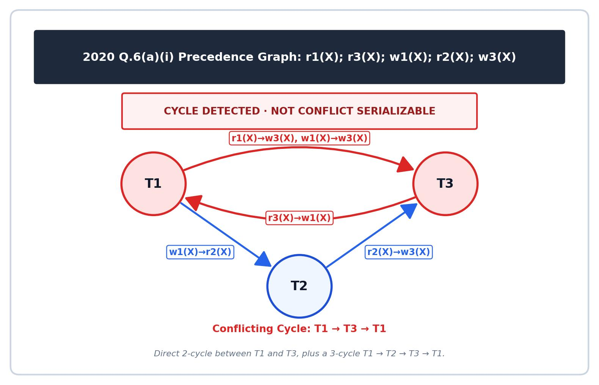

[← Prev: 2019](2019.md) | [Exam-Style Layer](../yearly_answers_exam_style/2020.md) | [Original Question Paper](../PreviousYearQuestion/2020.md) | [Next: 2021 →](2021.md)

---

# ECE 2215: Database Systems · Semester Final 2020 · Explanations

> [!info] Paper Metadata
> - **Examination:** B.Sc. Engineering 2nd Year Even Semester Examination, 2020
> - **Institution:** Rajshahi University of Engineering & Technology (RUET)
> - **Department:** Department of Electrical & Computer Engineering
> - **Curriculum Era:** Pre-OBE
> - **Full Marks:** 72 | **Time:** 3 Hours
> - **Instructions:** Answer any SIX questions taking THREE from each section.
> - **Question Count:** 20 sub-questions across Section A (11) and Section B (9)

---

## SECTION A

### Q.1(a) · 05 Marks

*Topic: [[../Topicwise_answers_explaination/T01_DB_Concepts_and_Architecture.md#T01.3 · Functions/roles of the DBA ("five functions"); relation schema|T01.3 · Functions/roles of the DBA ("five functions"); relation schema]] · Section A*

**Question.**
What are the five main functions of a database administrator? What is relation schema?

**Answer.**

**What the examiner wants.**  
The five official functions of a DBA (3 marks, following the exact terminology from Deck 01 Slide 10) and the definition of a relation schema with a formal example (2 marks).

**Key idea.**  
The Database Administrator (DBA) is the person with centralized control over the database system. The DBA handles both physical storage decisions and user authorization. A relation schema is the logical structural definition of a table (its blueprint).

**Step-by-step solution.**  
**Five Main Functions of a Database Administrator (DBA):**
1. **Schema definition:** The DBA creates the original database schema by executing DDL statements.
2. **Storage structure and access-method definition:** The DBA defines internal storage structures, indexing methods, and file organizations to optimize data access.
3. **Schema and physical-organization modification:** The DBA modifies database schemas and physical storage layouts to improve performance or adapt to changing business requirements.
4. **Granting of authorization for data access:** The DBA assigns access rights and user roles to regulate who can inspect or modify specific data items.
5. **Routine maintenance:** The DBA performs recurring operational tasks. These include periodically backing up the database, monitoring running jobs, and ensuring sufficient free disk space.

**Relation Schema:**  
A **relation schema** is the formal logical definition or blueprint of a relation (table). It specifies the name of the relation along with its set of attributes (columns) and their corresponding domains (data types).

- Format: $R(A_1, A_2, \dots, A_n)$
- Example: $\text{instructor}(\underline{\text{ID}}, \text{name}, \text{dept\_name}, \text{salary})$, where $\underline{\text{ID}}$ serves as the primary key.

*Variant for 2021 Q.1(b) (3 marks):* State and explain the five DBA functions above; omit the relation schema.  
*Variant for 2017 Q.1(c) (2 marks):* List only the names: (1) Schema definition, (2) Storage structure and access-method definition, (3) Schema and physical-organization modification, (4) Granting of authorization for data access, (5) Routine maintenance.

**Check.**  
*Quick self-test:*
- Q: What is the difference between a relation schema and a relation instance?  
  A: The schema is the logical definition (table design), while an instance is the actual data populated at a given moment.
- Q: Which DBA function ensures that the system does not run out of storage during operations?  
  A: Routine maintenance (monitoring disk space and upgrading storage).

> [!warning] Common mistakes
> - Inventing informal duties (like "writes SQL queries" or "enters user records") instead of using the five official functions from Deck 01 Slide 10.
> - Forgetting to provide a concrete schema example for the relation schema part.

**Exam tip.**  
Examiners check off the exact 5 headings from Slide 10. Write the exact headings and underline them.

**Sources.**  
- [Deck 01 · Slide 10](../LectureSlides/01_Intro_to_Database_and_DBMS.md)  
- [Deck 02 · Slide 6](../LectureSlides/02_Relational_Model.md)  
- [Textbook Ch. 1 §1.3.2, §1.8.2](../Textbook/Chapter_01_Introduction/Chapter%2001%20-%20Introduction.md)

---

### Q.1(b) · 03 Marks

*Topic: [[../Topicwise_answers_explaination/T01_DB_Concepts_and_Architecture.md#T01.7 · 2-tier vs 3-tier architecture; DB application structure|T01.7 · 2-tier vs 3-tier architecture; DB application structure]] · Section A*

**Question.**
Differentiate between the two-tier architecture and three-tier architecture of database. Which is better suited for web application? Why?

**Answer.**

**What the examiner wants.**  
Key differences between two-tier and three-tier database architectures (1.5 marks), and a definitive choice of three-tier for web applications with technical justification (1.5 marks).

**Key idea.**  
In two-tier systems, the client communicates directly with the database system. In three-tier systems, an application server sits between the client and the database. Web applications require three-tier architecture so client browsers remain lightweight and never access database ports directly.

**Step-by-step solution.**  
**Differences between Two-Tier and Three-Tier Architectures:**

| Feature | Two-Tier Architecture | Three-Tier Architecture |
| :--- | :--- | :--- |
| **Application Placement** | The application logic resides entirely on the client machine. | The client holds only the presentation layer. Application logic resides on an intermediate application server. |
| **Database Communication** | The client invokes database system calls directly over the network (using ODBC or JDBC). | The client communicates with the application server, which in turn contacts the database system. |
| **Client Overhead** | Thick (fat) client. Requires database drivers and business code installed on each client. | Thin client. Runs in a web browser or simple mobile interface. |


*Figure: Two-tier and three-tier database architectures (Deck 01, Slide 30)*

**Web Application Choice & Reason:**  
**Three-tier architecture is better suited for web applications.**
- **Reason:** Web clients (browsers) should remain thin and lightweight without direct database drivers. Placing application logic on an intermediate server protects database credentials behind firewalls and allows connection pooling for thousands of concurrent users.

**Check.**  
*Quick self-test:*
- Q: Where does business logic execute in a three-tier setup?  
  A: On the intermediate application server.
- Q: Why is two-tier unsuitable for internet-scale web apps?  
  A: Exposing database ports directly to clients is insecure, and managing thousands of direct database connections overwhelms the database server.

> [!warning] Common mistakes
> - Suggesting two-tier for web applications.
> - Forgetting to explain *why* three-tier is suited for web applications (security and thin client).

**Exam tip.**  
State your verdict in bold font: **Three-tier architecture is better suited for web applications.** Then supply the two key reasons: thin clients and security/connection pooling.

**Sources.**  
- [Deck 01 · Slides 29–30](../LectureSlides/01_Intro_to_Database_and_DBMS.md)  
- [Textbook Ch. 1 §1.7](../Textbook/Chapter_01_Introduction/Chapter%2001%20-%20Introduction.md)

---

### Q.1(c) · 04 Marks

*Topic: [[../Topicwise_answers_explaination/T02_ER_and_EER_Modeling.md#T02.3 · Mapping cardinality (1:1, 1:N, M:N) & participation constraints|T02.3 · Mapping cardinality (1:1, 1:N, M:N) & participation constraints]] · Section A*

**Question.**
What is mapping cardinalities? Define different types of cardinalities.

**Answer.**

**What the examiner wants.**  
Definition of mapping cardinalities (1 mark). Formal definitions and examples for each of the four binary cardinality ratios: 1:1, 1:N, N:1, and M:N (3 marks).

**Key idea.**  
Mapping cardinalities place limits on the number of relationship instances an entity can join. In a binary relationship between sets $A$ and $B$, arrows in the E-R diagram denote "one" and undirected lines denote "many".

**Step-by-step solution.**  
**Mapping Cardinality:**  
Mapping cardinality specifies how many entities from one entity set can be associated with entities from another entity set through a binary relationship set.

**Types of Mapping Cardinalities:**

1. **One-to-One (1:1):**
   - An entity in $A$ is associated with at most one entity in $B$, and an entity in $B$ is associated with at most one entity in $A$.
   - *Example:* A department has at most one head (`dept_head`).

2. **One-to-Many (1:N):**
   - An entity in $A$ is associated with any number (0 or more) of entities in $B$. An entity in $B$ is associated with at most one entity in $A$.
   - *Example:* An instructor advises many students, but each student has at most one advisor.

3. **Many-to-One (N:1):**
   - An entity in $A$ is associated with at most one entity in $B$. An entity in $B$ is associated with any number of entities in $A$.
   - *Example:* Many students belong to one department.

4. **Many-to-Many (M:N):**
   - An entity in $A$ is associated with any number of entities in $B$, and an entity in $B$ is associated with any number of entities in $A$.
   - *Example:* A student can register for multiple courses, and a course can contain multiple students.

*See also:* [[#2018 Q.1(c) · 05 Marks]] (tests participation constraints) and [[#CT-02 Q.02 · 10 Marks]] (identifies entities, keys, relationships, and cardinalities).

**Check.**  
*Quick self-test:*
- Q: How does Chen notation represent cardinality on relationship lines?  
  A: Either by writing "1", "N", "M" near the entity sets, or by drawing a directed arrow ($\rightarrow$) for "one" and an undirected line for "many".
- Q: If a student can have multiple advisors, does the relationship remain 1:N?  
  A: No, it becomes Many-to-Many (M:N).

> [!warning] Common mistakes
> - Writing vague descriptions like "one thing links to many things" without mentioning "at most one" and "zero or more".
> - Confusing Many-to-One with One-to-Many. They are simply directional mirrors of each other.

**Exam tip.**  
Use bullet points with the format: name, formal rule, and everyday university schema example.

**Sources.**  
- [Deck 05 · Slides 20–26](../LectureSlides/05_ER_Model.md)  
- [Textbook Ch. 6 §6.4](../Textbook/Chapter_06_ER_Model/Chapter%2006%20-%20Database%20Design%20Using%20the%20E-R%20Model.md)

---

### Q.2(a) · 06 Marks

*Topic: [[../Topicwise_answers_explaination/T04_Relational_Algebra_and_Calculus.md#T04.2 · Write RA queries on a given schema (incl. "only" queries → set difference, $\gamma$ count/max, RA modification/update)|T04.2 · Write RA queries on a given schema (incl. "only" queries → set difference, $\gamma$ count/max, RA modification/update)]] · Section A*

**Question.**
Consider the following relation schema:<br>&emsp;person(<u>id</u>, name, age)<br>&emsp;vaccine(<u>id</u>, center, dose_no, date)<br>Now give expression in relational algebra to express-<br>(i) Find the names of all persons who are adult.<br>(ii) Find the names of all persons who have taken the $1^{\text{st}}$ dose only.<br>(iii) Find the details of all persons who were given vaccine from "RMC" center and completed $2^{\text{nd}}$ dose.

**Answer.**

**What the examiner wants.**  
Three relational algebra expressions worth 2 marks each. Tests simple attribute filtering, the relational set difference operator ($-$) for an "only" query condition, and join filtering on multiple attributes.

**Key idea.**  
A person with two doses has a record for dose 1 and another record for dose 2. Selecting `dose_no = 1` alone will incorrectly return two-dose individuals. To find persons taking dose 1 *only*, subtract IDs with dose 2 from IDs with dose 1.

**Step-by-step solution.**

*Assumption: An adult is defined as a person with $\text{age} \ge 18$. The attribute `vaccine.id` references `person.id`.*

**(i) Names of all adult persons:**

Select persons with age 18 or older, then project their names:

$$
\boxed{\Pi_{\text{name}}(\sigma_{\text{age} \ge 18}(\text{person}))}
$$

**(ii) Names of all persons who have taken the $1^{\text{st}}$ dose only:**

1. Project the IDs of all persons who received dose 1:

$$
T_{\text{dose1}} \leftarrow \Pi_{\text{id}}(\sigma_{\text{dose\_no} = 1}(\text{vaccine}))
$$

2. Project the IDs of all persons who received dose 2:

$$
T_{\text{dose2}} \leftarrow \Pi_{\text{id}}(\sigma_{\text{dose\_no} = 2}(\text{vaccine}))
$$

3. Subtract $T_{\text{dose2}}$ from $T_{\text{dose1}}$ using set difference to keep persons with no second dose:

$$
T_{\text{only1}} \leftarrow T_{\text{dose1}} - T_{\text{dose2}}
$$

4. Join with `person` on `id` and project the names:

$$
\boxed{\Pi_{\text{name}}(\text{person} \bowtie T_{\text{only1}})}
$$

Equivalently, written as a single expression:

$$
\Pi_{\text{name}}(\text{person} \bowtie (\Pi_{\text{id}}(\sigma_{\text{dose\_no} = 1}(\text{vaccine})) - \Pi_{\text{id}}(\sigma_{\text{dose\_no} = 2}(\text{vaccine}))))
$$

**(iii) Details of all persons vaccinated from "RMC" center who completed $2^{\text{nd}}$ dose:**

1. Filter the `vaccine` table for center "RMC" and dose number 2:

$$
T_{\text{rmc2}} \leftarrow \sigma_{\text{center} = \text{"RMC"} \land \text{dose\_no} = 2}(\text{vaccine})
$$

2. Natural join with `person` on `id`:

$$
\boxed{\text{person} \bowtie T_{\text{rmc2}}}
$$

To restrict output to person attributes only:

$$
\Pi_{\text{person.id}, \text{name}, \text{age}}(\text{person} \bowtie T_{\text{rmc2}})
$$

**Check.**  
Sample data:
- `person`: `(1, "Rahim", 25)`, `(2, "Karim", 17)`, `(3, "Sara", 30)`.
- `vaccine`: `(1, "RMC", 1, "2021-01")`, `(1, "RMC", 2, "2021-02")`, `(3, "DMC", 1, "2021-01")`.

- Part (i): Rahim and Sara have age $\ge 18$. Output: `{"Rahim", "Sara"}`.
- Part (ii): $T_{\text{dose1}} = \{1, 3\}$. $T_{\text{dose2}} = \{1\}$. Difference $\{1, 3\} - \{1\} = \{3\}$. Join yields `{"Sara"}`. Rahim is excluded because he completed dose 2.
- Part (iii): Rahim matches RMC and dose 2. Join retrieves Rahim's full record.

> [!warning] Common mistakes
> - Writing $\sigma_{\text{dose\_no} = 1}(\text{vaccine})$ for part (ii). Rahim took dose 1 and dose 2. Filtering for dose 1 alone includes him, violating the requirement of taking dose 1 *only*.
> - Attempting set difference between `person` and `vaccine` directly. Set difference requires identical arity and compatible attribute domains. You must project to `id` first.
> - Forgetting to define what makes a person an adult. Always write an assumption line stating $\text{age} \ge 18$.

**Exam tip.**  
When an exam query says "only", use relational set difference ($-$). Subtract the forbidden set from the desired set.

**Sources.**  
`[Lecture Deck 02 · Slides 11–24](../LectureSlides/02_Relational_Model.md)`  
`[Textbook Ch. 2 §2.6](../Textbook/Chapter_02_Relational_Model/Chapter%2002%20-%20Introduction%20to%20the%20Relational%20Model.md)`

---

### Q.2(b) · 04 Marks

*Topic: [[../Topicwise_answers_explaination/T03_Relational_Model_Keys_and_Integrity.md#T03.2 · Keys: super / candidate / primary / alternate / composite / foreign|T03.2 · Keys: super / candidate / primary / alternate / composite / foreign]] · Section A*

**Question.**
Write short note about: Super Key, Candidate Key, Primary Key, and Foreign Key.

**Answer.**

**What the examiner wants.**  
Four distinct short notes. The mark split is 1 mark per key. Each short note must provide a definition, its core technical property, and a concrete example.

**Key idea.**  
Do not write long essays for short notes. Provide a clean structure for each key: Definition, Key Property, and Example using a single table.

**Step-by-step solution.**  
**1. Super Key:**
- **Definition:** A set of one or more attributes that uniquely identifies a tuple in a relation.
- **Features:** It can have extra attributes. If $K$ is a super key, any superset of $K$ is also a super key.
- **Example:** In $\text{Student}(\underline{\text{student\_id}}, \text{name}, \text{email}, \text{dept\_name})$, both $\{\text{student\_id}\}$ and $\{\text{student\_id}, \text{name}\}$ are super keys.

**2. Candidate Key:**
- **Definition:** A minimal super key. No proper subset can uniquely identify a tuple.
- **Features:** It has zero redundant attributes. A table can have multiple candidate keys.
- **Example:** Both $\{\text{student\_id}\}$ and $\{\text{email}\}$ are candidate keys for $\text{Student}$.

**3. Primary Key:**
- **Definition:** The specific candidate key chosen by the database designer to identify rows.
- **Features:** Must be unique and cannot contain NULL (`NOT NULL`). It should rarely or never change.
- **Example:** $\{\text{student\_id}\}$ is chosen as the primary key of $\text{Student}$.

**4. Foreign Key:**
- **Definition:** An attribute in a referencing table that matches the primary key of a referenced table.
- **Features:** It enforces referential integrity. Every value must match an existing parent key or be NULL.
- **Example:** `dept_name` in $\text{Student}$ is a foreign key referencing $\text{Department}(\text{dept\_name})$.

**Check.**  
*Self-test check:*
- Can a candidate key contain NULL values? Yes, in SQL unique columns, unless constrained `NOT NULL`.
- Can a primary key contain NULL values? Never. Relational theory and SQL standards forbid NULLs in primary keys.
- Can a foreign key be NULL? Yes, indicating an unassigned or optional relationship.

> [!warning] Common mistakes
> - Writing unstructured text blocks with missing examples.
> - Defining candidate key vaguely instead of emphasizing the minimality condition.
> - Forgetting to mention that foreign keys connect child tables to parent primary keys.

**Exam tip.**  
Spend about 2.5 minutes per note. Keep all examples rooted in the same `Student` table to save precious exam time.

**Sources.**  
- [Deck 02 · Slide 7](../LectureSlides/02_Relational_Model.md)  
- [Deck 06 · Slide 11](../LectureSlides/06_DBMS_Normalization.md)  
- [Textbook Ch. 2 §2.3](../Textbook/Chapter_02_Relational_Model/Chapter%2002%20-%20Introduction%20to%20the%20Relational%20Model.md)

---

### Q.2(c) · 02 Marks

*Topic: [[../Topicwise_answers_explaination/T02_ER_and_EER_Modeling.md#T02.4 · Weak vs strong entity sets (discriminator, identifying relationship)|T02.4 · Weak vs strong entity sets (discriminator, identifying relationship)]] · Section A*
*(Repeated question: Also asked in 2018 | Solved in T02)*

**Question.**
Explain the difference between a weak and a strong entity set with appropriate example.

**Answer.**

**What the examiner wants.**  
Definition of an entity set (1 mark). Comprehensive comparison and explanation of strong vs weak entity sets (2 marks). Concrete examples showing the identifying relationship, discriminator, and composite primary key (1 mark).

**Key idea.**  
A strong entity set has enough attributes to tell every record apart. A weak entity set does not. A weak entity depends on an owner entity for its existence and identity. Its key is formed by taking the owner's primary key and attaching its own partial key (discriminator).

**Step-by-step solution.**  
**Entity Set:**  
An entity set is a collection of entities of the same type that share the same properties or attributes (e.g., the set of all students in a university).

| Feature | Strong Entity Set | Weak Entity Set |
| :--- | :--- | :--- |
| **Primary Key** | Has sufficient attributes to form its own primary key. | Lacks a primary key of its own. Uses a partial key (discriminator). |
| **Existence Dependency** | Independent. Does not depend on another entity set. | Existence-dependent on an identifying (strong) entity set. |
| **E-R Notation** | Single rectangle. | Double rectangle. |
| **Relationship Set** | Connected via regular relationship (single diamond). | Connected via identifying relationship (double diamond). |
| **Discriminator Key** | None (uses full primary key underlined with solid line). | Has a discriminator underlined with a dashed line. |
| **Composite PK** | Its own primary key. | Formed by (Owner Primary Key + Discriminator). |
| **Example** | `course` with primary key `course_id`. | `section` with discriminator `sec_id`, `semester`, `year`. |


*Figure: Expressing Weak Entity Sets in ER Diagram (Deck 05, Slide 37)*

- **Strong Entity Set Example:** `course` has attributes `course_id` (PK), `title`, `credits`. It exists independently.
- **Weak Entity Set Example:** `section` has attributes `sec_id`, `semester`, `year`. A section number like `Sec 1` is meaningless without knowing the course. Its full primary key is `(course_id, sec_id, semester, year)`.

*Short version for 2020 Q.2(c) and 2021 Q.8(c) (2 marks):*  
State the comparison table rows (Primary Key, Dependency, Notation, Example) and omit the separate entity set definition.

**Check.**  
*Quick self-test:*
- Q: What happens to a section tuple if the corresponding course tuple is deleted?  
  A: Because the section is existence-dependent, the section tuple must also be deleted (cascading delete).
- Q: How is a discriminator underlined in an E-R diagram?  
  A: With a dashed line.

> [!warning] Common mistakes
> - Thinking a weak entity set has no key attributes at all. It does have a discriminator (partial key).
> - Forgetting the double diamond for the identifying relationship. Drawing a single diamond loses marks.

**Exam tip.**  
Always mention the standard textbook example (`course` and `section`). Show the exact composite primary key formula.

**Sources.**  
- [Deck 05 · Slides 34–37](../LectureSlides/05_ER_Model.md)  
- [Textbook Ch. 6 §6.5](../Textbook/Chapter_06_ER_Model/Chapter%2006%20-%20Database%20Design%20Using%20the%20E-R%20Model.md)

---

### Q.3(a) · 02 Marks

*Topic: [[../Topicwise_answers_explaination/T02_ER_and_EER_Modeling.md#T02.8 · EER: aggregation|T02.8 · EER: aggregation]] · Section A*
*(Repeated question: Also asked in 2018 | Solved in T02)*

**Question.**
What is aggregation in ER-model design?

**Answer.**

**What the examiner wants.**  
Definition of aggregation (1 mark). Two concrete real-world examples explaining why aggregation is useful to avoid redundancy (2 marks).

**Key idea.**  
In standard E-R modeling, relationships cannot connect to other relationships. Aggregation solves this limitation. It wraps a relationship and its entities into a single abstract entity box, allowing other relationships to link to it directly.

**Step-by-step solution.**  
**Definition:**  
Aggregation is an abstraction in E-R modeling through which a relationship set is treated as a higher-level abstract entity set. This allows the relationship itself to participate in further relationships with other entity sets without duplicating attributes.


*Figure: Aggregation Representation in E-R Diagram (Deck 05, Slide 59)*

**Two Examples Where Aggregation is Useful:**

1. **Student Project Evaluation:**  
   The ternary relationship `proj_guide` associates `student`, `instructor`, and `project`. To record an `evaluation` for that specific guidance assignment, treating `proj_guide` as an aggregate entity avoids creating an overlapping ternary relationship. `evaluation` links directly to the aggregate `proj_guide` through the relationship `eval_for`.

2. **Employee Project Monitoring:**  
   Employees work on projects via the relationship `Works_On`. A manager needs to monitor that specific work assignment. By aggregating `Works_On` into an entity, the `manager` can participate in a relationship `Monitors` directly with the aggregate entity `(Employee, Project)`.

*Short version for 2020 Q.3(a) (2 marks):*  
Give the definition of aggregation and describe Example 1 (`proj_guide` with `eval_for`) in 2 lines.

**Check.**  
*Relational schema check for aggregation:*
- Aggregated relationship `proj_guide`: attributes `(s_id, project_id, i_id)`.
- Connecting relationship `eval_for`:
  $$
  \text{eval\_for}(\underline{\text{s\_id}}, \underline{\text{project\_id}}, \underline{\text{i\_id}}, \underline{\text{evaluation\_id}})
  $$
- This avoids duplicating the `proj_guide` relationship table.

> [!warning] Common mistakes
> - Confusing aggregation in E-R modeling with SQL aggregate functions (`COUNT`, `SUM`, `AVG`). In E-R modeling, aggregation means treating a relationship as an entity.
> - Drawing a relationship directly connected to another relationship diamond without enclosing it in an aggregate entity rectangle.

**Exam tip.**  
Define the concept clearly, mention the dashed/bounding rectangle around the relationship, and use the project guidance evaluation example from Deck 05 Slide 59.

**Sources.**  
- [Deck 05 · Slides 57–60](../LectureSlides/05_ER_Model.md)  
- [Textbook Ch. 6 §6.8.5](../Textbook/Chapter_06_ER_Model/Chapter%2006%20-%20Database%20Design%20Using%20the%20E-R%20Model.md)

---

[← Prev: T01 · DB Concepts and Architecture](T01_DB_Concepts_and_Architecture.md) | [Exam-style layer](../Topicwise_answers_exam_style/T02_ER_and_EER_Modeling.md) | [Next: T03 · Relational Model, Keys & Integrity →](T03_Relational_Model_Keys_and_Integrity.md)

---

### Q.3(b) · 10 Marks

*Topic: [[../Topicwise_answers_explaination/T05_SQL_DDL_DML_Aggregates_Subqueries.md#T05.7 · Multi-table business-schema query sets (MySQL): Covid, Company, Insurance, E-commerce|T05.7 · Multi-table business-schema query sets (MySQL): Covid, Company, Insurance, E-commerce]] · Section A*

**Question.**
Consider the following company database schema.<br>&emsp;employee(<u>ssn</u>, fname, lname, DoB, Address, Sex, Salary, dept_no)<br>&emsp;department(<u>dnumber</u>, dname, mgr_ssn, mgr_start_date)<br>&emsp;dept_location(<u>dnumber</u>, <u>dlocation</u>)<br>&emsp;project(<u>pnumber</u>, pname, dnum)<br>&emsp;works_on(<u>essn</u>, <u>pno</u>, hours)<br>&emsp;dependent(<u>essn</u>, <u>dependent_name</u>, Sex, DoB, relationship)<br>Now write down the MySQL query for the followings.<br>(i) For each department whose average salary is more than \$30,000, retrieve the department_name and the number of employees working for that department.<br>(ii) Find the names of all employees who are working on project number "5" and are from the same department.<br>(iii) Find the number of dependent people of those employees who are from "H&R" department.

**Answer.**

**What the examiner wants.**  
Three enterprise-schema queries (parts (i) and (ii) worth ~3.5 marks, part (iii) worth ~3 marks):  
1. Grouping by department, counting employees, and filtering with `HAVING AVG(Salary) > 30000`.  
2. Joining employee, assignment (`works_on`), and project tables while enforcing that the employee's department matches the project's controlling department (`dnum`).  
3. Counting dependents across joined tables for employees in a specific named department ('H&R').

**Key idea.**  
Complex relational databases separate entities into normalized tables. Queries require traversing relationships: employee to department via `dept_no = dnumber`, employee to project via `works_on`, and employee to dependents via `essn = ssn`.

**Step-by-step solution.**  
*(i) Department name and employee count for departments with average salary > \$30,000:*

```sql
SELECT d.dname AS department_name,
       COUNT(e.ssn) AS number_of_employees
FROM department d
JOIN employee e ON d.dnumber = e.dept_no
GROUP BY d.dnumber, d.dname
HAVING AVG(e.Salary) > 30000;
```

*(ii) Names of employees working on project 5 who belong to the department controlling project 5:*

*Assumption: "from the same department" means the employee's department matches the department controlling project 5 (e.dept_no = p.dnum).*

```sql
SELECT e.fname, e.lname
FROM employee e
JOIN works_on w ON e.ssn = w.essn
JOIN project p ON w.pno = p.pnumber
WHERE p.pnumber = 5
  AND e.dept_no = p.dnum;
```

*(iii) Total number of dependents for employees in the "H&R" department:*

```sql
SELECT COUNT(dp.dependent_name) AS total_dependents
FROM dependent dp
JOIN employee e ON dp.essn = e.ssn
JOIN department d ON e.dept_no = d.dnumber
WHERE d.dname = 'H&R';
```

**Check.**  
*Trace of part (ii):*
- Employee A (`dept_no = 1`) works on Project 5 (`dnum = 1`). `1 = 1` matches $\implies$ included.
- Employee B (`dept_no = 2`) works on Project 5 (`dnum = 1`). `2 = 1` does not match $\implies$ excluded (working on the project from a different department).
The predicate `e.dept_no = p.dnum` correctly enforces departmental affiliation.

> [!warning] Common mistakes
> - Putting `AVG(e.Salary) > 30000` in the `WHERE` clause instead of `HAVING`.
> - Counting `COUNT(*)` in part (iii) when using a `LEFT JOIN`; if an employee has zero dependents, `COUNT(*)` would count 1 row for that employee. Using `COUNT(dp.dependent_name)` correctly counts 0.
> - Missing the department match condition `e.dept_no = p.dnum` in part (ii).

**Exam tip.**  
When a question says "from the same department" regarding a project, connect the employee's `dept_no` with the project's controlling department attribute `dnum`.

**Sources.**  
[Deck 03 · Slides 18–19, 30–34](../LectureSlides/03_Introduction_to_SQL.md), [Textbook Ch. 3 §3.4, §3.7](../Textbook/Chapter_03_Intro_SQL/Chapter%2003%20-%20Introduction%20to%20SQL.md).

---

### Q.4(a) · 04 Marks

*Topic: [[../Topicwise_answers_explaination/T13_Security_Indexing_and_Hashing.md#T13.2 · SQL injection: how it works + prevention|T13.2 · SQL injection: how it works + prevention]] · Section A*
*(Repeated question: Also asked in 2021 | Solved in T13)*

**Question.**
What is an SQL injection attack? Explain how it works and what precautions must be taken to prevent SQL injection attack.

**Answer.**

**What the examiner wants.**  
Definition of SQL injection (1 mark), a concrete example of how the attack operates (1.5 to 2 marks), and comprehensive technical precautions for prevention (2 marks).

**Key idea.**  
SQL injection happens because the database cannot tell code apart from data when strings are glued together. Prepared statements separate the code structure (precompiled query plan) from the data (parameters). Even if a parameter contains SQL keywords or quotes, the database treats it only as a literal string.

**Step-by-step solution.**  

**1. What is an SQL Injection Attack?**  
An **SQL injection attack** occurs when an attacker inputs malicious SQL commands into an application input field. The application concatenates this untrusted input directly into a dynamic SQL query string. The database parser interprets the malicious input as SQL instructions rather than data. This allows the attacker to bypass authentication, read unauthorized data, or modify and delete tables.

**2. How It Works**  
Consider an application that builds a query using string concatenation:

```python
# Vulnerable query construction
query = "SELECT * FROM instructor WHERE name = '" + user_input + "'"
```

- **Scenario 1: Authentication Bypass / Data Dumping**
  - **Attacker input:** `' OR '1'='1`
  - **Resulting SQL:**
    ```sql
    SELECT * FROM instructor WHERE name = '' OR '1'='1';
    ```
  - **Mechanism:** The quote closes the name literal. The `'1'='1'` condition is always true. The database returns all records in the `instructor` table.

- **Scenario 2: Destructive Attack (Piggybacked Query)**
  - **Attacker input:** `'; DROP TABLE student; -- `
  - **Resulting SQL:**
    ```sql
    SELECT * FROM instructor WHERE name = ''; DROP TABLE student; -- ';
    ```
  - **Mechanism:** The semicolon terminates the first query. The database engine executes the injected `DROP TABLE student` statement. The trailing `--` treats the remaining query syntax as a comment.

**3. Precautions to Prevent SQL Injection**  

1. **Use Prepared Statements (Parameterized Queries):**
   This is the primary defense. The application precompiles the SQL query structure with placeholders. User input is bound separately as data parameters. The parser never executes parameter content as SQL commands.
   ```python
   # Secure parameterized query
   cursor.execute("SELECT * FROM instructor WHERE name = %s", (user_input,))
   ```
   In Java/JDBC, use `PreparedStatement` with `?` markers and `setString()`.

2. **Input Validation and Whitelisting:**
   Validate data types, lengths, and patterns before passing them to queries. For dynamic query parts like table or column names that cannot use parameters, check input against an explicit whitelist of allowed identifiers.

3. **Enforce Least Privilege:**
   Configure database user accounts with minimal necessary privileges. A public web application account should only have `SELECT` or `INSERT` access. It must never have administrative permissions like `DROP TABLE` or `GRANT`.

4. **Use Parameterized Stored Procedures:**
   Wrap database operations inside stored procedures with typed parameters. Do not concatenate dynamic SQL inside the stored procedure body.

5. **Suppress Database Error Messages:**
   Hide internal database error details, table names, and stack traces from end users. Display generic error pages instead.

*Short version for 2020 Q.4(a) (4 marks):* Provide the definition, the `' OR '1'='1` exploit example, and the three core precautions: prepared statements, input validation, and least privilege.

**Check.**  
*Replaying the attack in a prepared statement:*
- If an attacker submits `' OR '1'='1` into `cursor.execute("SELECT * FROM instructor WHERE name = %s", (user_input,))`, the database searches for an instructor whose literal name is the exact 10-character string `' OR '1'='1`.
- Because no instructor has that literal name, the query safely returns 0 rows.

*Quick self-test:*
- Q: Why is escaping quotes less reliable than prepared statements?  
  A: Hand-crafted escaping functions often miss edge cases, like second-order injection or multibyte character encodings.
- Q: Can prepared statements parameterize table names or `ORDER BY` columns?  
  A: No. SQL parameters only work for data literals. Table and column names must be validated against a strict whitelist.

> [!warning] Common mistakes
> - Confusing SQL injection with cross-site scripting (XSS). XSS executes scripts in the user browser; SQL injection executes queries in the database engine.
> - Claiming that client-side validation (like HTML5 form attributes) prevents SQL injection. Attackers bypass browsers completely using tools like `curl`.
> - Forgetting to show both the input string and the resulting modified SQL statement.

**Exam tip.**  
Always show the input `' OR '1'='1` and the resulting query where `'1'='1'` makes the `WHERE` clause tautological. This guarantees full marks on "how it works".

**Sources.**  
`[Textbook Ch. 9 §9.8.1](../Textbook/Chapter_09_App_Development/Chapter%2009%20-%20Application%20Development.md)`  
`[Textbook Ch. 5 §5.1.1.5](../Textbook/Chapter_05_Advanced_SQL/Chapter%2005%20-%20Advanced%20SQL.md)`

---

### Q.4(b) · 03 Marks

*Topic: [[../Topicwise_answers_explaination/T04_Relational_Algebra_and_Calculus.md#T04.5 · Domain relational calculus (and division $\div$)|T04.5 · Domain relational calculus (and division $\div$)]] · Section A*

**Question.**
Let that, $R=(A, B, C)$ and $r_1$, $r_2$ both be relations on the schema R. Give an expression in the domain relational calculus that is equivalent to each of the followings.<br>(i) $\pi_A(r_1)$<br>(ii) $r_1 \cup r_2$<br>(iii) $r_1 \cap r_2$

**Answer.**

**What the examiner wants.**  
Three Domain Relational Calculus (DRC) expressions worth 1 mark each. Evaluates the ability to translate projection, union, and intersection from relational algebra into predicate formulas over domain variables.

**Key idea.**  
Domain relational calculus uses domain variables corresponding to relation attributes rather than whole-tuple variables. A query expression has the form:

$$
\{\, \langle x_1, x_2, \dots, x_n \rangle \mid P(x_1, x_2, \dots, x_n) \,\}
$$

For a schema $R = (A, B, C)$, each relation instance consists of 3-tuples $\langle a, b, c \rangle$. Projection uses the existential quantifier ($\exists$) to bind omitted attributes. Union uses logical disjunction ($\lor$). Intersection uses logical conjunction ($\land$).

**Step-by-step solution.**

Let domain variables $a, b, c$ range over the domains of attributes $A, B, C$ respectively.

**(i) Domain calculus for $\pi_A(r_1)$:**

1. Projecting attribute $A$ produces a 1-attribute result tuple $\langle a \rangle$.
2. Attributes $B$ and $C$ do not appear in the result. We bind them using existential quantifiers:

$$
\boxed{\{\, \langle a \rangle \mid \exists b, c \; (\langle a, b, c \rangle \in r_1) \,\}}
$$

This formula states: "the set of all values $a$ such that there exist values $b$ and $c$ where $\langle a, b, c \rangle$ is a tuple in $r_1$."

**(ii) Domain calculus for $r_1 \cup r_2$:**

1. The union produces 3-tuples $\langle a, b, c \rangle$.
2. A tuple belongs to $r_1 \cup r_2$ if it belongs to $r_1$, or to $r_2$, or to both. We express this using logical disjunction ($\lor$):

$$
\boxed{\{\, \langle a, b, c \rangle \mid \langle a, b, c \rangle \in r_1 \lor \langle a, b, c \rangle \in r_2 \,\}}
$$

**(iii) Domain calculus for $r_1 \cap r_2$:**

1. The intersection produces 3-tuples $\langle a, b, c \rangle$.
2. A tuple belongs to $r_1 \cap r_2$ if and only if it belongs to both relations simultaneously. We express this using logical conjunction ($\land$):

$$
\boxed{\{\, \langle a, b, c \rangle \mid \langle a, b, c \rangle \in r_1 \land \langle a, b, c \rangle \in r_2 \,\}}
$$

**Check.**  
Quick self-test:
- **Q:** How does Domain Relational Calculus differ from Tuple Relational Calculus?  
  **A:** DRC uses individual domain variables $\langle a, b, c \rangle$ for each column. TRC uses a single tuple variable $t$ and attribute lookups like $t[A]$.
- **Q:** Why is an existential quantifier needed in part (i)?  
  **A:** The output tuple has arity 1 ($\langle a \rangle$). Variables $b$ and $c$ must be bound by $\exists b, c$ so the formula evaluates to true whenever at least one matching tuple exists in $r_1$.
- **Q:** Are these expressions safe?  
  **A:** Yes. Every variable in the result tuple is restricted to values that appear in the domains of relation $r_1$ or $r_2$.

> [!warning] Common mistakes
> - Writing Tuple Relational Calculus instead of Domain Relational Calculus. Writing $\{ t \mid t \in r_1 \lor t \in r_2 \}$ is TRC, not DRC.
> - Forgetting the existential quantifier $\exists b, c$ in projection. Writing $\{ \langle a \rangle \mid \langle a, b, c \rangle \in r_1 \}$ leaves $b$ and $c$ unbound, making the formula invalid.
> - Writing curly braces or angle brackets incorrectly. In DRC, the tuple of domain variables uses angle brackets $\langle \dots \rangle$ inside the set definition.

**Exam tip.**  
Always match the arity of the angle-bracketed domain variables on the left of the vertical bar to the arity of the resulting relation.

**Sources.**  
`[Lecture Deck 02 · Slides 9–10](../LectureSlides/02_Relational_Model.md)`  
`[Textbook Ch. 2 §2.6](../Textbook/Chapter_02_Relational_Model/Chapter%2002%20-%20Introduction%20to%20the%20Relational%20Model.md)`

---

[← Prev: T03 · Relational Model, Keys and Integrity](T03_Relational_Model_Keys_and_Integrity.md) | [Exam-style layer](../Topicwise_answers_exam_style/T04_Relational_Algebra_and_Calculus.md) | [Next: T05 · SQL (DDL, DML, Aggregates, Subqueries) →](T05_SQL_DDL_DML_Aggregates_Subqueries.md)

---

### Q.4(c) · 05 Marks

*Topic: [[../Topicwise_answers_explaination/T06_Joins_and_Views.md#T06.2 · Join outcome tables (natural/left/right/full on given data; MySQL has no `FULL OUTER JOIN` → `LEFT` $\cup$ `RIGHT`)|T06.2 · Join outcome tables (natural/left/right/full on given data; MySQL has no `FULL OUTER JOIN` → `LEFT` $\cup$ `RIGHT`)]] · Section A*

**Question.**
Consider the following tables:<br><br><table style="border: none; border-collapse: collapse; margin-top: 6px; margin-bottom: 6px;"><tr style="border: none; vertical-align: top;"><td style="border: none; padding-right: 25px;"><b>Courses</b><br><table border="1" style="border-collapse: collapse; text-align: center; margin-top: 4px;"><thead><tr><th style="padding: 3px 8px;">Code</th><th style="padding: 3px 8px;">Series</th><th style="padding: 3px 8px;">t code</th></tr></thead><tbody><tr><td>ECE 2215</td><td>2017</td><td>T1</td></tr><tr><td>ECE 4127</td><td>2016</td><td>T2</td></tr><tr><td>ECE 1203</td><td>2019</td><td>T3</td></tr><tr><td>ECE 2219</td><td>2017</td><td>T2</td></tr></tbody></table></td><td style="border: none;"><b>Teacher</b><br><table border="1" style="border-collapse: collapse; text-align: center; margin-top: 4px;"><thead><tr><th style="padding: 3px 8px;">t code</th><th style="padding: 3px 8px;">Designation</th></tr></thead><tbody><tr><td>T1</td><td>Head</td></tr><tr><td>T2</td><td>Professor</td></tr><tr><td>T3</td><td>Lecturer</td></tr><tr><td>T4</td><td>Lecturer</td></tr></tbody></table></td></tr></table><br>What will happen when the following actions will be performed on these two relations?<br>(i) Natural Join<br>(ii) Left Outer Join<br>(iii) Right Outer Join<br>(iv) Full Outer Join

**Answer.**

**What the examiner wants.**  
The exact resulting relations for all four join operations on the given instance (about 1.25 marks per sub-question). Examiners verify correct attributes, accurate row counts, and proper `NULL` values.

**Key idea.**  
Both relations share the join attribute `t code`. In Courses, the teacher codes are T1, T2, and T3 (T2 appears twice). In Teacher, the codes are T1, T2, T3, and T4. Every course has a matching teacher. But teacher T4 has no courses assigned. Natural and left joins produce 4 rows. Right and full joins preserve T4 with `NULL` in the course columns, giving 5 rows.

**Step-by-step solution.**

*Assumption: The attribute "t code" is the common join key between Courses and Teacher.*

The common attribute is `t code`. In SQL statements, it is written as `` `t code` ``.

#### (i) Natural Join
Matches tuples where `t code` is identical and outputs one copy of `t code`.

Relational algebra:
$$
\text{Courses} \bowtie \text{Teacher}
$$

MySQL query:
```sql
SELECT Code, Series, `t code`, Designation
FROM Courses
NATURAL JOIN Teacher;
```

**Outcome Table (4 rows):**

| Code | Series | t code | Designation |
| :--- | :--- | :--- | :--- |
| ECE 2215 | 2017 | T1 | Head |
| ECE 4127 | 2016 | T2 | Professor |
| ECE 1203 | 2019 | T3 | Lecturer |
| ECE 2219 | 2017 | T2 | Professor |

*Explanation:* Every course has a matching teacher. T4 in Teacher has no course, so it is omitted.

---

#### (ii) Left Outer Join
Preserves all rows from the left table (**Courses**). Missing right attributes get `NULL`.

Relational algebra:
$$
\text{Courses} \mathbin{⟕} \text{Teacher}
$$

MySQL query:
```sql
SELECT Courses.Code, Courses.Series, Courses.`t code`, Teacher.Designation
FROM Courses
LEFT JOIN Teacher ON Courses.`t code` = Teacher.`t code`;
```

**Outcome Table (4 rows):**

| Code | Series | t code | Designation |
| :--- | :--- | :--- | :--- |
| ECE 2215 | 2017 | T1 | Head |
| ECE 4127 | 2016 | T2 | Professor |
| ECE 1203 | 2019 | T3 | Lecturer |
| ECE 2219 | 2017 | T2 | Professor |

*Explanation:* All `t code` values in Courses (T1, T2, T3) exist in Teacher. No `NULL` padding is needed. The result matches the Natural Join.

---

#### (iii) Right Outer Join
Preserves all rows from the right table (**Teacher**). Unmatched rows get `NULL` in Courses columns.

Relational algebra:
$$
\text{Courses} \mathbin{⟖} \text{Teacher}
$$

MySQL query:
```sql
SELECT Courses.Code, Courses.Series, Teacher.`t code`, Teacher.Designation
FROM Courses
RIGHT JOIN Teacher ON Courses.`t code` = Teacher.`t code`;
```

**Outcome Table (5 rows):**

| Code | Series | t code | Designation |
| :--- | :--- | :--- | :--- |
| ECE 2215 | 2017 | T1 | Head |
| ECE 4127 | 2016 | T2 | Professor |
| ECE 2219 | 2017 | T2 | Professor |
| ECE 1203 | 2019 | T3 | Lecturer |
| `NULL` | `NULL` | T4 | Lecturer |

*Explanation:* Teacher T4 has no matching course. It appears with `NULL` for `Code` and `Series`.

---

#### (iv) Full Outer Join
Retains all rows from both tables. Missing attributes from either side are padded with `NULL`.

Relational algebra:
$$
\text{Courses} \mathbin{⟗} \text{Teacher}
$$

MySQL query:
```sql
SELECT Courses.Code, Courses.Series, Courses.`t code`, Teacher.Designation
FROM Courses
LEFT JOIN Teacher ON Courses.`t code` = Teacher.`t code`
UNION
SELECT Courses.Code, Courses.Series, Teacher.`t code`, Teacher.Designation
FROM Courses
RIGHT JOIN Teacher ON Courses.`t code` = Teacher.`t code`;
```

**Outcome Table (5 rows):**

| Code | Series | t code | Designation |
| :--- | :--- | :--- | :--- |
| ECE 2215 | 2017 | T1 | Head |
| ECE 4127 | 2016 | T2 | Professor |
| ECE 2219 | 2017 | T2 | Professor |
| ECE 1203 | 2019 | T3 | Lecturer |
| `NULL` | `NULL` | T4 | Lecturer |

*Explanation:* Combines all matching rows plus unmatched teacher T4 with `NULL` values.

**Check.**  
*Tuple count verification:*
- Courses has 4 tuples; Teacher has 4 tuples.
- Matched pairs on `t code`: (ECE 2215, T1), (ECE 4127, T2), (ECE 2219, T2), (ECE 1203, T3). Total = 4 matched tuples.
- Unmatched Courses tuples: 0.
- Unmatched Teacher tuples: 1 (T4).
- Natural Join rows = 4.
- Left Outer Join rows = $4 + 0 = 4$.
- Right Outer Join rows = $4 + 1 = 5$.
- Full Outer Join rows = $4 + 0 + 1 = 5$.

> [!warning] Common mistakes
> - Writing empty spaces instead of explicit `NULL` for missing attributes.
> - Repeating `t code` twice in the Natural Join output table.
> - Omitting the second row for teacher T2 (ECE 2219). Both course rows must appear.

**Exam tip.**  
Always count the tuples before drawing the tables. If all left tuples find a match, the Left Outer Join result is identical to the Natural Join.

**Sources.**  
- [Deck 04 · Slides 5–11, 14–18](../LectureSlides/04_Joining_and_Views.md)  
- [Textbook Ch. 4 §4.1](../Textbook/Chapter_04_Intermediate_SQL/Chapter%2004%20-%20Intermediate%20SQL.md)

---

## SECTION B

### Q.5(a) · 04 Marks

*Topic: [[../Topicwise_answers_explaination/T02_ER_and_EER_Modeling.md#T02.2 · Attribute types (simple/composite, single/multivalued, derived)|T02.2 · Attribute types (simple/composite, single/multivalued, derived)]] · Section B*

**Question.**
Differentiate between-<br>(i) Simple and composite attribute<br>(ii) Single-valued and multi-valued attribute

**Answer.**

**What the examiner wants.**  
Clear pairwise distinctions: 2 marks for simple vs composite, and 2 marks for single-valued vs multi-valued. The examiner looks for definitions, divisibility, storage impact, and concrete examples.

**Key idea.**  
Attributes describe entities. Some attributes are indivisible (simple), while others contain smaller subparts (composite). Similarly, some attributes hold only one value per record (single-valued), while others can hold a set of values (multi-valued).

**Step-by-step solution.**  
**(i) Simple vs Composite Attribute:**

| Feature | Simple (Atomic) Attribute | Composite Attribute |
| :--- | :--- | :--- |
| **Definition** | Cannot be divided into smaller subparts. | Can be divided into smaller subparts that form independent attributes. |
| **Structure** | Holds a single atomic value from its domain. | Forms a hierarchy of component attributes. |
| **E-R Notation** | Single ellipse connected to the entity rectangle. | An ellipse connected to component ellipses. |
| **Storage / Schema** | Maps to a single column in a relational table. | Flattened into separate columns for each subpart. |
| **Example** | `salary`, `student_id`, `credits` | `name` (`first_name`, `last_name`), `address` (`street`, `city`, `zip_code`) |

**(ii) Single-Valued vs Multi-Valued Attribute:**

| Feature | Single-Valued Attribute | Multi-Valued Attribute |
| :--- | :--- | :--- |
| **Definition** | Holds at most one value for a specific entity instance. | Can hold a set of values for a single entity instance. |
| **Values per Entity** | Exactly one value per record. | Zero, one, or multiple values per record. |
| **E-R Notation** | Single ellipse. | Double ellipse (concentric ellipses). |
| **Table Conversion** | Stored directly in the main entity table. | Converted into a separate table with the entity primary key. |
| **Example** | `date_of_birth`, `roll_no`, `nid` | `phone_numbers`, `degrees`, `email_addresses` |

**Check.**  
*Quick self-test:*
- Q: How does first normal form (1NF) treat multi-valued attributes?  
  A: Relational tables require atomic values. So multi-valued attributes must move to a separate table.
- Q: Is a person's age a simple or composite attribute?  
  A: It is simple. But it is also a derived attribute computed from `date_of_birth`.

> [!warning] Common mistakes
> - Giving definitions without examples. Examiners deduct half marks if examples are missing.
> - Confusing composite with multi-valued. A composite attribute has multiple subparts of different meanings (like street, city). A multi-valued attribute has multiple values of the exact same kind (like two phone numbers).

**Exam tip.**  
Use two separate comparison tables. This shows structure immediately and guarantees all 4 marks.

**Sources.**  
- [Deck 05 · Slides 17–19](../LectureSlides/05_ER_Model.md)  
- [Textbook Ch. 6 §6.2](../Textbook/Chapter_06_ER_Model/Chapter%2006%20-%20Database%20Design%20Using%20the%20E-R%20Model.md)

---

### Q.5(b) · 04 Marks

*Topic: [[../Topicwise_answers_explaination/T09_Transactions_ACID_and_Anomalies.md#T09.3 · Transaction states / life-cycle diagram|T09.3 · Transaction states / life-cycle diagram]] · Section B*

**Question.**
What is a transaction? Describe the life cycle of a transaction.

**Answer.**

**What the examiner wants.**  
Definition of a transaction (1 mark), followed by a description of the 5 states of its execution lifecycle (2 marks), and the state transition diagram (1 mark).

**Key idea.**  
A transaction functions as a finite state machine. It begins in the Active state, executes its code, enters Partially Committed after the last statement, and either successfully Commits or encounters an error, enters Failed, and Aborts.

**Step-by-step solution.**  
**Definition:**  
A **transaction** is a logical unit of program execution that accesses and possibly updates various data items in a database.

**Life Cycle of a Transaction:**  
A transaction moves through five distinct states during its execution:


*Figure: Transaction State Transition Diagram (Source: Deck 07, Slide 8)*

1. **Active:**  
   The initial state. The transaction enters this state upon creation and remains active while executing its read, write, and computational statements.
2. **Partially Committed:**  
   Entered after the final statement has been executed. The updates are still held in volatile main-memory buffers and have not yet been flushed permanently to disk.
3. **Failed:**  
   Entered when normal execution can no longer proceed due to hardware faults, internal logical errors, or concurrency conflicts.
4. **Aborted:**  
   Entered after the transaction has failed and the recovery system has undone all partial writes, restoring the database to its state prior to the transaction. After an abort, the system can:
   - **Restart** the transaction (if aborted by transient hardware failure or deadlock).
   - **Kill** the transaction (if aborted by bad input or internal programming errors).
5. **Committed:**  
   Entered after successful completion, once all updates are safely written to non-volatile log/storage. The transaction terminates successfully.

**Check.**  
*Quick self-test:*
- Q: What are the two terminal states of a transaction?  
  A: Committed and Aborted. Once in either state, the transaction has terminated.
- Q: Can an aborted transaction be restarted if it failed due to a divide-by-zero error?  
  A: No. It must be killed because an internal logical error will reoccur upon restart.

> [!warning] Common mistakes
> - Leaving out the Partially Committed state. Many students mistakenly jump directly from Active to Committed.
> - Forgetting the two recovery options after an abort: Restart vs Kill.
> - Drawing transitions out of the Committed state. A committed transaction cannot be aborted.

**Exam tip.**  
Draw the five state boxes with arrows before writing prose. A neat diagram guarantees full marks on the lifecycle part.

**Sources.**  
- [Deck 07 · Slides 8–9](../LectureSlides/07_Transactions.md)  
- [Textbook Ch. 17 §17.4](../Textbook/Chapter_17_Transactions/Chapter%2017%20-%20Transactions.md)

---

### Q.5(c) · 04 Marks

*Topic: [[../Topicwise_answers_explaination/T10_Serializability.md#T10.2 · Conflict equivalence by swapping (proof)|T10.2 · Conflict equivalence by swapping (proof)]] · Section B*

**Question.**
Draw a concurrent schedule equivalent to serial schedule. Prove its step by step swapping process.

**Answer.**

**What the examiner wants.** A drawn concurrent schedule table (1.5 marks), a clear statement of the swapping rule (0.5 marks), and the numbered step-by-step swap sequence that yields a serial schedule (2 marks).

**Key idea.** In an interleaved schedule, operations on different data items do not interfere. If transaction $T_2$ operates on item $A$ while transaction $T_1$ operates on item $B$, they do not conflict. We can safely push $T_1$'s operations to the left (earlier) and $T_2$'s operations to the right (later) by swapping adjacent pairs until all $T_1$ operations precede all $T_2$ operations.

**Step-by-step solution.**

#### 1. Define the Transactions and Draw the Concurrent Schedule

Let $T_1$ and $T_2$ be two transactions operating on items $A$ and $B$:
- $T_1$: $\text{read}(A) \to \text{write}(A) \to \text{read}(B) \to \text{write}(B)$
- $T_2$: $\text{read}(A) \to \text{write}(A) \to \text{read}(B) \to \text{write}(B)$

We draw the concurrent schedule $S$, where $T_2$'s operations on $A$ are interleaved before $T_1$'s operations on $B$:

| Step | $T_1$ | $T_2$ |
| :--: | :-- | :-- |
| 1 | $\text{read}(A)$ | |
| 2 | $\text{write}(A)$ | |
| 3 | | $\text{read}(A)$ |
| 4 | | $\text{write}(A)$ |
| 5 | $\text{read}(B)$ | |
| 6 | $\text{write}(B)$ | |
| 7 | | $\text{read}(B)$ |
| 8 | | $\text{write}(B)$ |

#### 2. Swapping Rule

Two adjacent instructions $I_i$ and $I_j$ can be swapped if and only if they do not conflict. Since $I_i$ accesses item $A$ and $I_j$ accesses item $B$, they access distinct data items ($A \neq B$). Therefore, they never conflict and can be swapped without changing the result of the schedule.

#### 3. Step-by-Step Swapping Proof

We move $T_1$'s instructions on $B$ ahead of $T_2$'s instructions on $A$:

- **Initial Instruction List:**
  1. $T_1: \text{read}(A)$
  2. $T_1: \text{write}(A)$
  3. $T_2: \text{read}(A)$
  4. $T_2: \text{write}(A)$
  5. $T_1: \text{read}(B)$
  6. $T_1: \text{write}(B)$
  7. $T_2: \text{read}(B)$
  8. $T_2: \text{write}(B)$

- **Swap 1:** Swap adjacent instructions at positions 4 and 5 ($T_2: \text{write}(A)$ and $T_1: \text{read}(B)$).
  - *Reason:* They access different items ($A \neq B$), so they do not conflict.
  - *New order:* $T_1:\text{r}(A), T_1:\text{w}(A), T_2:\text{r}(A), T_1:\text{r}(B), T_2:\text{w}(A), T_1:\text{w}(B), T_2:\text{r}(B), T_2:\text{w}(B)$.

- **Swap 2:** Swap adjacent instructions at positions 3 and 4 ($T_2: \text{read}(A)$ and $T_1: \text{read}(B)$).
  - *Reason:* Different items ($A \neq B$), no conflict.
  - *New order:* $T_1:\text{r}(A), T_1:\text{w}(A), T_1:\text{r}(B), T_2:\text{r}(A), T_2:\text{w}(A), T_1:\text{w}(B), T_2:\text{r}(B), T_2:\text{w}(B)$.

- **Swap 3:** Swap adjacent instructions at positions 5 and 6 ($T_2: \text{write}(A)$ and $T_1: \text{write}(B)$).
  - *Reason:* Different items ($A \neq B$), no conflict.
  - *New order:* $T_1:\text{r}(A), T_1:\text{w}(A), T_1:\text{r}(B), T_2:\text{r}(A), T_1:\text{w}(B), T_2:\text{w}(A), T_2:\text{r}(B), T_2:\text{w}(B)$.

- **Swap 4:** Swap adjacent instructions at positions 4 and 5 ($T_2: \text{read}(A)$ and $T_1: \text{write}(B)$).
  - *Reason:* Different items ($A \neq B$), no conflict.
  - *New order:* $T_1:\text{r}(A), T_1:\text{w}(A), T_1:\text{r}(B), T_1:\text{w}(B), T_2:\text{r}(A), T_2:\text{w}(A), T_2:\text{r}(B), T_2:\text{w}(B)$.

#### 4. Resulting Serial Schedule

The instructions now form a serial schedule $S'$ where $T_1$ executes completely, followed by $T_2$:

| Step | $T_1$ | $T_2$ |
| :--: | :-- | :-- |
| 1 | $\text{read}(A)$ | |
| 2 | $\text{write}(A)$ | |
| 3 | $\text{read}(B)$ | |
| 4 | $\text{write}(B)$ | |
| 5 | | $\text{read}(A)$ |
| 6 | | $\text{write}(A)$ |
| 7 | | $\text{read}(B)$ |
| 8 | | $\text{write}(B)$ |

This is the serial schedule $\langle T_1, T_2 \rangle$.

**Result:** Since schedule $S$ was transformed into serial schedule $\langle T_1, T_2 \rangle$ through 4 valid swaps of non-conflicting adjacent instructions, $S$ is **conflict equivalent** to $\langle T_1, T_2 \rangle$ and is **conflict serializable**.

**Check.**
- Check that each swapped pair involved one operation on $A$ and one on $B$. All 4 swaps involved distinct items, so none violated conflict rules.
- Check that the final order has all 4 operations of $T_1$ followed by all 4 operations of $T_2$. This matches the serial schedule $\langle T_1, T_2 \rangle$.

> [!warning] Common mistakes
> - Attempting to swap two instructions that both access item $A$ (such as $T_1:\text{write}(A)$ and $T_2:\text{read}(A)$). That would change the data read by $T_2$, violating conflict equivalence.
> - Swapping instructions non-adjacently in one jump without explaining intermediate adjacent swaps.
> - Forgetting to specify the transactions and operations clearly before beginning the proof.

**Exam tip.** Always draw the initial interleaved schedule in table form first. Then number each swap explicitly and state: "Different items, so non-conflicting."

**Sources.**
- [Deck 07 · Slides 19–20](../LectureSlides/07_Transactions.md)
- [Textbook Ch. 17 §17.6](../Textbook/Chapter_17_Transactions/Chapter%2017%20-%20Transactions.md)

---

### Q.6(a) · 06 Marks

*Topic: [[../Topicwise_answers_explaination/T10_Serializability.md#T10.3 · Precedence-graph test → cycle → serial order(s)|T10.3 · Precedence-graph test → cycle → serial order(s)]] · Section B*

**Question.**
Which of the following schedule is (conflict) serializable? For each serializable schedule, determine the equivalent serial schedules.<br>(i) $r_1(X);\, r_3(X);\, w_1(X);\, r_2(X);\, w_3(X)$<br>(ii) $r_1(X);\, r_3(X);\, w_3(X);\, w_1(X);\, r_2(X)$

**Answer.**

**What the examiner wants.** Independent analysis of schedule (i) (3 marks) and schedule (ii) (3 marks). For each schedule, list all conflicting pairs, construct the precedence graph, test for cycles, and give equivalent serial schedules if serializable.

**Key idea.** Both schedules operate on a single item $X$ across three transactions $T_1, T_2, T_3$. Any two operations from different transactions conflict if at least one is a write. We check each pair chronologically to build the precedence graph for each schedule.

**Step-by-step solution.**

#### 1. Analysis of Schedule (i): $r_1(X);\, r_3(X);\, w_1(X);\, r_2(X);\, w_3(X)$

Step-by-step conflict analysis on item $X$:
1. $r_1(X)$ precedes $w_3(X)$: $T_1$ read before $T_3$ write $\implies$ edge $T_1 \to T_3$.
2. $r_3(X)$ precedes $w_1(X)$: $T_3$ read before $T_1$ write $\implies$ edge $T_3 \to T_1$.
3. $w_1(X)$ precedes $r_2(X)$: $T_1$ write before $T_2$ read $\implies$ edge $T_1 \to T_2$.
4. $w_1(X)$ precedes $w_3(X)$: $T_1$ write before $T_3$ write $\implies$ edge $T_1 \to T_3$.
5. $r_2(X)$ precedes $w_3(X)$: $T_2$ read before $T_3$ write $\implies$ edge $T_2 \to T_3$.

Summary of directed edges:
$$
T_1 \longrightarrow T_3, \quad T_3 \longrightarrow T_1, \quad T_1 \longrightarrow T_2, \quad T_2 \longrightarrow T_3
$$



Cycle detection:
- Edges $T_1 \to T_3$ and $T_3 \to T_1$ form a direct 2-cycle: $T_1 \leftrightarrow T_3$.
- Edges $T_1 \to T_2 \to T_3 \to T_1$ form a 3-cycle.

**Verdict for (i):** The precedence graph contains cycles. Schedule (i) is **NOT conflict serializable**. There is no equivalent serial schedule.

---

#### 2. Analysis of Schedule (ii): $r_1(X);\, r_3(X);\, w_3(X);\, w_1(X);\, r_2(X)$

Step-by-step conflict analysis on item $X$:
1. $r_1(X)$ precedes $w_3(X)$: $T_1$ read before $T_3$ write $\implies$ edge $T_1 \to T_3$.
2. $r_3(X)$ precedes $w_1(X)$: $T_3$ read before $T_1$ write $\implies$ edge $T_3 \to T_1$.
3. $w_3(X)$ precedes $w_1(X)$: $T_3$ write before $T_1$ write $\implies$ edge $T_3 \to T_1$.
4. $w_3(X)$ precedes $r_2(X)$: $T_3$ write before $T_2$ read $\implies$ edge $T_3 \to T_2$.
5. $w_1(X)$ precedes $r_2(X)$: $T_1$ write before $T_2$ read $\implies$ edge $T_1 \to T_2$.

Summary of directed edges:
$$
T_1 \longrightarrow T_3, \quad T_3 \longrightarrow T_1, \quad T_3 \longrightarrow T_2, \quad T_1 \longrightarrow T_2
$$


Cycle detection:
- Edges $T_1 \to T_3$ and $T_3 \to T_1$ form a direct 2-cycle: $T_1 \leftrightarrow T_3$.

**Verdict for (ii):** The precedence graph contains a cycle. Schedule (ii) is **NOT conflict serializable**. There is no equivalent serial schedule.

---

**Conclusion:** Neither schedule (i) nor schedule (ii) is conflict serializable.

**Check.**
- Notice that in both schedules, $T_1$ reads $X$ before $T_3$ writes $X$ ($T_1 \to T_3$), while $T_3$ reads $X$ before $T_1$ writes $X$ ($T_3 \to T_1$). This mutual read-before-write dependency on the same item immediately creates the cycle $T_1 \leftrightarrow T_3$ in both schedules.

> [!warning] Common mistakes
> - Assuming that at least one schedule must be serializable simply because the question asks "Which of the following schedule is (conflict) serializable?". Always trust the math: both schedules are non-serializable.
> - Overlooking the edge between $T_2$ and $T_3$ in schedule (i).
> - Forgetting to compare read operations against write operations across all pairs.

**Exam tip.** Label each edge with the operation pair that creates it (for example, $r_1(X) \to w_3(X)$). This leaves no room for marks deduction.

**Sources.**
- [Deck 07 · Slides 25–26](../LectureSlides/07_Transactions.md)
- [Textbook Ch. 17 §17.6](../Textbook/Chapter_17_Transactions/Chapter%2017%20-%20Transactions.md)

---

### Q.6(b) · 06 Marks

*Topic: [[../Topicwise_answers_explaination/T10_Serializability.md#T10.5 · View serializability (3 conditions, blind writes)|T10.5 · View serializability (3 conditions, blind writes)]] · Section B*

**Question.**
What is view serializability? Why do we need view serializability? Check the view serializability of the following schedule if any.<br><br><table border="1" style="border-collapse: collapse; text-align: center; margin-top: 6px; margin-bottom: 6px;"><thead><tr><th style="padding: 4px 20px;">T<sub>1</sub></th><th style="padding: 4px 20px;">T<sub>2</sub></th></tr></thead><tbody><tr><td style="padding: 3px 12px;">R(X)</td><td style="padding: 3px 12px;"></td></tr><tr><td style="padding: 3px 12px;">W(X)</td><td style="padding: 3px 12px;"></td></tr><tr><td style="padding: 3px 12px;"></td><td style="padding: 3px 12px;">R(X)</td></tr><tr><td style="padding: 3px 12px;"></td><td style="padding: 3px 12px;">W(X)</td></tr><tr><td style="padding: 3px 12px;">R(Y)</td><td style="padding: 3px 12px;"></td></tr><tr><td style="padding: 3px 12px;">W(Y)</td><td style="padding: 3px 12px;"></td></tr><tr><td style="padding: 3px 12px;"></td><td style="padding: 3px 12px;">R(Y)</td></tr><tr><td style="padding: 3px 12px;"></td><td style="padding: 3px 12px;">W(Y)</td></tr></tbody></table>

**Answer.**

**What the examiner wants.** Formal definition of view serializability with all three conditions (2 marks), explanation of why it is needed and the role of blind writes (2 marks), and testing the given schedule against the serial schedule (2 marks).

**Key idea.** Conflict serializability is based on swapping non-conflicting adjacent instructions. Sometimes a schedule produces the exact same read flows and final state as a serial schedule, but cannot be swapped because of "blind writes" (writes with no preceding read). View serializability is a broader definition that focuses on who reads whose writes and who writes last.

**Step-by-step solution.**

#### 1. What is View Serializability?

A schedule $S$ is **view serializable** if it is **view equivalent** to some serial schedule $S'$.

Two schedules $S$ and $S'$ with the same set of transactions are **view equivalent** if the following three conditions hold for every data item $Q$:
1. **Initial Read Condition:** If transaction $T_i$ reads the initial value of $Q$ in schedule $S$, then $T_i$ must also read the initial value of $Q$ in schedule $S'$.
2. **Read-From Condition (Updated Read):** If transaction $T_i$ reads the value of $Q$ produced by a write operation of transaction $T_j$ in schedule $S$, then $T_i$ must read the value produced by the same write operation of $T_j$ in schedule $S'$.
3. **Final Write Condition:** If transaction $T_i$ performs the final write operation on $Q$ in schedule $S$, then $T_i$ must perform the final write operation on $Q$ in schedule $S'$.

---

#### 2. Why Do We Need View Serializability?

1. **Conflict serializability is too restrictive:** Conflict equivalence rejects some concurrent schedules that leave the database in a completely consistent state.
2. **Handling blind writes:** A **blind write** occurs when a transaction writes to an item without reading it first. In schedules with blind writes, conflicting instructions cannot be swapped, yet the final database state and all intermediate read values match a serial execution.
3. **Broader class of schedules:** View serializability encompasses all conflict serializable schedules plus valid schedules with blind writes:
   $$
   \text{Conflict Serializable} \subset \text{View Serializable}
   $$
   Protocols like **Thomas' Write Rule** take advantage of view serializability to allow greater concurrency.

---

#### 3. Checking View Serializability of the Given Schedule

We represent the given schedule $S$ in table form:

| Step | $T_1$ | $T_2$ | Data Item |
| :--: | :-- | :-- | :--: |
| 1 | $R(X)$ | | $X$ |
| 2 | $W(X)$ | | $X$ |
| 3 | | $R(X)$ | $X$ |
| 4 | | $W(X)$ | $X$ |
| 5 | $R(Y)$ | | $Y$ |
| 6 | $W(Y)$ | | $Y$ |
| 7 | | $R(Y)$ | $Y$ |
| 8 | | $W(Y)$ | $Y$ |

We test whether $S$ is view equivalent to the serial schedule $S' = \langle T_1, T_2 \rangle$:

1. **Check Condition 1 (Initial Read):**
   - In schedule $S$: $T_1$ reads the initial value of $X$ (step 1), and $T_1$ reads the initial value of $Y$ (step 5).
   - In serial schedule $\langle T_1, T_2 \rangle$: $T_1$ runs first, reading the initial values of both $X$ and $Y$.
   - *Verdict:* Condition 1 holds.
2. **Check Condition 2 (Read-From):**
   - In schedule $S$: $T_2$ reads $X$ at step 3, which was written by $T_1$ at step 2. $T_2$ reads $Y$ at step 7, which was written by $T_1$ at step 6.
   - In serial schedule $\langle T_1, T_2 \rangle$: $T_1$ completes all writes before $T_2$ reads. $T_2$ reads $X$ written by $T_1$, and $T_2$ reads $Y$ written by $T_1$.
   - *Verdict:* Condition 2 holds.
3. **Check Condition 3 (Final Write):**
   - In schedule $S$: $T_2$ writes $X$ at step 4 (final write on $X$). $T_2$ writes $Y$ at step 8 (final write on $Y$).
   - In serial schedule $\langle T_1, T_2 \rangle$: $T_2$ executes last, performing the final write on $X$ and final write on $Y$.
   - *Verdict:* Condition 3 holds.


All three conditions are fully satisfied with respect to the serial schedule $\langle T_1, T_2 \rangle$. (Also, the precedence graph has only edges $T_1 \to T_2$, meaning $S$ is also conflict serializable).

**Result:** The schedule is **view serializable**, equivalent to the serial schedule:
$$
\boxed{\langle T_1, T_2 \rangle}
$$

**Check.**
- Initial reads: $T_1$ reads initial $X$ and initial $Y$ in both schedules.
- Data dependencies: $T_2$ reads from $T_1$ on both $X$ and $Y$ in both schedules.
- Final writes: $T_2$ writes last on both $X$ and $Y$ in both schedules.
- Since all three view conditions match $\langle T_1, T_2 \rangle$, view serializability is confirmed.

> [!warning] Common mistakes
> - Listing only two conditions and forgetting the "Initial Read" condition. All three conditions must be stated and verified.
> - Missing the term "blind writes" when explaining why view serializability is needed. Examiners look for this specific term.
> - Not stating which serial schedule it is equivalent to. Always specify $\langle T_1, T_2 \rangle$.

**Exam tip.** Whenever a schedule has no blind writes and is conflict serializable, it is automatically view serializable. Mentioning this connection demonstrates strong conceptual understanding.

**Sources.**
- [Deck 07 · Slides 22–23, 27](../LectureSlides/07_Transactions.md)
- [Textbook Ch. 18 §18.5 Note 18.1 (p. 867)](../Textbook/Chapter_18_Concurrency_Control/Chapter%2018%20-%20Concurrency%20Control.md)

---

### Q.7(a) · 04 Marks

*Topic: [[../Topicwise_answers_explaination/T11_Concurrency_Control_Protocols.md#T11.4 · Deadlock: conditions, prevention vs detection, wait-for graph, victim selection|T11.4 · Deadlock: conditions, prevention vs detection, wait-for graph, victim selection]] · Section B*

**Question.**
What is deadlock? Describe the time-shared locking protocol with example.

**Answer.**

**What the examiner wants.**  
The question asks for the definition of deadlock (1 mark) and a description of the "time-shared locking protocol" with an example (3 marks). As noted in the course syllabus, "time-shared locking protocol" is an exam misprint for Two-Phase Locking (2PL). The examiner expects the two phases of 2PL, the lock point, and an example schedule.

**Key idea.**  
State the misprint assumption right away so the examiner sees your grasp of the syllabus. Explain that 2PL enforces growing and shrinking phases to ensure serializability. Provide a short 4-step example showing locks acquired, lock point, and unlocks.

**Step-by-step solution.**  
*Assumption: "Time-shared locking protocol" is an exam misprint for the Two-Phase Locking (2PL) protocol.*

**1. Deadlock:**  
A deadlock is an execution state where two or more transactions wait indefinitely for locks held by each other. Neither transaction can proceed, and external system rollback is required to resolve the block.

**2. Two-Phase Locking (2PL) Protocol:**  
The Two-Phase Locking protocol ensures conflict serializability by requiring that each transaction acquires and releases locks in two distinct phases:

- **Growing Phase:** The transaction may acquire locks (shared or exclusive) and upgrade locks ($\text{S} \to \text{X}$). It cannot release any locks.
- **Shrinking Phase:** The transaction may release held locks and downgrade locks ($\text{X} \to \text{S}$). It cannot acquire any new locks.

**Lock Point:**  
The point in time where a transaction acquires its final lock is its **lock point**. Serializability is guaranteed in the order of transaction lock points.

  
*Figure: Two-Phase Locking Protocol (Source: Deck 08, Slide 13)*

**3. Example:**  
Consider transaction $T_1$ modifying accounts $A$ and $B$:

| Step | Action | Phase |
| :---: | :--- | :--- |
| 1 | $\text{lock-S}(A)$; $\text{read}(A)$ | Growing |
| 2 | $\text{lock-X}(B)$; $\text{read}(B)$; $\text{write}(B)$ | Growing (**Lock Point**) |
| 3 | $\text{unlock}(A)$ | Shrinking begins |
| 4 | $\text{unlock}(B)$ | Shrinking |

Because all locks precede the first unlock, $T_1$ obeys 2PL and guarantees serializability.

**Check.**  
*Self-test:*
- Q: Why is 2PL called two-phase?  
  A: Because lock acquisition and lock release are grouped into two separate phases that never overlap.
- Q: What does 2PL guarantee?  
  A: Conflict serializability.

> [!warning] Common mistakes
> - Leaving the question unanswered because "time-shared locking" does not exist in standard textbooks. Always add the assumption line and answer for 2PL.
> - Forgetting to define lock point.
> - Showing an example where an unlock is followed by another lock.

**Exam tip.**  
Start your answer with the explicit assumption line. Then deliver the textbook 2PL definition and table.

**Sources.**  
- [Deck 08 · Slides 13–15, 20](../LectureSlides/08_Concurrency_Control_Mechanisms.md)  
- [Textbook Ch. 18 §18.1.1, §18.2](../Textbook/Chapter_18_Concurrency_Control/Chapter%2018%20-%20Concurrency%20Control.md)

---

### Q.7(b) · 08 Marks

*Topic: [[../Topicwise_answers_explaination/T05_SQL_DDL_DML_Aggregates_Subqueries.md#T05.7 · Multi-table business-schema query sets (MySQL): Covid, Company, Insurance, E-commerce|T05.7 · Multi-table business-schema query sets (MySQL): Covid, Company, Insurance, E-commerce]] · Section B*

**Question.**
Define RDMS. Consider the following insurance database where the primary keys are underlined.<br>&emsp;Person(<u>driver_id</u>, name, address)<br>&emsp;Car(<u>license</u>, model, year)<br>&emsp;Accident(<u>report_no</u>, date, location)<br>&emsp;Owner(driver_id, license)<br>&emsp;Participated(driver_id, report_no, car, damage_amount)<br>Write MySQL for the following queries-<br>(i) Find the number of accidents in which the cars belonging to "John Smith" were involved.<br>(ii) Add a new accident to the database, assuming any values for required attributes.<br>(iii) Update the car "Mazda" belonging to "John".<br>(iv) Update the damage amounts \$3000 for the car with license number "YJK-100" in the accident with report number "APR2197".<br><br>*(Note: Printed as "RDMS" in original question paper; refers to "RDBMS")*

**Answer.**

**What the examiner wants.**  
Definition of RDBMS (printed as "RDMS", ~2 marks) followed by four distinct SQL statements (1.5 marks each in 2020; 1 mark each in 2024):  
1. Aggregation counting distinct accident reports for vehicles registered to John Smith.  
2. `INSERT INTO Accident` statement with sample literals.  
3. Multi-table `UPDATE` statement modifying a vehicle record through an ownership join.  
4. Targeted `UPDATE` statement setting damage amounts on a composite primary key match.

**Key idea.**  
In an insurance database, vehicle ownership (`Owner`) is distinct from accident participation (`Participated`). John Smith's car could be driven by someone else during an accident; joining `Participated.car` to `Owner.license` links accidents back to the car's owner.

**Step-by-step solution.**  
**Definition of RDBMS:** An **RDBMS (Relational Database Management System)** is a database management software based on the relational model of data. It stores information in tables (relations) of rows and columns, enforces data integrity using keys and constraints, and provides a structured declarative query language (SQL) for retrieval and manipulation.

*(i) Number of accidents involving cars owned by "John Smith":*

```sql
SELECT COUNT(DISTINCT p.report_no) AS accident_count
FROM Participated p
JOIN Owner o ON p.car = o.license
JOIN Person per ON o.driver_id = per.driver_id
WHERE per.name = 'John Smith';
```

*(ii) Add a new accident with sample values:*

```sql
INSERT INTO Accident (report_no, date, location)
VALUES ('AR-2024-01', '2024-10-15', 'Dhaka-Rajshahi Highway');
```

*(iii) Update the car "Mazda" belonging to "John":*

*Assumption: The query updates the manufacturing year of John's Mazda to 2022.*

```sql
UPDATE Car c
JOIN Owner o ON c.license = o.license
JOIN Person p ON o.driver_id = p.driver_id
SET c.year = 2022
WHERE p.name = 'John'
  AND c.model = 'Mazda';
```

*(Alternative standard SQL subquery:*
```sql
UPDATE Car
SET year = 2022
WHERE model = 'Mazda'
  AND license IN (
      SELECT o.license
      FROM Owner o
      JOIN Person p ON o.driver_id = p.driver_id
      WHERE p.name = 'John'
  );
```
*)*

*(iv) Update damage amount to \$3,000 for car "YJK-100" in accident "APR2197":*

```sql
UPDATE Participated
SET damage_amount = 3000
WHERE car = 'YJK-100'
  AND report_no = 'APR2197';
```

*Variant for 2024 Q.5(b) (6 marks):* The same RDBMS definition and four queries directly solve the question.

**Check.**  
*Validation of part (i):*
- If John Smith owns a car that was involved in an accident with two other cars, `Participated` has multiple rows with the same `report_no`.
- `COUNT(DISTINCT p.report_no)` counts that accident exactly once rather than overcounting.

> [!warning] Common mistakes
> - Joining `Participated.driver_id` directly to `Person.driver_id` in part (i); that queries accidents where John Smith was the *driver*, whereas the prompt specifically states "cars belonging to John Smith" (ownership).
> - Leaving part (iii) unwritten because the attribute to update is unspecified. Always write an assumption setting a realistic attribute like `year` or `model`.

**Exam tip.**  
MySQL natively supports multi-table `UPDATE ... JOIN ... SET` syntax; showing both the MySQL join update and the standard SQL `IN` subquery covers all grading rubrics.

**Sources.**  
[Deck 03 · Slides 18, 30, 56, 58–59](../LectureSlides/03_Introduction_to_SQL.md), [Textbook Ch. 3 §3.4, §3.9](../Textbook/Chapter_03_Intro_SQL/Chapter%2003%20-%20Introduction%20to%20SQL.md).

---

### Q.8(a) · 04 Marks

*Topic: [[../Topicwise_answers_explaination/T07_Triggers_and_Stored_Procedures.md#T07.1 · What a trigger is, its purposes, its syntax (ECA, `BEFORE/AFTER`, `FOR EACH ROW`)|T07.1 · What a trigger is, its purposes, its syntax (ECA, `BEFORE/AFTER`, `FOR EACH ROW`)]] · Section B*
*(Repeated question: Also asked in 2018 | Solved in T07)*

**Question.**
What is triggering? What are the purposes of using triggering? Write the syntax for creating a trigger.

**Answer.**

**What the examiner wants.**  
A complete three-part answer: the definition of trigger and triggering (1.5 marks), four distinct practical purposes (1.5 marks), and the exact syntax for creating a trigger (2 marks).

**Key idea.**  
A trigger is an automated stored routine. It wakes up when a table event occurs, tests an optional condition, and runs an action. Think of a smoke detector. When smoke appears (event), it checks whether smoke density is high (condition), and rings an alarm (action). This structure is the ECA model.

**Step-by-step solution.**  

#### 1. What is Triggering?

A **trigger** is a stored SQL block. The DBMS executes it automatically when a modification occurs on a table or view.

The automatic detection of the event and execution of the trigger action is called **triggering**.

Triggers follow the **ECA (Event-Condition-Action) model**:
- **Event:** A database modification (`INSERT`, `UPDATE`, or `DELETE`) that activates the trigger.
- **Condition:** An optional boolean test checked when the event occurs.
- **Action:** The SQL statements that run automatically if the condition is satisfied.

#### 2. Purposes of Using Triggers

1. **Enforcing Complex Integrity Constraints:** Triggers enforce business rules across multiple tables that standard table constraints (`CHECK`, `FOREIGN KEY`) cannot express.
2. **Auditing and Security:** Triggers automatically log sensitive operations into audit tables with user identity, timestamp, and before-and-after values.
3. **Maintaining Derived and Summary Data:** Triggers keep summary values synchronized across tables. For example, they update a student credit total or warehouse stock automatically.
4. **Automating Workflows and Alerts:** Triggers generate reorders when inventory falls below minimum levels, create notifications, or clean up related dependent records.

#### 3. Syntax for Creating a Trigger (MySQL 8)

**General Template:**

```sql
DELIMITER //

CREATE TRIGGER trigger_name
{BEFORE | AFTER} {INSERT | UPDATE | DELETE}
ON table_name
FOR EACH ROW
BEGIN
    -- Trigger body statements
    -- Access row values via OLD.column_name and NEW.column_name
    -- Terminate and rollback on error using SIGNAL
END //

DELIMITER ;
```

- `BEFORE | AFTER`: Specifies whether the action executes before modifying table data or after the modification completes.
- `INSERT | UPDATE | DELETE`: Identifies the DML event that activates the trigger.
- `ON table_name`: Specifies the target table.
- `FOR EACH ROW`: Defines a row-level trigger that runs once for each affected row.
- `OLD` and `NEW`: Transition qualifiers that refer to column values before and after the change.

**Example (Enforcing non-negative stock before insert):**

```sql
DELIMITER //

CREATE TRIGGER trg_check_product_stock
BEFORE INSERT ON Products
FOR EACH ROW
BEGIN
    IF NEW.stock < 0 THEN
        SIGNAL SQLSTATE '45000'
            SET MESSAGE_TEXT = 'Error: Stock level cannot be negative';
    END IF;
END //

DELIMITER ;
```

*Variant for 2020 Q.8(a) (4 marks):* The same definition, purposes, syntax template, and example answer the question directly.

**Check.**  
*Quick self-test:*
- Q: Why is `FOR EACH ROW` needed?  
  A: It instructs the database engine to fire the trigger logic individually for each row modified by the statement.
- Q: Which transition qualifiers are available during an `UPDATE` event?  
  A: Both `OLD` (values before the change) and `NEW` (values after the change).
- Q: Can an `INSERT` trigger access `OLD.column_name`?  
  A: No. There is no existing record before an insert, so `OLD` is undefined.

> [!warning] Common mistakes
> - Forgetting `DELIMITER //`, which causes MySQL command line tools to fail on the inner semicolons.
> - Confusing `BEFORE` and `AFTER` timing. Use `BEFORE` to validate or modify incoming data. Use `AFTER` to update secondary tables or write audit logs.
> - Omitting the ECA (Event-Condition-Action) model when explaining the core mechanism.
> - Using SQL:1999 standard syntax (`REFERENCING NEW ROW`, `WHEN (condition)`) in MySQL. MySQL 8 does not support these clauses and uses built-in `NEW.col` / `OLD.col` with `IF ... THEN` constructs instead.

**Exam tip.**  
Divide your answer into three clear numbered headings: Definition and ECA model, Purposes, and Syntax. This structure lets the examiner assign full marks quickly.

**Sources.**  
- [Textbook Ch. 5 §5.3](../Textbook/Chapter_05_Advanced_SQL/Chapter%2005%20-%20Advanced%20SQL.md)

---

### Q.8(b) · 08 Marks

*Topic: [[../Topicwise_answers_explaination/T08_Normalization_and_Functional_Dependencies.md#T08.8 · Normalize an unnormalized table → 1NF → 2NF → 3NF|T08.8 · Normalize an unnormalized table → 1NF → 2NF → 3NF]] · Section B*

**Question.**
Consider the given structure below:<br><br><table border="1" cellpadding="4" style="border-collapse: collapse; text-align: center; margin-top: 6px; margin-bottom: 6px;"><thead><tr><th style="padding: 3px 6px;">Proj. Num.</th><th style="padding: 3px 6px;">Proj. Name</th><th style="padding: 3px 6px;">Emp. No.</th><th style="padding: 3px 6px;">Emp. Name</th><th style="padding: 3px 6px;">Job Class</th><th style="padding: 3px 6px;">Chg/Hr</th><th style="padding: 3px 6px;">Hrs. Biller.</th><th style="padding: 3px 6px;">Total Charge</th></tr></thead><tbody><tr><td rowspan="2">13</td><td rowspan="2">Banking</td><td>103</td><td>John</td><td style="text-align: left;">Analyst</td><td>500</td><td>8</td><td>4000</td></tr><tr><td>105</td><td>Steve</td><td style="text-align: left;">Programmer</td><td>300</td><td>8</td><td>2400</td></tr><tr><td rowspan="2">26</td><td rowspan="2">Telecom</td><td>115</td><td>Jim</td><td style="text-align: left;">Business Analyst</td><td>100</td><td>10</td><td>1000</td></tr><tr><td>717</td><td>Joe</td><td style="text-align: left;">Engineer</td><td>300</td><td>7</td><td>2100</td></tr><tr><td rowspan="2">39</td><td rowspan="2">Finance</td><td>113</td><td>David</td><td style="text-align: left;">Team Leader</td><td>1000</td><td>4</td><td>4000</td></tr><tr><td>120</td><td>Jian</td><td style="text-align: left;">DBA</td><td>800</td><td>3</td><td>2400</td></tr></tbody></table><br>(i) Identify the anomalies in the given structure.<br>(ii) Normalize it up to third Normal Form (3NF).<br><br>*(Note: In the original examination paper, "Hrs. Billed" is printed as "Hrs. Biller.", and the `Proj. Num.` and `Proj. Name` cells span both employee rows for each project)*

**Answer.**

**What the examiner wants.**  
Part (i): Identification of data redundancy and concrete examples of update, insertion, and deletion anomalies (3 marks). Part (ii): Complete normalization progression to 1NF, 2NF, and 3NF with sample rows and primary keys (5 marks).

**Key idea.**  
The table has merged project cells (violating 1NF) and derived calculations (`Total Charge = Chg/Hr * Hrs. Biller.`). It mixes project data, employee data, job classification rates, and project assignments. Unmerge the cells, drop the derived attribute, isolate partial dependencies into separate tables (2NF), and remove the transitive job charge rate dependency (3NF).

**Step-by-step solution.**

#### (i) Anomalies in the Given Structure

1. **Redundancy and Derived Data:**
   - `Proj. Name` is repeated for every employee assigned to the same project.
   - `Total Charge` is a derived attribute ($\text{Total Charge} = \text{Chg/Hr} \times \text{Hrs. Biller.}$). Storing calculated values wastes space and creates data inconsistency risks.
2. **Update Anomaly:**
   - If the hourly charge (`Chg/Hr`) for a job class (e.g., "Programmer") changes, multiple rows across different projects must be updated. Missing a single row produces conflicting hourly rates.
3. **Insertion Anomaly:**
   - A new project cannot be added unless at least one employee is assigned to it, because `Emp. No.` is part of the primary key and cannot be `NULL`.
   - A new job class cannot be recorded without an assigned employee and project.
4. **Deletion Anomaly:**
   - If Project 39 (Finance) is completed and its rows are deleted, records for employees David (113) and Jian (120) are permanently lost if they work on no other project.

---

#### (ii) Normalization up to 3NF

*(Note: We use `Hrs_Billed` to denote the column printed as "Hrs. Biller.")*

**Identified Functional Dependencies:**
- $\text{Proj\_Num} \rightarrow \text{Proj\_Name}$
- $\text{Emp\_No} \rightarrow \text{Emp\_Name}, \text{Job\_Class}$
- $\text{Job\_Class} \rightarrow \text{Chg\_Hr}$
- $(\text{Proj\_Num}, \text{Emp\_No}) \rightarrow \text{Hrs\_Billed}$
- $\text{Total Charge}$ is dropped because it is derived.

#### Step 1: First Normal Form (1NF)
Fill in the merged project cells so that each row represents an atomic, complete record:

| Proj_Num | Proj_Name | Emp_No | Emp_Name | Job_Class | Chg_Hr | Hrs_Billed |
| :---: | :--- | :---: | :--- | :--- | :---: | :---: |
| 13 | Banking | 103 | John | Analyst | 500 | 8 |
| 13 | Banking | 105 | Steve | Programmer | 300 | 8 |
| 26 | Telecom | 115 | Jim | Business Analyst | 100 | 10 |
| 26 | Telecom | 717 | Joe | Engineer | 300 | 7 |
| 39 | Finance | 113 | David | Team Leader | 1000 | 4 |
| 39 | Finance | 120 | Jian | DBA | 800 | 3 |

PK: `(Proj_Num, Emp_No)`

#### Step 2: Second Normal Form (2NF)
Remove partial dependencies on the composite key `(Proj_Num, Emp_No)`:
- $\text{Proj\_Num} \rightarrow \text{Proj\_Name}$
- $\text{Emp\_No} \rightarrow \text{Emp\_Name}, \text{Job\_Class}, \text{Chg\_Hr}$

Decomposed into three relations:
1. `PROJECT(Proj_Num, Proj_Name)` with PK `Proj_Num`
2. `EMPLOYEE_2NF(Emp_No, Emp_Name, Job_Class, Chg_Hr)` with PK `Emp_No`
3. `ASSIGNMENT(Proj_Num, Emp_No, Hrs_Billed)` with PK `(Proj_Num, Emp_No)`

#### Step 3: Third Normal Form (3NF)
In `EMPLOYEE_2NF`, there is a transitive dependency:
$$
\text{Emp\_No} \rightarrow \text{Job\_Class} \quad \text{and} \quad \text{Job\_Class} \rightarrow \text{Chg\_Hr}
$$
We decompose `EMPLOYEE_2NF` into `EMPLOYEE` and `JOB`.

#### Final 3NF Relations and Data

1. **PROJECT**

   | Proj_Num | Proj_Name |
   | :---: | :--- |
   | 13 | Banking |
   | 26 | Telecom |
   | 39 | Finance |

   PK: `Proj_Num`

2. **JOB**

   | Job_Class | Chg_Hr |
   | :--- | :---: |
   | Analyst | 500 |
   | Programmer | 300 |
   | Business Analyst | 100 |
   | Engineer | 300 |
   | Team Leader | 1000 |
   | DBA | 800 |

   PK: `Job_Class`

3. **EMPLOYEE**

   | Emp_No | Emp_Name | Job_Class |
   | :---: | :--- | :--- |
   | 103 | John | Analyst |
   | 105 | Steve | Programmer |
   | 115 | Jim | Business Analyst |
   | 717 | Joe | Engineer |
   | 113 | David | Team Leader |
   | 120 | Jian | DBA |

   PK: `Emp_No` | FK: `Job_Class` references `JOB(Job_Class)`

4. **ASSIGNMENT**

   | Proj_Num | Emp_No | Hrs_Billed |
   | :---: | :---: | :---: |
   | 13 | 103 | 8 |
   | 13 | 105 | 8 |
   | 26 | 115 | 10 |
   | 26 | 717 | 7 |
   | 39 | 113 | 4 |
   | 39 | 120 | 3 |

   PK: `(Proj_Num, Emp_No)` | FKs: `Proj_Num` references `PROJECT(Proj_Num)`, `Emp_No` references `EMPLOYEE(Emp_No)`

**Check.**  
*Lossless join check:*
- `PROJECT` joins with `ASSIGNMENT` on `Proj_Num` (key of `PROJECT`).
- `EMPLOYEE` joins with `ASSIGNMENT` on `Emp_No` (key of `EMPLOYEE`).
- `JOB` joins with `EMPLOYEE` on `Job_Class` (key of `JOB`).
- Every join is on a primary key, so no spurious tuples can be generated.

> [!warning] Common mistakes
> - Keeping `Total Charge` as a separate column across the decomposed tables. Derived attributes should be dropped during normalization.
> - Forgetting to decompose `Job_Class -> Chg_Hr` in 3NF. `Chg_Hr` depends on the job role, not directly on the individual employee.

**Exam tip.**  
Explicitly state that `Total Charge` is dropped because it is a calculated attribute. This shows the examiner that you understand schema optimization.

**Sources.**  
- [Deck 06 · Slides 30–40](../LectureSlides/06_DBMS_Normalization.md)
- [Textbook Ch. 7 §7.3, §7.5](../Textbook/Chapter_07_Normalization/Chapter%2007%20-%20Relational%20Database%20Design.md)

---

[← Prev: 2019](2019.md) | [Exam-Style Layer](../yearly_answers_exam_style/2020.md) | [Original Question Paper](../PreviousYearQuestion/2020.md) | [Next: 2021 →](2021.md)
