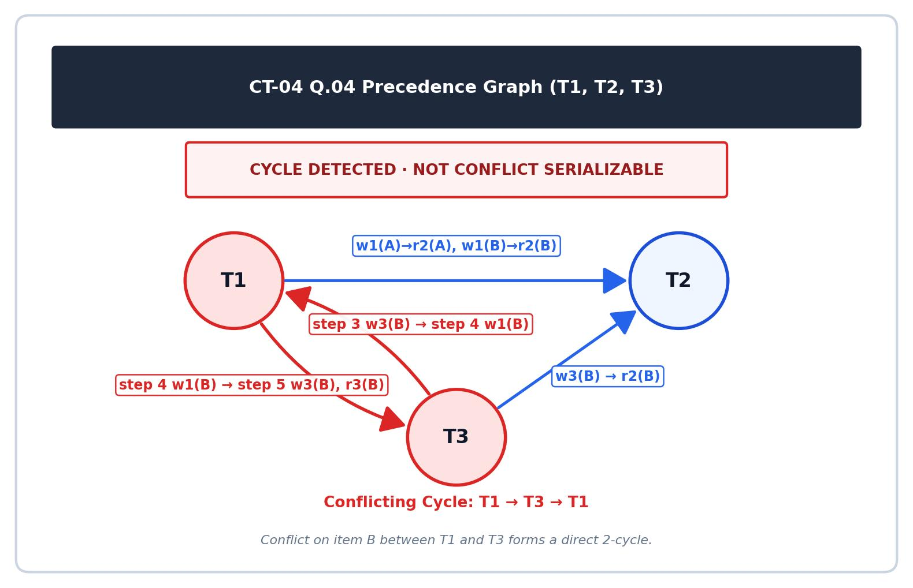

[← Prev: 2024](2024.md) | [Exam-Style Layer](../yearly_answers_exam_style/ClassTestQuestions.md) | [Original CT Questions](../PreviousYearQuestion/ClassTestQuestions.md) | [Directory Overview →](README.md)

---

# ECE 2215: Database Systems · Class Test Collection · Explanations

> [!info] Document Metadata
> - **Institution:** Rajshahi University of Engineering & Technology (RUET)
> - **Department:** Department of Electrical & Computer Engineering
> - **Document:** Solved Class Test Collection (CT-01 to CT-04)
> - **Total Marks:** 80 (20 Marks per test) | **Format:** CO Mapped
> - **Coverage:** Relational Algebra, SQL Queries, ER Modeling, Normalization, Transactions & Concurrency

## Navigation & Overview

- [[#Class Test 01 (Data Abstraction, Schema & Relational Algebra)|Class Test 01 (Data Abstraction, Schema & Relational Algebra)]] — *Data Abstraction, Schema Diagram, Application Structure, Relational Algebra*
- [[#Class Test 02 (SQL Queries & ER Modeling)|Class Test 02 (SQL Queries & ER Modeling)]] — *SQL Data Retrieval, Aggregates, Subqueries without LIMIT, University ER Model*
- [[#Class Test 03 (Functional Dependencies, Normalization & BCNF)|Class Test 03 (Functional Dependencies, Normalization & BCNF)]] — *Candidate Keys, Prime Attributes, Normalization (1NF–BCNF), Anomalies*
- [[#Class Test 04 (Transactions, ACID & Conflict Serializability)|Class Test 04 (Transactions, ACID & Conflict Serializability)]] — *ACID Properties, Serial vs Concurrent Execution, Concurrency Anomalies, Precedence Graph*

---

## Class Test 01 (Data Abstraction, Schema & Relational Algebra)

| Parameter | Details |
| :--- | :--- |
| **Institution** | Rajshahi University of Engineering & Technology (RUET) |
| **Department** | Electrical & Computer Engineering |
| **Test Title** | CT-01 |
| **Marks** | 20 |
| **Time** | 30 minutes |
| **Curriculum Standard** | With CO Mapping |

### CT-01 Question 01 · 05 Marks · CO1

*Topic: [[../Topicwise_answers_explaination/T01_DB_Concepts_and_Architecture.md#T01.4 · Data abstraction levels, schemas and instances|T01.4 · Data abstraction levels, schemas and instances]] · CT-01 · CO1*

**Question.**
Define data abstraction. Describe different types of data abstractions.

**Answer.**

**What the examiner wants.**  
The definition and purpose of data abstraction (~1 mark), clear descriptions of all three abstraction levels (physical, logical, view) (~2 marks), and the architecture diagram (~1 mark).

**Key idea.**  
Database systems use complex data structures to store information efficiently. Most users and application programmers do not understand storage pointers or disk block layouts. Data abstraction hides low-level complexity to provide a clean and intuitive interface.

**Step-by-step solution.**  
**Purpose of Data Abstraction:**  
A database contains complex data structures, storage blocks, and indexing schemes. Most end users and programmers are not trained in low-level storage details. Data abstraction hides this physical complexity. It simplifies user interactions, enforces security, and enables physical data independence.

**Levels of Data Abstraction:**
1. **Physical level:** The lowest abstraction level. It describes *how* records are stored on secondary storage media (such as byte offsets, data blocks, B+ trees, and hashing schemes).
2. **Logical level:** The intermediate level. It describes *what* data is stored in the database and the relationships among those data. Programmers and administrators work at this level using schemas.
   Example record:
   ```text
   type instructor = record
       ID : string;
       name : string;
       dept_name : string;
       salary : integer;
   end;
   ```
3. **View level:** The highest abstraction level. It describes only the subset of the database relevant to a specific user group. It hides other data and complex structures for ease of use and security (for example, hiding instructor salaries from students).


*Figure: Three levels of data abstraction (Deck 01, Slide 14)*

*Variant for 2019 Q.2(a) (4 marks):* Define data abstraction, describe the three levels, and include the diagram.  
*Variant for CT-01 Q.01 (5 marks):* State the definition, explain the three levels, show the record example, and draw the diagram.

**Check.**  
*Quick level-matching test:*
- Record block allocation on disk blocks $\rightarrow$ Physical level.
- Entity definition with column names and data types $\rightarrow$ Logical level.
- Form displaying student grades without instructor salaries $\rightarrow$ View level.

> [!warning] Common mistakes
> - Mixing up the logical level and view level. Remember that the logical level describes the *entire* database, while each view describes a *subset*.
> - Leaving out the architecture diagram.

**Exam tip.**  
Draw the three-tiered box diagram with multiple view boxes on top, the logical box in the middle, and the physical box at the bottom.

**Sources.**  
- [Deck 01 · Slides 13–14](../LectureSlides/01_Intro_to_Database_and_DBMS.md)  
- [Textbook Ch. 1 §1.3](../Textbook/Chapter_01_Introduction/Chapter%2001%20-%20Introduction.md)

---

### CT-01 Question 02 · 05 Marks · CO1

*Topic: [[../Topicwise_answers_explaination/T03_Relational_Model_Keys_and_Integrity.md#T03.3 · Schema diagram: construction & foreign key links|T03.3 · Schema diagram: construction & foreign key links]] · CT-01 · CO1*

**Question.**
Draw a schema diagram for ECE, including 5 tables (Students, Courses, Instructors, Classroom, Results).

**Answer.**

**What the examiner wants.**  
A complete Silberschatz-style relational schema diagram containing the five designated ECE tables: `Students`, `Courses`, `Instructors`, `Classroom`, and `Results`. The examiner looks for:
1. One rectangular box per table with attributes listed inside.
2. Primary keys clearly underlined.
3. Directed arrows connecting referencing foreign key attributes to referenced primary keys.

**Key idea.**  
A relational schema diagram provides a complete architectural map of a relational database. It displays tables as boxes, underlines primary keys, and uses arrows to indicate foreign key dependencies.

**Step-by-step solution.**  
**1. Relational Schemas and Keys:**
- $\text{Students}(\underline{\text{student\_id}}, \text{name}, \text{email}, \text{dept\_name})$
- $\text{Instructors}(\underline{\text{instructor\_id}}, \text{name}, \text{dept\_name}, \text{salary})$
- $\text{Classroom}(\underline{\text{building}}, \underline{\text{room\_number}}, \text{capacity})$
- $\text{Courses}(\underline{\text{course\_id}}, \text{title}, \text{credits}, \text{instructor\_id}, \text{building}, \text{room\_number})$
  - $\text{instructor\_id} \rightarrow \text{Instructors}(\text{instructor\_id})$
  - $(\text{building}, \text{room\_number}) \rightarrow \text{Classroom}(\text{building}, \text{room\_number})$
- $\text{Results}(\underline{\text{student\_id}}, \underline{\text{course\_id}}, \underline{\text{semester}}, \text{marks}, \text{grade})$
  - $\text{student\_id} \rightarrow \text{Students}(\text{student\_id})$
  - $\text{course\_id} \rightarrow \text{Courses}(\text{course\_id})$

**2. Relational Schema Diagram:**  
In Silberschatz style, each table is shown as a box with its attributes. Primary keys are underlined. Directed arrows point from foreign key attributes to the referenced primary keys.


*Figure: Relational schema diagram for ECE with 5 tables and foreign key references.*

**Check.**  
*Schema design audit:*
- All 5 specified tables are included: `Students`, `Courses`, `Instructors`, `Classroom`, `Results`.
- Every table has at least one underlined primary key.
- All foreign key relationships point to existing primary keys:
  - `Courses.instructor_id` $\rightarrow$ `Instructors.instructor_id`
  - `Courses.(building, room_number)` $\rightarrow$ `Classroom.(building, room_number)`
  - `Results.student_id` $\rightarrow$ `Students.student_id`
  - `Results.course_id` $\rightarrow$ `Courses.course_id`
- The relations form a fully connected, coherent schema graph.

> [!warning] Common mistakes
> - Drawing an Entity-Relationship (ER) diagram with diamonds and ellipses instead of a relational schema diagram with rectangular boxes.
> - Reversing arrow directions. In Silberschatz schema diagrams, arrows must originate at the child foreign key and point to the parent primary key.
> - Forgetting that `Classroom` uses a composite primary key consisting of both `building` and `room_number`.

**Exam tip.**  
Write out the relational schema text lines first ($\text{Students}(\dots)$) to organize the primary and foreign keys in your head. Then draw the table boxes and connect the arrows.

**Sources.**  
- [Deck 02 · Slide 8](../LectureSlides/02_Relational_Model.md)  
- [Textbook Ch. 2 §2.4](../Textbook/Chapter_02_Relational_Model/Chapter%2002%20-%20Introduction%20to%20the%20Relational%20Model.md)

---

[← Prev: T02 · E-R and EER Modeling](T02_ER_and_EER_Modeling.md) | [Exam-style layer](../Topicwise_answers_exam_style/T03_Relational_Model_Keys_and_Integrity.md) | [Next: T04 · Relational Algebra and Calculus →](T04_Relational_Algebra_and_Calculus.md)

---

### CT-01 Question 03 · 02 Marks · CO1

*Topic: [[../Topicwise_answers_explaination/T01_DB_Concepts_and_Architecture.md#T01.7 · Two-tier vs three-tier architecture|T01.7 · Two-tier vs three-tier architecture]] · CT-01 · CO1*

**Question.**
Describe the structure of a database application.

**Answer.**

**What the examiner wants.**  
A concise description of the functional structure of a database application, covering user interaction, application logic, and database access.

**Key idea.**  
A database application acts as a mediator. It accepts user input through an interface, executes business rules using host programming languages, and interacts with the DBMS engine via queries.

**Step-by-step solution.**  
A database application connects user interfaces to the database engine through three functional layers:

1. **Presentation Layer (Client Front End):** The client interface (web browser, mobile app, or desktop form) through which users enter input and view results.
2. **Business Logic Layer (Application Server):** Programs written in host languages (like Python, Java, or C++) that implement business rules, validate input, and issue database queries.
3. **Data Access Layer (Database Server / DBMS Engine):** The database system that uses APIs (such as JDBC or ODBC) to execute SQL queries, manage transactions, and persist data.

**Check.**  
*Role verification:*
- Client / Front end: Collects inputs from the user.
- Application server / programs: Implements business rules that SQL alone cannot express.
- Database server / DBMS engine: Executes queries and manages storage blocks safely.

> [!warning] Common mistakes
> - Describing internal DBMS engine modules (storage manager, buffer manager) instead of the database *application* architecture.

**Exam tip.**  
List the three clear application tiers: Presentation Layer, Business Logic Layer, and Data Access Layer.

**Sources.**  
- [Deck 01 · Slides 20, 29–31](../LectureSlides/01_Intro_to_Database_and_DBMS.md)  
- [Textbook Ch. 1 §1.7](../Textbook/Chapter_01_Introduction/Chapter%2001%20-%20Introduction.md)

---

[← Prev: T00 · Question Bank](../subtopicwise_questions.md) | [Exam-style layer](../Topicwise_answers_exam_style/T01_DB_Concepts_and_Architecture.md) | [Next: T02 · E-R and EER Modeling →](T02_ER_and_EER_Modeling.md)

---

### CT-01 Question 04 · 04 Marks · CO1

*Topic: [[../Topicwise_answers_explaination/T04_Relational_Algebra_and_Calculus.md#T04.3 · Fundamental & additional operations queries|T04.3 · Fundamental & additional operations queries]] · CT-01 · CO1*

**Question.**
Relations:
- $\text{STUDENT}(\text{Student\_ID}, \text{Name}, \text{Dept\_Name}, \text{CGPA})$
- $\text{COURSE}(\text{Course\_ID}, \text{Course\_Name}, \text{Student\_ID}, \text{Semester}, \text{Marks})$
- $\text{ALUMNI}(\text{Student\_ID}, \text{Name}, \text{Dept\_Name})$

Write the relational algebra expressions for the following conditions using the relations above.

- **v.** Write the relational algebra expression to rename the relation $\text{STUDENT}$ as $\text{S}$ and display the $\text{Student\_ID}$ and $\text{Name}$ of all students.
- **vi.** Retrieve the $\text{Student\_ID}$, $\text{Name}$, and $\text{Course\_Name}$ of all students who belong to the CSE department and scored 80 or more marks in any course.
- **vii.** Write the relational algebra expression to retrieve the $\text{Student\_ID}$ and $\text{Name}$ of all students who are either in the $\text{STUDENT}$ relation or the $\text{ALUMNI}$ relation.
- **viii.** Write the relational algebra expression to determine the number of students in each department.

*(Note: Sub-parts are numbered v, vi, vii, viii on the original question script).*

**Answer.**

**What the examiner wants.**  
Four distinct relational algebra queries worth 1 mark each. Evaluates the rename operator ($\rho$), multi-table selection and projection, union compatibility constraints, and aggregation with grouping ($\gamma$).

**Key idea.**  
Part (v) uses the rename operator $\rho$. Part (vi) combines selection on department and marks before joining. Part (vii) requires union compatibility: `STUDENT` has 4 attributes while `ALUMNI` has 3. Both relations must be projected to the same two attributes before applying $\cup$. Part (viii) groups by department name.

**Step-by-step solution.**

**(v) Rename relation STUDENT as S and display Student_ID and Name:**

1. Apply the rename operator $\rho_S$:
2. Project `Student_ID` and `Name`:

$$
\boxed{\Pi_{\text{Student\_ID}, \text{Name}}(\rho_S(\text{STUDENT}))}
$$

**(vi) Student_ID, Name, and Course_Name for CSE students with Marks $\ge 80$:**

1. Filter students from the "CSE" department:

$$
T_1 \leftarrow \sigma_{\text{Dept\_Name} = \text{"CSE"}}(\text{STUDENT})
$$

2. Filter course enrollments where marks are 80 or above:

$$
T_2 \leftarrow \sigma_{\text{Marks} \ge 80}(\text{COURSE})
$$

3. Natural join $T_1$ and $T_2$ on `Student_ID`, then project the requested columns:

$$
\boxed{\Pi_{\text{Student\_ID}, \text{Name}, \text{Course\_Name}}(T_1 \bowtie T_2)}
$$

**(vii) Student_ID and Name of students in either STUDENT or ALUMNI:**

1. The schema of `STUDENT` is `(Student_ID, Name, Dept_Name, CGPA)` (arity 4). The schema of `ALUMNI` is `(Student_ID, Name, Dept_Name)` (arity 3).
2. The union operation $r \cup s$ requires both relations to have identical arity and compatible domains.
3. Project each relation to `(Student_ID, Name)` first, then take the union:

$$
\boxed{\Pi_{\text{Student\_ID}, \text{Name}}(\text{STUDENT}) \cup \Pi_{\text{Student\_ID}, \text{Name}}(\text{ALUMNI})}
$$

**(viii) Number of students in each department:**

Group the `STUDENT` relation by `Dept_Name` and count `Student_ID`:

$$
\boxed{{}_{\text{Dept\_Name}}\gamma_{\text{count}(\text{Student\_ID})}(\text{STUDENT})}
$$

**Check.**  
- Part (vii): If `STUDENT` contains `(101, "A", "CSE", 3.8)` and `ALUMNI` contains `(201, "B", "EEE")`, direct union $\text{STUDENT} \cup \text{ALUMNI}$ fails because $4 \neq 3$. Projecting first yields `{(101, "A")}` and `{(201, "B")}`. The union produces `{(101, "A"), (201, "B")}`, which is valid and correct.
- Part (viii): Grouping `STUDENT` tuples by `Dept_Name` produces a two-column relation `(Dept_Name, count(Student_ID))`.

> [!warning] Common mistakes
> - Writing $\text{STUDENT} \cup \text{ALUMNI}$ directly. This violates union compatibility and loses marks immediately.
> - Forgetting `Course_Name` in the projection of part (vi).
> - Writing $\sigma$ instead of $\gamma$ for part (viii). Counting rows requires an aggregate operator.

**Exam tip.**  
Before applying $\cup$, $\cap$, or $-$, always check the column counts of both tables. If they differ, project the common target columns first.

**Sources.**  
`[Lecture Deck 02 · Slides 13–29](../LectureSlides/02_Relational_Model.md)`  
`[Textbook Ch. 2 §2.6](../Textbook/Chapter_02_Relational_Model/Chapter%2002%20-%20Introduction%20to%20the%20Relational%20Model.md)`

---

### CT-01 Question 05 · 04 Marks · CO1

*Topic: [[../Topicwise_answers_explaination/T04_Relational_Algebra_and_Calculus.md#T04.4 · Interpretation/explanation of RA expressions|T04.4 · Interpretation/explanation of RA expressions]] · CT-01 · CO1*

**Question.**
Describe the following relational algebra expression:

- **iii.**
  $$
  \Pi_{\text{Name}} \left(\sigma_{\text{Marks} < 50} \left(\text{STUDENT} \bowtie_{\text{STUDENT.Student\_ID} = \text{COURSE.Student\_ID}} \text{COURSE}\right)\right)
  $$

- **iv.**
  $$
  \Pi_{\text{course\_id}} \left(\sigma_{\text{semester} = \text{"Fall"} \land \text{year} = 2017} (\text{section})\right) - \Pi_{\text{course\_id}} \left(\sigma_{\text{semester} = \text{"Spring"} \land \text{year} = 2018} (\text{section})\right)
  $$

*(Note: Sub-parts are numbered iii, iv on the original question script).*

**Answer.**

**What the examiner wants.**  
Accurate descriptions of two complex relational algebra expressions (2 marks each). Evaluates theta joins with selection and projection, and set difference between projected query expressions.

**Key idea.**  
Part (iii) performs a theta join on student identifiers, filters on an academic performance threshold (marks under 50), and projects the student names. Part (iv) is a classic set difference pattern identifying courses offered in a specific semester but not in another semester.

**Step-by-step solution.**

**(iii) Expression:** $\Pi_{\text{Name}} \left(\sigma_{\text{Marks} < 50} \left(\text{STUDENT} \bowtie_{\text{STUDENT.Student\_ID} = \text{COURSE.Student\_ID}} \text{COURSE}\right)\right)$

1. **Theta Join:** $\text{STUDENT} \bowtie_{\text{STUDENT.Student\_ID} = \text{COURSE.Student\_ID}} \text{COURSE}$ combines records from `STUDENT` and `COURSE` where the student IDs match. This pairs student personal data with their course enrollment records and marks.
2. **Selection:** The selection condition $\sigma_{\text{Marks} < 50}$ filters the joined relation. It keeps only tuples where the student scored strictly less than 50 marks.
3. **Projection:** The operator $\Pi_{\text{Name}}$ extracts only the `Name` attribute from the filtered records, eliminating any duplicate student names.
4. **Summary in words:** Finds the names of all students who scored less than 50 marks in at least one course.

**(iv) Expression:** $\Pi_{\text{course\_id}} \left(\sigma_{\text{semester} = \text{"Fall"} \land \text{year} = 2017} (\text{section})\right) - \Pi_{\text{course\_id}} \left(\sigma_{\text{semester} = \text{"Spring"} \land \text{year} = 2018} (\text{section})\right)$

1. **First Sub-expression:** Filters `section` for courses offered in Fall 2017 and projects their unique `course_id` values:

$$
S_{\text{Fall}} = \Pi_{\text{course\_id}}(\sigma_{\text{semester} = \text{"Fall"} \land \text{year} = 2017}(\text{section}))
$$

2. **Second Sub-expression:** Filters `section` for courses offered in Spring 2018 and projects their unique `course_id` values:

$$
S_{\text{Spring}} = \Pi_{\text{course\_id}}(\sigma_{\text{semester} = \text{"Spring"} \land \text{year} = 2018}(\text{section}))
$$

3. **Set Difference ($-$) :** Computes $S_{\text{Fall}} - S_{\text{Spring}}$. It retains all course IDs that appear in the Fall 2017 set but do not appear in the Spring 2018 set.
4. **Summary in words:** Finds all courses taught in the Fall 2017 semester that were not taught in the Spring 2018 semester.

**Check.**  
- Part (iii): If student "Suman" scored 42 in Math and 75 in Physics, the selection retains the Math row. Projection outputs "Suman". If a student scored above 50 in all courses, that student is excluded.
- Part (iv): If CS-101 was taught in Fall 2017 and Spring 2018, and CS-347 was taught only in Fall 2017:
  - $S_{\text{Fall}} = \{\text{CS-101}, \text{CS-347}\}$.
  - $S_{\text{Spring}} = \{\text{CS-101}\}$.
  - Difference is $\{\text{CS-347}\}$. CS-101 is eliminated.

> [!warning] Common mistakes
> - Calling the set difference operator minus or arithmetic subtraction. Use the technical term set difference.
> - Confusing set difference with intersection. Writing "taught in Fall 2017 AND Spring 2018" describes $r \cap s$, not $r - s$.
> - Forgetting that duplicate student names are removed by the projection operator.

**Exam tip.**  
Part (iv) is taken verbatim from Slide 24 of Lecture Deck 02. Knowing slide examples verbatim ensures rapid, confident full marks in class tests.

**Sources.**  
`[Lecture Deck 02 · Slides 18–24](../LectureSlides/02_Relational_Model.md)`  
`[Textbook Ch. 2 §2.6](../Textbook/Chapter_02_Relational_Model/Chapter%2002%20-%20Introduction%20to%20the%20Relational%20Model.md)`

---

## Class Test 02 (SQL Queries & ER Modeling)

| Parameter | Details |
| :--- | :--- |
| **Institution** | Rajshahi University of Engineering & Technology (RUET) |
| **Department** | Electrical & Computer Engineering |
| **Test Title** | CT-02 |
| **Marks** | 20 |
| **Time** | 20 minutes |
| **Curriculum Standard** | With CO Mapping |

### CT-02 Question 01 · 10 Marks · CO2

*Topic: [[../Topicwise_answers_explaination/T05_SQL_DDL_DML_Aggregates_Subqueries.md#T05.2 · Basic single-table queries|T05.2 · Basic single-table queries]] · CT-02 · CO2*

**Question.**
Consider the table and write SQL queries for the following queries:

$$
\text{STUDENT}(\text{StudentID}, \text{Name}, \text{Department}, \text{Semester}, \text{CGPA})
$$

- **(a)** Display all students from the ECE department. `[Marks: 02 | CO: CO2]`
- **(b)** Display students from the ECE department whose CGPA is greater than 3.50, arranged by CGPA in descending order. `[Marks: 02 | CO: CO2]`
- **(c)** Find students whose CGPA is greater than the overall average CGPA. `[Marks: 03 | CO: CO2]`
- **(d)** Display the students having the second-highest CGPA without using LIMIT. `[Marks: 03 | CO: CO2]`

**Answer.**

#### Part (a): Display ECE students (2 Marks)

**What the examiner wants.**  
Basic single-relation selection and projection in SQL. Full marks for correct `SELECT *` (or all attributes) and equality filter `WHERE Department = 'ECE'`.

**Key idea.**  
The `WHERE` clause acts as the relational selection operator ($\sigma$), filtering table tuples according to the boolean expression.

**Step-by-step solution.**  
```sql
SELECT *
FROM STUDENT
WHERE Department = 'ECE';
```

**Check.**  
*Execution:* The DBMS scans `STUDENT` and checks each row's `Department` column against the string literal `'ECE'`. Only matching tuples appear in the result table.

> [!warning] Common mistakes
> - Omitting quotes around string literal `'ECE'`. Without quotes, SQL treats `ECE` as an attribute name.

**Exam tip.**  
For simple CT queries, write clean standard SQL without unnecessary clauses.

**Sources.**  
[Deck 03 · Slide 17](../LectureSlides/03_Introduction_to_SQL.md), [Textbook Ch. 3 §3.3](../Textbook/Chapter_03_Intro_SQL/Chapter%2003%20-%20Introduction%20to%20SQL.md).

#### Part (b): ECE students with CGPA > 3.50 descending (2 Marks)

**What the examiner wants.**  
A multi-condition `WHERE` clause combining department match and numeric threshold using logical `AND`, followed by sorting using `ORDER BY ... DESC`.

**Key idea.**  
SQL evaluates the `WHERE` filter first to select tuples belonging to ECE with CGPA > 3.50. It then processes the `ORDER BY` clause to arrange the surviving tuples from highest to lowest CGPA.

**Step-by-step solution.**  
```sql
SELECT *
FROM STUDENT
WHERE Department = 'ECE' AND CGPA > 3.50
ORDER BY CGPA DESC;
```

**Check.**  
*Trace with candidate records:*
- Student 1: ECE, CGPA = 3.80 $\implies$ passes `WHERE`, placed top in output.
- Student 2: ECE, CGPA = 3.60 $\implies$ passes `WHERE`, placed second in output.
- Student 3: CSE, CGPA = 3.90 $\implies$ rejected by `Department = 'ECE'`.
- Student 4: ECE, CGPA = 3.40 $\implies$ rejected by `CGPA > 3.50`.

> [!warning] Common mistakes
> - Writing `DESCENDING` instead of the SQL keyword `DESC`.
> - Placing `ORDER BY` before the `WHERE` clause (violating SQL grammatical order).

**Exam tip.**  
Remember the strict clause sequence: `SELECT` $\to$ `FROM` $\to$ `WHERE` $\to$ `ORDER BY`.

**Sources.**  
[Deck 03 · Slides 17, 24](../LectureSlides/03_Introduction_to_SQL.md), [Textbook Ch. 3 §3.3, §3.6](../Textbook/Chapter_03_Intro_SQL/Chapter%2003%20-%20Introduction%20to%20SQL.md).

#### Part (c): Students with CGPA > overall average CGPA (3 Marks)

**What the examiner wants.**  
An uncorrelated scalar subquery using `AVG(CGPA)` in a `WHERE` comparison predicate.

**Key idea.**  
In SQL, aggregate functions cannot be placed directly in a `WHERE` clause (e.g., `WHERE CGPA > AVG(CGPA)` is invalid syntax). The aggregate must be evaluated inside a nested subquery, which computes the table-wide average and supplies it as a scalar value to the outer query.

**Step-by-step solution.**  
```sql
SELECT *
FROM STUDENT
WHERE CGPA > (
    SELECT AVG(CGPA)
    FROM STUDENT
);
```

**Check.**  
*Trace:*
If student CGPA values are $\{3.2, 3.5, 3.8, 3.9\}$, the subquery evaluates:
$\text{AVG(CGPA)} = \frac{3.2 + 3.5 + 3.8 + 3.9}{4} = 3.60$.
The outer query evaluates `CGPA > 3.60`, returning the students with 3.8 and 3.9.

> [!warning] Common mistakes
> - Writing `WHERE CGPA > AVG(CGPA)` directly without `SELECT`; SQL parser throws a syntax error because aggregates are not permitted in `WHERE` predicates of the same query block.

**Exam tip.**  
Wrap the aggregate calculation in a `(SELECT AVG(...) FROM ...)` subquery whenever comparing an attribute to a dataset-wide summary.

**Sources.**  
[Deck 03 · Slides 30, 35, 52](../LectureSlides/03_Introduction_to_SQL.md), [Textbook Ch. 3 §3.7, §3.8](../Textbook/Chapter_03_Intro_SQL/Chapter%2003%20-%20Introduction%20to%20SQL.md).

#### Part (d): Second-highest CGPA without LIMIT (3 Marks)

**What the examiner wants.**  
Querying the second-highest numeric value using subqueries without relying on vendor-specific pagination keywords (`LIMIT` or `TOP`).

**Key idea.**  
The second-highest value in a set is the maximum value strictly less than the overall maximum value. Once that scalar value is determined by a nested subquery, the outer query retrieves all student records matching that CGPA.

**Step-by-step solution.**  
```sql
SELECT *
FROM STUDENT
WHERE CGPA = (
    SELECT MAX(CGPA)
    FROM STUDENT
    WHERE CGPA < (
        SELECT MAX(CGPA)
        FROM STUDENT
    )
);
```

*Note on ties:* This query identifies the unique second-highest distinct CGPA value. If multiple students share this exact second-highest CGPA, all tied students are displayed in the result.

**Check.**  
*Trace with sample values:*
Suppose CGPA values in `STUDENT` are: `{4.00, 4.00, 3.85, 3.85, 3.70}`.
1. Innermost subquery: `SELECT MAX(CGPA) FROM STUDENT` $\implies 4.00$.
2. Intermediate subquery: `SELECT MAX(CGPA) FROM STUDENT WHERE CGPA < 4.00` $\implies 3.85$.
3. Outer query: `SELECT * FROM STUDENT WHERE CGPA = 3.85`.
Both students with CGPA 3.85 are returned. A naive `ORDER BY ... LIMIT 1 OFFSET 1` would have returned the second student with 4.00, failing to locate the true second-highest grade.

> [!warning] Common mistakes
> - Using `LIMIT 1 OFFSET 1` when the prompt explicitly bans `LIMIT`.
> - Writing `WHERE CGPA < (SELECT MAX(CGPA))` without finding the `MAX` of that reduced subset, which would retrieve all students except the top one.

**Exam tip.**  
Nested `MAX` subqueries are the universal, standard-compliant way to find $n$-th highest values without vendor-specific extensions.

**Sources.**  
[Deck 03 · Slides 35, 52](../LectureSlides/03_Introduction_to_SQL.md), [Textbook Ch. 3 §3.7, §3.8](../Textbook/Chapter_03_Intro_SQL/Chapter%2003%20-%20Introduction%20to%20SQL.md).

---

### CT-02 Question 02 · 10 Marks · CO3

*Topic: [[../Topicwise_answers_explaination/T02_ER_and_EER_Modeling.md#T02.5 · Design a full E-R diagram for a scenario|T02.5 · Design a full E-R diagram for a scenario]] · CT-02 · CO3*

**Question.**
A university maintains information about Students, Courses, and Teachers. A student can enroll in several courses and each course can have many students. Each course is taught by one teacher, though a teacher may teach several courses.

- **(a)** Identify the entities, attributes, primary keys, relationships, and cardinalities. `[Marks: 04 | CO: CO3]`
- **(b)** Draw the complete ER diagram. `[Marks: 06 | CO: CO3]`

**Answer.**

**What the examiner wants.**  
Part (a): Explicit identification and listing of all database design elements: entity sets, attributes, primary keys, relationship sets, and mapping cardinalities (4 marks).  
Part (b): A complete, well-proportioned Chen-notation E-R diagram reflecting all identified elements (6 marks).

**Key idea.**  
Extract business rules directly from the problem description:
- "Student enrolls in several courses and course can have many students" $\rightarrow$ Many-to-Many (`Enrolls`, M:N).
- "Course taught by one teacher, teacher teaches several courses" $\rightarrow$ One-to-Many (`Teaches`, 1:N from Teacher to Course).

**Step-by-step solution.**  
**(a) Identification of Components:**

| Component | Type | Details | Primary Key |
| :--- | :--- | :--- | :--- |
| **STUDENT** | Entity Set | Attributes: `student_id`, `name`, `email`, `dept_name` | `student_id` |
| **COURSE** | Entity Set | Attributes: `course_id`, `title`, `credits` | `course_id` |
| **TEACHER** | Entity Set | Attributes: `teacher_id`, `name`, `dept_name`, `phone` | `teacher_id` |
| **Enrolls** | Relationship Set | Connects `STUDENT` and `COURSE` | `(student_id, course_id)` |
| **Teaches** | Relationship Set | Connects `TEACHER` and `COURSE` | `course_id` |

**Cardinalities:**
- **Student to Course (`Enrolls`):** Many-to-Many (**M:N**). A student enrolls in several courses; each course has many students.
- **Teacher to Course (`Teaches`):** One-to-Many (**1:N**). A teacher teaches several courses; each course is taught by exactly one teacher.

**(b) Complete E-R Diagram:**


*Figure: University Enterprise Complete E-R Diagram*

**Check.**  
*Cardinality and rule verification:*
- Teacher has degree 1:N to Course: An arrow or "N" on the Course side and "1" on the Teacher side $\checkmark$
- Student has degree M:N to Course: Both sides have "M" and "N" labels $\checkmark$
- Primary keys are underlined in both the table and the diagram $\checkmark$

> [!warning] Common mistakes
> - Drawing a direct relationship between Student and Teacher. The prompt describes students enrolling in courses and teachers teaching courses. The link is through Course.
> - Skipping Part (a) and jumping straight to the diagram. That throws away 4 easy marks.

**Exam tip.**  
Fill out the structured table in Part (a) first. Then draw the diagram in Part (b). This shows the examiner that your diagram matches your formal analysis.

**Sources.**  
- [Deck 05 · Slides 7–39](../LectureSlides/05_ER_Model.md)  
- [Textbook Ch. 6 §6.2–§6.4](../Textbook/Chapter_06_ER_Model/Chapter%2006%20-%20Database%20Design%20Using%20the%20E-R%20Model.md)

---

## Class Test 03 (Functional Dependencies, Normalization & BCNF)

| Parameter | Details |
| :--- | :--- |
| **Institution** | Rajshahi University of Engineering & Technology (RUET) |
| **Department** | Electrical & Computer Engineering |
| **Test Title** | CT-03 |
| **Marks** | 20 |
| **Time** | 25 minutes |
| **Curriculum Standard** | With CO Mapping |

### CT-03 Question 01 · 10 Marks · CO3

*Topic: [[../Topicwise_answers_explaination/T08_Normalization_and_Functional_Dependencies.md#T08.4 · Attribute closure X+, finding candidate keys|T08.4 · Attribute closure X+, finding candidate keys]] · CT-03 · CO3*

**Question.**
Consider the relation:

$$
\text{ENROLLMENT}(\text{StudentID}, \text{StudentName}, \text{CourseID}, \text{CourseName}, \text{InstructorID}, \text{InstructorName}, \text{Grade})
$$

Assume the following functional dependencies:

$$
\begin{aligned}
\text{StudentID} &\rightarrow \text{StudentName} \\
\text{CourseID} &\rightarrow \text{CourseName}, \text{InstructorID} \\
\text{InstructorID} &\rightarrow \text{InstructorName} \\
(\text{StudentID}, \text{CourseID}) &\rightarrow \text{Grade}
\end{aligned}
$$

- **a)** Identify all the possible candidate key of the relation. `[Marks: 04]`
- **b)** Identify the prime and non-prime attributes. `[Marks: 02]`
- **c)** Identify the partial and transitive dependencies. `[Marks: 02]`
- **d)** Determine the highest normal form satisfied by the given relation. Give a proper justification. `[Marks: 02]`

**Answer.**

#### Part (a): Find Candidate Keys (4 Marks)

**What the examiner wants.**  
Systematic derivation of candidate keys: identifying core non-RHS attributes (1.5 marks), showing the step-by-step expansion of the attribute closure (1.5 marks), and proving minimality (1 mark).

**Key idea.**  
Look at which attributes never appear on the right side of any arrow. Those attributes can never be derived from anything else, so they must be part of every candidate key.

**Step-by-step solution.**

To find all candidate keys, we analyze the attributes that must appear in every key.

1. **Attributes not on any RHS:**
   Examining the right-hand sides of the given functional dependencies:
   - $\text{RHS} = \{\text{StudentName}, \text{CourseName}, \text{InstructorID}, \text{InstructorName}, \text{Grade}\}$
   - Attributes $\text{StudentID}$ and $\text{CourseID}$ never appear on any right-hand side.
   - Therefore, $\{\text{StudentID}, \text{CourseID}\}$ must be present in every candidate key.

2. **Compute the Attribute Closure of $\{\text{StudentID}, \text{CourseID}\}$:**
   - **Step 1 (Initial):**  
     $X^+ = \{\text{StudentID}, \text{CourseID}\}$
   - **Step 2 (Apply $\text{StudentID} \rightarrow \text{StudentName}$):**  
     $X^+ = \{\text{StudentID}, \text{CourseID}, \text{StudentName}\}$
   - **Step 3 (Apply $\text{CourseID} \rightarrow \text{CourseName}, \text{InstructorID}$):**  
     $X^+ = \{\text{StudentID}, \text{CourseID}, \text{StudentName}, \text{CourseName}, \text{InstructorID}\}$
   - **Step 4 (Apply $\text{InstructorID} \rightarrow \text{InstructorName}$):**  
     $X^+ = \{\text{StudentID}, \text{CourseID}, \text{StudentName}, \text{CourseName}, \text{InstructorID}, \text{InstructorName}\}$
   - **Step 5 (Apply $(\text{StudentID}, \text{CourseID}) \rightarrow \text{Grade}$):**  
     $X^+ = \{\text{StudentID}, \text{CourseID}, \text{StudentName}, \text{CourseName}, \text{InstructorID}, \text{InstructorName}, \text{Grade}\}$

3. **Check for Minimality:**
   We check proper subsets of $\{\text{StudentID}, \text{CourseID}\}$:
   - $\{\text{StudentID}\}^+ = \{\text{StudentID}, \text{StudentName}\} \neq R$
   - $\{\text{CourseID}\}^+ = \{\text{CourseID}, \text{CourseName}, \text{InstructorID}, \text{InstructorName}\} \neq R$

Neither proper subset determines all attributes. Therefore, $\{\text{StudentID}, \text{CourseID}\}$ is minimal.

$$
\boxed{\text{Candidate Key} = \{\text{StudentID}, \text{CourseID}\}}
$$

This is the only candidate key for the relation.

**Check.**  
*Quick self-test:*
- Q: Can `InstructorID` be added to form a candidate key?  
  A: No. Adding `InstructorID` produces a superkey, but not a candidate key, because it is not minimal.
- Q: Could another candidate key exist without `StudentID`?  
  A: No, because no functional dependency has `StudentID` on the right side. It cannot be derived.

> [!warning] Common mistakes
> - Stating the key by intuition without showing the step-by-step growth of $X^+$.
> - Forgetting to test the proper subsets $\{\text{StudentID}\}$ and $\{\text{CourseID}\}$ to prove minimality.

**Exam tip.**  
Start your solution by listing attributes that never appear on the RHS. This proves to the examiner that no other combination of attributes can be a candidate key.

**Sources.**  
- [Deck 06 · Slides 25–27](../LectureSlides/06_DBMS_Normalization.md)
- [Textbook Ch. 7 §7.4.2](../Textbook/Chapter_07_Normalization/Chapter%2007%20-%20Relational%20Database%20Design.md)

#### Parts (b–c): Functional Dependencies & Prime Attributes (4 Marks)

**What the examiner wants.**  
Accurate classification of attributes as prime or non-prime based on the candidate key (2 marks), and identification of all partial and transitive functional dependencies with explicit determinants and dependents (2 marks).

**Key idea.**  
A prime attribute belongs to at least one candidate key. Any attribute not in a candidate key is non-prime. A partial dependency occurs when a non-prime attribute depends on only part of a composite key. A transitive dependency occurs when a non-prime attribute depends on another non-prime attribute.

**Step-by-step solution.**

First, we determine the Candidate Key.

Attributes $\text{StudentID}$ and $\text{CourseID}$ never appear on the right-hand side of any functional dependency. Therefore, every candidate key must contain both attributes.

Computing the closure:
$$
\begin{aligned}
\{\text{StudentID}, \text{CourseID}\}^+ &= \{\text{StudentID}, \text{CourseID}, \text{StudentName}, \text{CourseName}, \text{InstructorID}, \text{InstructorName}, \text{Grade}\}
\end{aligned}
$$

Because no proper subset is a superkey, the unique Candidate Key is:
$$
\text{Candidate Key} = \{\text{StudentID}, \text{CourseID}\}
$$

#### (b) Prime and Non-Prime Attributes

- **Prime Attributes:** Attributes that belong to at least one Candidate Key.
$$
\text{Prime Attributes} = \{\text{StudentID}, \text{CourseID}\}
$$
- **Non-Prime Attributes:** Attributes that do not belong to any Candidate Key.
$$
\text{Non-Prime Attributes} = \{\text{StudentName}, \text{CourseName}, \text{InstructorID}, \text{InstructorName}, \text{Grade}\}
$$

#### (c) Partial and Transitive Dependencies

- **Partial Dependencies:** Occur when a non-prime attribute depends on a proper subset of a composite candidate key:
  1. $\text{StudentID} \rightarrow \text{StudentName}$ (the non-prime attribute $\text{StudentName}$ depends only on $\text{StudentID}$).
  2. $\text{CourseID} \rightarrow \text{CourseName}$ (the non-prime attribute $\text{CourseName}$ depends only on $\text{CourseID}$).
  3. $\text{CourseID} \rightarrow \text{InstructorID}$ (the non-prime attribute $\text{InstructorID}$ depends only on $\text{CourseID}$).

- **Transitive Dependencies:** Occur when a non-prime attribute depends on another non-prime attribute:
$$
\text{InstructorID} \rightarrow \text{InstructorName}
$$
  Here, $\text{InstructorID}$ is a non-prime attribute that determines the non-prime attribute $\text{InstructorName}$. From the primary key, we have $(\text{StudentID}, \text{CourseID}) \rightarrow \text{InstructorID} \rightarrow \text{InstructorName}$.

**Check.**  
*Attribute partition check:*
- Total attributes in schema = 7.
- Prime attributes count = 2 ($\text{StudentID}, \text{CourseID}$).
- Non-prime attributes count = 5 ($\text{StudentName}, \text{CourseName}, \text{InstructorID}, \text{InstructorName}, \text{Grade}$).
- $2 + 5 = 7$. Every attribute is accounted for.

> [!warning] Common mistakes
> - Treating `InstructorID` as a prime attribute because it appears on the LHS of `InstructorID -> InstructorName`. Prime status comes strictly from membership in a candidate key, not from being a determinant!
> - Listing $(\text{StudentID}, \text{CourseID}) \rightarrow \text{Grade}$ as a partial dependency. It is a full dependency because it requires both attributes of the key.

**Exam tip.**  
Write down the candidate key before answering part (b). Even if part (a) is graded separately, stating the candidate key explicitly protects your marks.

**Sources.**  
- [Deck 06 · Slides 16–17](../LectureSlides/06_DBMS_Normalization.md)
- [Textbook Ch. 7 §7.3.4, §7.5.1](../Textbook/Chapter_07_Normalization/Chapter%2007%20-%20Relational%20Database%20Design.md)

#### Part (d): BCNF Verification (2 Marks)

**What the examiner wants.**  
Identifying the highest normal form satisfied (1NF, 1 mark) and giving a rigorous justification explaining why it satisfies 1NF but fails 2NF (1 mark).

**Key idea.**  
All attribute values are atomic, so the relation is in 1NF. But the composite key is `(StudentID, CourseID)`, and non-prime attributes like `StudentName` and `CourseName` depend on parts of that key. Since partial dependencies exist, it fails 2NF. The highest normal form reached is therefore 1NF.

**Step-by-step solution.**

1. **First Normal Form (1NF) Check:**  
   All attributes hold atomic, single values. Therefore, the relation satisfies **1NF**.

2. **Second Normal Form (2NF) Check:**  
   The candidate key is composite: $\{\text{StudentID}, \text{CourseID}\}$.  
   Prime attributes: $\{\text{StudentID}, \text{CourseID}\}$.  
   Non-prime attributes: $\{\text{StudentName}, \text{CourseName}, \text{InstructorID}, \text{InstructorName}, \text{Grade}\}$.

   Examining the functional dependencies:
   - $\text{StudentID} \rightarrow \text{StudentName}$: The non-prime attribute $\text{StudentName}$ depends only on $\text{StudentID}$, which is a proper subset of the candidate key.
   - $\text{CourseID} \rightarrow \text{CourseName}, \text{InstructorID}$: The non-prime attributes depend only on $\text{CourseID}$, which is a proper subset of the candidate key.

   Both dependencies are **partial functional dependencies**. Because non-prime attributes depend on proper subsets of the candidate key, the relation violates 2NF.

$$
\boxed{\text{Highest Normal Form Satisfied: First Normal Form (1NF)}}
$$

**Check.**  
*Quick self-test:*
- Q: Could this relation be in 2NF if `Grade` was the only non-prime attribute?  
  A: Yes! If `Grade` were the only non-prime attribute, it would depend on the full composite key, so no partial dependencies would exist.
- Q: What is needed to bring this relation to 2NF?  
  A: Decompose into relations where non-prime attributes depend on full keys.

> [!warning] Common mistakes
> - Guessing 2NF or 3NF without checking if non-prime attributes depend on subsets of the candidate key.
> - Forgetting to state that it satisfies 1NF before explaining why it fails 2NF.

**Exam tip.**  
A 2-mark question requires only 3 to 4 sentences: confirm 1NF atomicity, point out one partial dependency, and conclude that the relation violates 2NF.

**Sources.**  
- [Deck 06 · Slides 30–31](../LectureSlides/06_DBMS_Normalization.md)
- [Textbook Ch. 7 §7.3.4](../Textbook/Chapter_07_Normalization/Chapter%2007%20-%20Relational%20Database%20Design.md)

---

### CT-03 Question 02 · 03 Marks · CO3

*Topic: [[../Topicwise_answers_explaination/T08_Normalization_and_Functional_Dependencies.md#T08.1 · Why normalize: redundancy and insert/update/delete anomalies|T08.1 · Why normalize: redundancy and insert/update/delete anomalies]] · CT-03 · CO3*

**Question.**
Mention the problems caused by an unnormalized relation.

**Answer.**

**What the examiner wants.**  
A structured answer listing data redundancy and the three classic modification anomalies (1.5 marks). Then, a concrete relational table example illustrating each problem clearly (2.5 marks).

**Key idea.**  
When you lump multiple real-world entities into a single relation, you store the same fact repeatedly. This repetition wastes disk space. Worse, when you modify, insert, or delete data, the database either loses valid facts or ends up with conflicting values. Normalization fixes this by giving each independent entity its own table.

**Step-by-step solution.**

Using databases without normalization causes four major problems:

1. **Data Redundancy:** The same facts are stored repeatedly in multiple rows. This wastes disk storage and slows down query processing.
2. **Update Anomaly:** If a piece of data is stored in multiple records, modifying it requires updating all those records. If any row is missed, the database enters an inconsistent state.
3. **Insertion Anomaly:** New data cannot be recorded unless unrelated data is also present. For instance, a new course cannot be inserted without enrolling a student if the primary key includes the student ID.
4. **Deletion Anomaly:** Deleting one fact unintentionally erases another valid fact. For example, deleting the only student enrolled in a course deletes the course itself.

#### Example

Consider an unnormalized table storing student enrollment and instructor data:

| Student_ID | Student_Name | Course | Instructor | Instructor_Phone |
| :--- | :--- | :--- | :--- | :--- |
| S01 | Riad | DBMS | Dr. Hasan | 01711... |
| S01 | Riad | AI | Dr. Abdullah | 01811... |
| S02 | Zoha | DBMS | Dr. Hasan | 01711... |

- **Redundancy:** The instructor name and phone for "DBMS" are stored twice.
- **Update Anomaly:** If Dr. Hasan changes his phone number, we must update both rows. If we update row 1 but miss row 3, Dr. Hasan has two different phone numbers.
- **Insertion Anomaly:** Suppose the university introduces a new course "ML" taught by Dr. Kamal. If no student has enrolled yet, we cannot insert this course because `Student_ID` is part of the primary key and cannot be `NULL`.
- **Deletion Anomaly:** If student S01 drops the "AI" course and row 2 is deleted, all information about Dr. Abdullah and the AI course is completely lost.

*Short version for CT-03 Q.02 (3 marks):* State the four problems (data redundancy, update anomaly, insertion anomaly, deletion anomaly). Give a brief two-line explanation and one table row example showing an inconsistent update.

**Check.**  
*Quick self-test:*
- Q: Why cannot a new course be added without a student in the example?  
  A: Because `Student_ID` is part of the primary key, and primary key attributes cannot be null.
- Q: How does normalization resolve the deletion anomaly?  
  A: By splitting the table into `STUDENT`, `COURSE`, and `ENROLLMENT` tables so course data exists independently of student enrollments.

> [!warning] Common mistakes
> - Listing only the names of anomalies without giving a concrete table example.
> - Confusing update anomaly with ordinary concurrency conflicts. Update anomaly is caused by redundant data copies in a single unnormalized table.
> - Forgetting to mention why an insertion fails: primary key columns reject `NULL` under Entity Integrity.

**Exam tip.**  
Draw a simple 3-row table with 5 columns. Use it to demonstrate all three anomalies one by one. This takes less than two minutes and guarantees full marks.

**Sources.**  
- [Deck 06 · Slides 3–10](../LectureSlides/06_DBMS_Normalization.md)
- [Textbook Ch. 7 §7.1](../Textbook/Chapter_07_Normalization/Chapter%2007%20-%20Relational%20Database%20Design.md)

---

### CT-03 Question 03 · 03 Marks · CO3

*Topic: [[../Topicwise_answers_explaination/T08_Normalization_and_Functional_Dependencies.md#T08.6 · Define normalization & 1NF / 2NF / 3NF|T08.6 · Define normalization & 1NF / 2NF / 3NF]] · CT-03 · CO3*

**Question.**
Define normalization and state its main objective.

**Answer.**

**What the examiner wants.**  
A concise definition of normalization (1.5 marks) and four clear points on why it is important for relational database design (1.5 marks).

**Key idea.**  
Normalization is systematic database cleanup. It takes messy, bloated tables and divides them into well-behaved tables where every non-key column depends strictly on the primary key.

**Step-by-step solution.**

#### 1. What is Normalization?

**Normalization** is a formal, systematic technique for designing relational database schemas. It decomposes relations with anomalies into smaller, well-structured relations to reduce data redundancy and ensure data integrity.

#### 2. Importance of Normalization (Main Objectives)

Normalization is essential for relational databases because it:

1. **Eliminates Unnecessary Data Redundancy:** Prevents storing the same facts repeatedly across multiple records, which conserves physical storage.
2. **Prevents Database Anomalies:** Completely removes insertion, deletion, and update anomalies that corrupt data during modifications.
3. **Ensures Data Consistency and Integrity:** Guarantees that an update applied to one record keeps all related facts accurate and consistent.
4. **Preserves Data Dependencies:** Ensures all real-world business constraints and functional dependencies can be enforced efficiently without complex cross-table joins.

*Short version for CT-03 Q.03 (3 marks):* Define normalization as the systematic decomposition of relations to minimize redundancy and eliminate anomalies. State the main objective: to produce well-structured tables free of insertion, update, and deletion anomalies while maintaining data consistency.

**Check.**  
*Quick self-test:*
- Q: What does normalization decompose?  
  A: It decomposes a relation schema $R$ into a set of smaller schemas $\{R_1, R_2, \dots, R_k\}$.
- Q: What two properties must a good decomposition guarantee?  
  A: Lossless-join decomposition and dependency preservation.

> [!warning] Common mistakes
> - Giving an overly casual definition like "making databases normal" without mentioning decomposition and anomaly elimination.
> - Forgetting to list data consistency and anomaly prevention as core objectives.

**Exam tip.**  
Provide the formal definition in 2 to 3 lines, followed by a numbered list of four distinct benefits.

**Sources.**  
- [Deck 06 · Slide 4](../LectureSlides/06_DBMS_Normalization.md)
- [Textbook Ch. 7 §7.1](../Textbook/Chapter_07_Normalization/Chapter%2007%20-%20Relational%20Database%20Design.md)

---

### CT-03 Question 04 · 04 Marks · CO3

*Topic: [[../Topicwise_answers_explaination/T08_Normalization_and_Functional_Dependencies.md#T08.9 · BCNF decomposition & properties|T08.9 · BCNF decomposition & properties]] · CT-03 · CO3*

**Question.**
Justify the statement: "Every BCNF relation is in 3NF, but every 3NF relation is not necessarily in BCNF."

**Answer.**

**What the examiner wants.**  
Formal definitions of 3NF and BCNF showing why BCNF condition is a strict subset of 3NF conditions (2 marks), followed by a concrete counterexample relation that satisfies 3NF but violates BCNF (2 marks).

**Key idea.**  
BCNF requires every determinant to be a superkey. 3NF allows an escape clause: if the determinant is not a superkey, the dependency is still valid as long as the right-hand side consists of prime attributes. Therefore, BCNF is strictly stronger than 3NF.

**Step-by-step solution.**

#### 1. Definitions of 3NF and BCNF

- **Boyce-Codd Normal Form (BCNF):**  
  A relation schema $R$ is in BCNF if for every non-trivial functional dependency $\alpha \rightarrow \beta$, $\alpha$ is a **superkey** of $R$.
- **Third Normal Form (3NF):**  
  A relation schema $R$ is in 3NF if for every non-trivial functional dependency $\alpha \rightarrow \beta$, at least one of the following conditions holds:
  1. $\alpha$ is a superkey of $R$, **OR**
  2. Each attribute $A \in (\beta - \alpha)$ is a **prime attribute** (member of some candidate key).

#### 2. Why Every BCNF Relation is in 3NF

If a relation is in BCNF, every non-trivial FD $\alpha \rightarrow \beta$ satisfies condition 1 ($\alpha$ is a superkey). Since condition 1 of 3NF is identical to the only condition of BCNF, every dependency that satisfies BCNF automatically satisfies 3NF. Thus, BCNF is a stricter subset of 3NF:
$$
\text{BCNF} \subset \text{3NF}
$$

#### 3. Why Every 3NF Relation is Not Necessarily in BCNF (Counterexample)

Consider relation $R(A, B, C, D)$ with functional dependencies:
$$
F = \{AB \rightarrow CD, \; D \rightarrow A\}
$$

1. **Find Candidate Keys:**
   - $AB^+ = \{A, B, C, D\} \implies AB$ is a candidate key.
   - $DB^+ = \{D, B, A, C\} \implies BD$ is a candidate key.
   - Prime attributes: $\{A, B, D\}$.
   - Non-prime attribute: $\{C\}$.

2. **Check 3NF:**
   - $AB \rightarrow CD$: $AB$ is a superkey (satisfies condition 1).
   - $D \rightarrow A$: $D$ is not a superkey. But attribute $A$ is a **prime attribute** because it is part of candidate key $AB$ (satisfies condition 2).
   - Therefore, the relation $R$ is in **3NF**.

3. **Check BCNF:**
   - In dependency $D \rightarrow A$, the determinant $D$ is not a superkey. BCNF does not allow the prime attribute relaxation (condition 2).
   - Therefore, the relation $R$ is **NOT in BCNF**.

Because relation $R$ is in 3NF but not in BCNF, the statement is justified.

**Check.**  
*Quick self-test:*
- Q: What is the benefit of 3NF over BCNF?  
  A: A 3NF decomposition can always achieve both lossless join and dependency preservation. BCNF decomposition cannot always preserve functional dependencies.
- Q: What makes $A$ a prime attribute in $D \rightarrow A$?  
  A: Attribute $A$ belongs to candidate key $AB$.

> [!warning] Common mistakes
> - Explaining the statement in prose without giving the mathematical definition of both normal forms.
> - Inventing an incorrect counterexample that fails 3NF as well. Use the standard example $R(A, B, C, D)$ with $AB \rightarrow CD$ and $D \rightarrow A$ from the lecture slides.

**Exam tip.**  
Use the exact counterexample from Slide 40 and Slide 43 of Deck 06 ($R(A, B, C, D)$ with $AB \rightarrow CD, D \rightarrow A$). Examiners at RUET recognize it immediately.

**Sources.**  
- [Deck 06 · Slides 40–43](../LectureSlides/06_DBMS_Normalization.md)
- [Textbook Ch. 7 §7.3.1, §7.3.3](../Textbook/Chapter_07_Normalization/Chapter%2007%20-%20Relational%20Database%20Design.md)

---

## Class Test 04 (Transactions, ACID & Conflict Serializability)

| Parameter | Details |
| :--- | :--- |
| **Institution** | Rajshahi University of Engineering & Technology (RUET) |
| **Department** | Electrical & Computer Engineering |
| **Test Title** | CT-04 |
| **Marks** | 20 |
| **Time** | 25 minutes |
| **Curriculum Standard** | With CO Mapping |

### CT-04 Question 01 · 06 Marks · CO3

*Topic: [[../Topicwise_answers_explaination/T09_Transactions_ACID_and_Anomalies.md#T09.1 · ACID properties (atomicity, consistency, isolation, durability)|T09.1 · ACID properties (atomicity, consistency, isolation, durability)]] · CT-04 · CO3*

**Question.**
Define a transaction? Explain the four ACID properties of a transaction with suitable examples.

**Answer.**

**What the examiner wants.**  
A formal definition of a transaction (1.5 marks) and a comprehensive explanation of all four ACID properties with concrete examples and enforcing mechanisms (4.5 marks).

**Key idea.**  
Give the precise textbook definition of a transaction as an execution unit delimited by `begin` and `end`. Then step through the \$50 transfer to provide concrete numerical examples for each property.

**Step-by-step solution.**  
**Definition:**  
A **transaction** is a logical unit of program execution that accesses and possibly updates various data items in a database. It consists of all operations executed between a `begin transaction` and an `end transaction` (`commit` or `abort`).

**The Four ACID Properties with Examples:**  
Consider transaction $T_1$ transferring \$50 from account $A$ (initially \$1000) to account $B$ (initially \$2000):

$$
T_1: \text{read}(A) \to A := A - 50 \to \text{write}(A) \to \text{read}(B) \to B := B + 50 \to \text{write}(B) \to \text{commit}
$$

1. **Atomicity ("All-or-None"):**
   - **Explanation:** Either all operations of the transaction take effect in the database or none do.
   - **Example:** If a crash happens after $\text{write}(A)$ has executed, $A$ is \$950 but $B$ is still \$2000. Atomicity requires the recovery system to undo the update on $A$ so that $A$ returns to \$1000.
   - **Enforcement:** Recovery system using log-based rollback.

2. **Consistency (Invariant Preservation):**
   - **Explanation:** A transaction running in isolation must preserve database consistency. It moves the database from one valid state to another valid state.
   - **Example:** The invariant is that total money $A + B = \$3000$. Before $T_1$, $A + B = \$1000 + \$2000 = \$3000$. After $T_1$, $A + B = \$950 + \$2050 = \$3000$. Consistency preserves the total money in the bank.
   - **Enforcement:** Application programmer logic and DBMS integrity constraints.

3. **Isolation (Shielding Concurrent Execution):**
   - **Explanation:** Even though multiple transactions execute concurrently, the system guarantees that each transaction is unaware of other concurrently running transactions. Intermediate results remain hidden.
   - **Example:** During $T_1$'s execution, after step 3, $A = \$950$ and $B = \$2000$. If transaction $T_2$ runs concurrently to print $A + B$, isolation prevents $T_2$ from reading the intermediate sum \$2950. $T_2$ sees either \$3000 before $T_1$ or \$3000 after $T_1$.
   - **Enforcement:** Concurrency-control manager (two-phase locking or timestamps).

4. **Durability (Permanence across Failures):**
   - **Explanation:** Once a transaction completes successfully and commits, its changes persist in the database, even if system crashes occur.
   - **Example:** Once $T_1$ executes `commit`, updates $A = \$950$ and $B = \$2050$ are recorded to stable storage. If power fails a second later, the values remain intact upon reboot.
   - **Enforcement:** Recovery system using write-ahead redo logging.

**Check.**  
*Quick self-test:*
- Q: What are the two termination operations of a transaction?  
  A: `commit` (success) and `abort` (rollback).
- Q: Can an aborted transaction leave partial updates in the database?  
  A: No. Atomicity requires rolling back all modifications.

> [!warning] Common mistakes
> - Writing a one-sentence answer for a 6-mark question. A 6-mark question requires detailed explanations, numerical examples, and enforcement mechanisms.
> - Skipping the definition of a transaction when the prompt opens with "Define a transaction?".

**Exam tip.**  
Write out the seven steps of $T_1$ clearly at the top. Then refer to specific step numbers under each of the four properties.

**Sources.**  
- [Deck 07 · Slides 3–7](../LectureSlides/07_Transactions.md)  
- [Textbook Ch. 17 §17.1–17.2](../Textbook/Chapter_17_Transactions/Chapter%2017%20-%20Transactions.md)

---

### CT-04 Question 02 · 04 Marks · CO3

*Topic: [[../Topicwise_answers_explaination/T09_Transactions_ACID_and_Anomalies.md#T09.3 · Serial vs concurrent schedules|T09.3 · Serial vs concurrent schedules]] · CT-04 · CO3*

**Question.**
Differentiate between a serial schedule and a concurrent schedule. Mention two advantages of concurrent execution of transactions.

**Answer.**

**What the examiner wants.**  
A comparison between a serial schedule and a concurrent schedule (2 marks), and two distinct, well-explained advantages of concurrent execution (2 marks).

**Key idea.**  
Serial schedules run one transaction at a time. Concurrent schedules interleave operations. Concurrency is essential in modern databases because it maximizes hardware use (CPU and disk in parallel) and prevents short queries from waiting behind long batch jobs.

**Step-by-step solution.**  
**Difference Between Serial Schedule and Concurrent Schedule:**

| Feature | Serial Schedule | Concurrent Schedule |
| :--- | :-- | :-- |
| **Execution Pattern** | Non-interleaved. One transaction runs to completion before another begins. | Interleaved. Operations from different transactions overlap in time. |
| **Resource Use** | Low. CPU remains idle while a transaction waits for disk I/O. | High. CPU processes one transaction while disk serves another. |
| **Response Time** | High average response time; short transactions wait behind long ones. | Low average response time; short transactions finish quickly. |
| **Need for Concurrency Control** | None. Execution is safe without concurrency control protocols. | Essential. Needs protocols (locks/timestamps) to avoid anomalies. |

**Two Advantages of Concurrent Execution of Transactions:**
1. **Increased Processor and Disk Use (Better Throughput):**  
   A transaction consists of both CPU and disk I/O operations. The CPU and disk subsystems can operate in parallel. While one transaction performs disk reads or writes, the CPU can execute calculations for another transaction. This parallel operation keeps hardware busy and increases transaction throughput.
2. **Reduced Average Response Time (Lower Waiting Time):**  
   In a serial schedule, a short transaction must wait for preceding long-running transactions to finish. Concurrent execution allows transactions to share CPU cycles and disk accesses. Short transactions complete without unpredictable delays, reducing average response time.

**Check.**  
*Quick self-test:*
- Q: What computer science concept is concurrent database execution analogous to?  
  A: Operating system multiprogramming.
- Q: If a short transaction is queued behind an hour-long batch update in a serial schedule, what happens?  
  A: The short transaction must wait an hour, leading to terrible response time.

> [!warning] Common mistakes
> - Stating that concurrency makes individual transactions run faster. Concurrency does not speed up a single isolated transaction; it improves total system throughput and average waiting time.
> - Omitting the explanation of parallel CPU and I/O overlap.

**Exam tip.**  
Under the advantages section, name the two textbook points explicitly: (1) Throughput and resource use, and (2) Average response time / waiting time.

**Sources.**  
- [Deck 07 · Slides 10–11](../LectureSlides/07_Transactions.md)  
- [Textbook Ch. 17 §17.5](../Textbook/Chapter_17_Transactions/Chapter%2017%20-%20Transactions.md)

---

### CT-04 Question 03 · 04 Marks · CO3

*Topic: [[../Topicwise_answers_explaination/T09_Transactions_ACID_and_Anomalies.md#T09.4 · Concurrency problems: dirty read, unrepeatable read, lost update|T09.4 · Concurrency problems: dirty read, unrepeatable read, lost update]] · CT-04 · CO3*

**Question.**
Explains any two problems caused by concurrent execution.

*(Note: Printed as "Explains any two problems caused by concurrent execution." in the original question script).*

**Answer.**

**What the examiner wants.**  
Identification and explanation of the data corruption anomalies that occur when concurrent transactions run without proper concurrency control. The examiner expects two-column chronological schedules showing exactly how values get corrupted. Mark split: 2 marks per problem explained with schedule.

**Key idea.**  
When concurrent operations interleave without control, they violate isolation. The five classic concurrency anomalies are: Lost Update, Dirty Read (temporary update), Unrepeatable Read, Phantom Read, and Incorrect Summary.

**Step-by-step solution.**  
If concurrency-control management is not implemented properly, uncoordinated interleaving violates transaction isolation. This causes five major anomalies:

1. **Lost Update Problem:**
   - **Concept:** An update done by one transaction is overwritten and lost because another concurrent transaction writes to the same item without incorporating the first update.
   - **Schedule ($A = 500$ initially):**

| Time | Transaction $T_1$ | Transaction $T_2$ | Database State / Note |
| :--- | :--- | :--- | :--- |
| $t_1$ | $\text{read}(A)$ | | $T_1$ reads $A = 500$ |
| $t_2$ | $A := A - 50$ | | $T_1$ computes local $A = 450$ |
| $t_3$ | $\text{write}(A)$ | | Database updated to $A = 450$ |
| $t_4$ | | $\text{write}(A)$ | $T_2$ performs blind write: $A = 25$ |
| $t_5$ | $\text{commit}$ | | $T_1$ commits |
| $t_6$ | | $\text{commit}$ | Final $A = 25$ ($T_1$'s $-\$50$ update is lost!) |

2. **Dirty Read Problem (Temporary Update Problem):**
   - **Concept:** Occurs when a transaction reads a data item updated by another transaction that has not yet committed and later fails and rolls back.
   - **Schedule ($A = 100$ initially):**

| Time | Transaction $T_1$ | Transaction $T_2$ | Database State / Note |
| :--- | :--- | :--- | :--- |
| $t_1$ | $\text{read}(A)$ | | $T_1$ reads $A = 100$ |
| $t_2$ | $A := A + 100$ | | $T_1$ computes local $A = 200$ |
| $t_3$ | $\text{write}(A)$ | | Database $A = 200$ (uncommitted) |
| $t_4$ | | $\text{read}(A)$ | $T_2$ reads dirty value $A = 200$ |
| $t_5$ | | $A := A - 50$ | $T_2$ computes $A = 150$ |
| $t_6$ | | $\text{write}(A)$ | Database $A = 150$ |
| $t_7$ | | $\text{commit}$ | $T_2$ commits with invalid data |
| $t_8$ | **Failure / Rollback** | | $T_1$ fails; log restores $A = 100$ |

$T_2$ based its computation on a temporary value that never officially existed, leaving the database inconsistent.

3. **Unrepeatable Read Problem:**
   - **Concept:** A transaction reads the same data item twice but obtains different values because another transaction modified and committed the item in between.
   - **Schedule ($A = 500$ initially):**

| Time | Transaction $T_1$ | Transaction $T_2$ | Database State / Note |
| :--- | :--- | :--- | :--- |
| $t_1$ | $\text{read}(A)$ | | $T_1$ reads $A = 500$ |
| $t_2$ | | $\text{read}(A)$ | $T_2$ reads $A = 500$ |
| $t_3$ | | $A := A + 100$ | $T_2$ computes local $A = 600$ |
| $t_4$ | | $\text{write}(A)$ | Database $A = 600$ |
| $t_5$ | | $\text{commit}$ | $T_2$ commits |
| $t_6$ | $\text{read}(A)$ | | $T_1$ reads $A = 600$ (reads different value!) |

4. **Phantom Read Problem:**
   - **Concept:** A transaction accesses a variable, but when it attempts to access that variable again, an error occurs because another transaction has deleted it.
   - **Schedule:**

| Time | Transaction $T_1$ | Transaction $T_2$ | Note |
| :--- | :--- | :--- | :--- |
| $t_1$ | $\text{read}(A)$ | $\text{read}(A)$ | Both transactions read data item $A$ |
| $t_2$ | $\text{delete}(A)$ | | $T_1$ deletes data item $A$ and commits |
| $t_3$ | | $\text{read}(A)$ | $T_2$ attempts to read $A$ again, but item does not exist |

5. **Incorrect Summary Problem:**
   - **Concept:** An aggregate transaction calculates a summary across items while another transaction updates them. The aggregate reads some items before the update and others after, yielding an inaccurate summary.
   - **Example:** $T_1$ transfers \$50 from $A$ to $B$. If $T_2$ reads $A$ after the deduction ($A = \$950$) but reads $B$ before the addition ($B = \$1000$), its computed sum is \$1950 instead of \$2000.

*Variant for 2024 Q.8(a) (3 marks):*  
List the five anomalies, then provide the full schedule tables for Lost Update and Dirty Read.

*Short version for CT-04 Q.03 (4 marks):*  
Select **Lost Update** and **Dirty Read** with their definitions and schedule tables above.

**Check.**  
*Quick self-test:*
- Q: What makes a read "dirty"?  
  A: The data was written by an uncommitted transaction that might abort and roll back.
- Q: How does an unrepeatable read differ from a dirty read?  
  A: In an unrepeatable read, the modifying transaction successfully commits. In a dirty read, the modifying transaction aborts or is still uncommitted.

> [!warning] Common mistakes
> - Writing text paragraphs without a chronological step-by-step table. Examiners deduct marks if the schedule sequence is not clearly tabulated.
> - Confusing Lost Update with Dirty Read.
> - Forgetting to specify the starting value of $A$ and the final damaged value.

**Exam tip.**  
For 4-mark questions, pick Lost Update and Dirty Read as your primary two examples. They are the easiest to draw and the most convincing to examiners.

**Sources.**  
- [Deck 07 · Slides 28–33](../LectureSlides/07_Transactions.md)  
- [Textbook Ch. 17 §17.5](../Textbook/Chapter_17_Transactions/Chapter%2017%20-%20Transactions.md)

---

[← Prev: T08 · Normalization and Functional Dependencies](T08_Normalization_and_Functional_Dependencies.md) | [Exam-style layer](../Topicwise_answers_exam_style/T09_Transactions_ACID_and_Anomalies.md) | [Next: T10 · Serializability →](T10_Serializability.md)

---

### CT-04 Question 04 · 06 Marks · CO3

*Topic: [[../Topicwise_answers_explaination/T10_Serializability.md#T10.2 · Testing conflict serializability (precedence graph)|T10.2 · Testing conflict serializability (precedence graph)]] · CT-04 · CO3*

**Question.**
Determine whether the schedule is conflict serializable or not. If it is serializable, give the equivalent serial order.

| $T_1$ | $T_2$ | $T_3$ |
| :---: | :---: | :---: |
| $\text{Write}(A)$ | | |
| | $\text{Read}(A)$ | |
| | | $\text{Write}(B)$ |
| $\text{Write}(B)$ | | |
| | | $\text{Write}(B)$ |
| | $\text{Write}(A)$ | |
| | | $\text{Read}(B)$ |
| | $\text{Read}(B)$ | |

**Answer.**

**What the examiner wants.** Chronological indexing of the 8 steps (1 mark), identification of conflicting pairs for items $A$ and $B$ (2 marks), precedence graph construction (1.5 marks), cycle detection and verdict (1.5 marks).

**Key idea.** With multiple writes on item $B$ interleaving across $T_1$ and $T_3$, we must trace the operations step by step. If $T_3$ writes $B$ before $T_1$ writes $B$, we get $T_3 \to T_1$. If $T_1$ writes $B$ before $T_3$ writes or reads $B$ again, we get $T_1 \to T_3$. That produces a cycle.

**Step-by-step solution.**

#### 1. Number the Operations Chronologically

- Step 1: $T_1: \text{Write}(A)$
- Step 2: $T_2: \text{Read}(A)$
- Step 3: $T_3: \text{Write}(B)$
- Step 4: $T_1: \text{Write}(B)$
- Step 5: $T_3: \text{Write}(B)$
- Step 6: $T_2: \text{Write}(A)$
- Step 7: $T_3: \text{Read}(B)$
- Step 8: $T_2: \text{Read}(B)$

#### 2. Conflict Analysis by Data Item

- **Conflicts on data item $A$:**
  - Step 1 ($T_1: \text{Write}(A)$) precedes Step 2 ($T_2: \text{Read}(A)$) $\implies T_1 \to T_2$.
  - Step 1 ($T_1: \text{Write}(A)$) precedes Step 6 ($T_2: \text{Write}(A)$) $\implies T_1 \to T_2$.
  - Step 2 ($T_2: \text{Read}(A)$) and Step 6 ($T_2: \text{Write}(A)$) belong to the same transaction ($T_2$), so they generate no edge.

- **Conflicts on data item $B$:**
  - Step 3 ($T_3: \text{Write}(B)$) precedes Step 4 ($T_1: \text{Write}(B)$) $\implies T_3 \to T_1$.
  - Step 3 ($T_3: \text{Write}(B)$) precedes Step 8 ($T_2: \text{Read}(B)$) $\implies T_3 \to T_2$.
  - Step 4 ($T_1: \text{Write}(B)$) precedes Step 5 ($T_3: \text{Write}(B)$) $\implies T_1 \to T_3$.
  - Step 4 ($T_1: \text{Write}(B)$) precedes Step 7 ($T_3: \text{Read}(B)$) $\implies T_1 \to T_3$.
  - Step 4 ($T_1: \text{Write}(B)$) precedes Step 8 ($T_2: \text{Read}(B)$) $\implies T_1 \to T_2$.
  - Step 5 ($T_3: \text{Write}(B)$) precedes Step 8 ($T_2: \text{Read}(B)$) $\implies T_3 \to T_2$.

#### 3. Precedence Graph and Cycle Detection



The graph contains:
- Vertices: $\{T_1, T_2, T_3\}$
- Edges:
  - $T_1 \to T_2$ (on $A$ and $B$)
  - $T_3 \to T_2$ (on $B$)
  - $T_3 \to T_1$ (Step 3 $w_3(B)$ before Step 4 $w_1(B)$)
  - $T_1 \to T_3$ (Step 4 $w_1(B)$ before Step 5 $w_3(B)$)

Between $T_1$ and $T_3$, there is a direct cycle:
$$
T_1 \longleftrightarrow T_3
$$

**Result:** The precedence graph contains a cycle. The schedule is **NOT conflict serializable**. Because it is non-serializable, **no equivalent serial order exists**.

**Check.**
- Check Step 3 to Step 4 on item $B$: $T_3$ writes $B$, then $T_1$ writes $B$. This forces $T_3$ to precede $T_1$ ($T_3 \to T_1$).
- Check Step 4 to Step 5 on item $B$: $T_1$ writes $B$, then $T_3$ writes $B$. This forces $T_1$ to precede $T_3$ ($T_1 \to T_3$).
- This pair of write operations on item $B$ creates a cycle.

> [!warning] Common mistakes
> - Forgetting that write-write pairs conflict. In Step 3, 4, and 5, all operations are writes on $B$. Each adjacent pair conflicts.
> - Missing operations on item $B$ that affect $T_2$ at the very end of the schedule.
> - Attempting to write a serial order after identifying a cycle.

**Exam tip.** In class tests, showing the step numbers for conflicting instructions proves you did not guess the cycle.

**Sources.**
- [Deck 07 · Slides 25–26](../LectureSlides/07_Transactions.md)
- [Textbook Ch. 17 §17.6](../Textbook/Chapter_17_Transactions/Chapter%2017%20-%20Transactions.md)

---

[← Prev: 2024](2024.md) | [Exam-Style Layer](../yearly_answers_exam_style/ClassTestQuestions.md) | [Original CT Questions](../PreviousYearQuestion/ClassTestQuestions.md) | [Directory Overview →](README.md)
